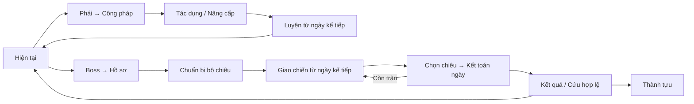

# Tu luyện — bản tổng hợp để triển khai và nghiệm thu

Cập nhật **14/10/2026**. Đây là bản đọc dành cho người dùng; chi tiết kỹ thuật và inventory ở [PLAN](CULTIVATION_IMPLEMENTATION_PLAN.md), trạng thái code/bằng chứng ở [PROGRESS](CULTIVATION_IMPLEMENTATION_PROGRESS.md), lệnh triển khai ở [GOAL](CULTIVATION_GOAL.md).

**Đích bàn giao:** một tab Tu luyện gọn, hiểu được sức mạnh và lợi ích luyện tiếp, thử được toàn bộ luồng trong HTML riêng, rồi dùng được trên staging. Phạm vi gồm cả **39 công pháp và 40 encounter**, dữ liệu cũ, cân bằng, tốc độ tải và hướng dẫn sử dụng.

**Đọc theo nhu cầu:** bản này tổng hợp sản phẩm; PLAN ghi hợp đồng, file và cổng nghiệm thu; PROGRESSION ghi công thức/lộ trình 39 môn; GLOSSARY ghi từ vựng hiệu ứng; PROGRESS ghi phần đã làm thật và phần còn dở. Số liệu local chưa kiểm lại sau sửa được ghi là chưa kiểm, không lấy trạng thái tài liệu thay trạng thái sản phẩm.

## 1. Những gì đã chốt

| Phần | Quyết định |
| --- | --- |
| Tab của app | Hôm nay → Thói quen → Lời nhắc → Tu luyện → Thành tích |
| Các mục của Tu luyện | Hiện tại / Công pháp / Thử thách / Thành tựu; nhãn Thử thách còn được biên tập |
| Hiện tại | Một thẻ theo đúng trạng thái luyện hoặc giao chiến; một hành động chính |
| Thẻ luyện | Ảnh công pháp/kiếm, tên, Tầng 1–4, Sát thương, thanh Độ thuần khiết, thời gian luyện |
| Công pháp | Chọn phái → chọn môn → Tác dụng/Nâng cấp → học hoặc luyện lại |
| Tầng | Đo thời gian luyện; hết số ngày quy định thì mở tầng, kể cả habit đạt 0% |
| Sát thương nhận thêm | Theo kết quả habit riêng của từng kỳ; không giảm phần đã nhận, không bù phần đã bỏ lỡ |
| Thuần khiết | Chất lượng của toàn bản luyện; khuyết điểm kế thừa, muốn cải thiện phải luyện lại từ tầng 1 |
| Hiệu ứng và đặc tính | Mở/tăng đủ theo tầng; không bị tỷ lệ habit hoặc trần thuần khiết khóa |
| Hai bản luyện | Giữ tối đa bản mạnh nhất và một bản luyện lại; lịch sử vẫn giữ, không ghép tầng |
| Boss | Danh sách chọn trận và hồ sơ rõ cơ chế; Thành tựu lưu chiến tích đã đạt |
| Thần binh | Bỏ khỏi luồng/trận/thưởng mới; bảo toàn lợi ích và snapshot lịch sử |
| Hình ảnh vòng này | Dùng bộ ảnh đang có, chỉnh cách dùng ảnh trong UI; chưa coi chất lượng mỹ thuật đã được nghiệm thu |

Luật cố định đầy đủ là **F01–F18 tại PLAN §3**. Các số thử bên dưới được AI điều chỉnh khi triển khai; không được đổi các hành vi đã chốt để làm code đơn giản hơn.

## 2. Tầng, sát thương và độ thuần là ba việc khác nhau

### Tầng: tiến độ thời gian

Mỗi ngày sinh hoạt ở chế độ luyện cộng một ngày luyện. Ngày chiến đấu hoặc dừng luyện không cộng. Hết kỳ mở tầng và các tác dụng tương ứng; không yêu cầu làm đủ habit để được lên tầng.

Đổi công pháp/chế độ có hiệu lực từ ngày sinh hoạt kế tiếp. Giao diện phải phân biệt trạng thái hôm nay với lựa chọn đang hẹn. `/ngu` không mở tầng hoặc kết toán trận.

### Sát thương: thành quả riêng của từng kỳ

Ví dụ đang có **100 Sát thương**, kỳ tiếp theo tối đa **+20**:

| Kết quả habit | Phần nhận thêm | Sát thương sau kỳ |
| --- | ---: | ---: |
| 0% | +0 | 100 |
| 50% | +10 | 110 |
| 100% | +20 | 120 |

Nếu kỳ trước đạt 50% và đang có 110, kỳ sau đạt 100% với tối đa +20 thì thành **130**. Khuyết điểm kỳ trước vẫn giữ trong thuần khiết; không cắt +20 của kỳ sau. Không nhân 50% vào toàn bộ sát thương đã có.

### Độ thuần khiết: chất lượng của cả bản

Thanh luôn có thang **100%**, cho thấy:

- **Đã đạt:** chất lượng đã kết toán.
- **Có thể đạt:** trần còn khả thi nếu làm tốt phần còn lại.
- **Đã mất:** khuyết điểm đã chốt, bản này không lấy lại được.

Trần dự báo còn phụ thuộc cam kết chưa kết toán phải có nhãn **Trần tạm tính**. Không gọi toàn bộ phần ngoài trần dự báo là mất vĩnh viễn.

Mô hình chất lượng đang thử: mỗi tầng hoàn hảo góp tối đa 25 điểm; chất lượng tầng sau không vượt trần kế thừa. Ví dụ kết quả habit 100/50/100/100% cho tổng thuần **25 → 37,5 → 50 → 62,5%**. Hai kỳ cuối vẫn nhận đủ phần sát thương tăng thêm. Công thức này được kiểm/cân bằng trong [PROGRESSION](CULTIVATION_PROGRESSION_PROPOSAL.md); không dùng cùng một trường dữ liệu cho kết quả habit và chất lượng kế thừa.

| Mốc chất lượng | Tên | Thưởng sát thương đang thử |
| --- | --- | ---: |
| 80% | Tinh Thuần | +5% |
| 90% | Chí Thuần | +10% |
| 100% | Thông Thần | +15% |

Chỉ lấy thưởng cao nhất, từ chất lượng đã chốt; dự báo không cấp thưởng. Tầng 4 có thể đã hoàn tất nhưng còn khuyết điểm, hoặc còn chờ cam kết tuần. Tên/mốc đã chốt; mức thưởng là số cân bằng còn mở.

Với mô hình đang thử, trần phần **đã đạt** sau tầng 1/2/3/4 lần lượt là **25/50/75/100%**. Vì vậy ba danh hiệu hiện chỉ có thể nhận sau khi chốt tầng 4. Tầng 2–3 vẫn có động lực luyện qua sát thương và đặc tính mới; không gọi việc mở tầng là đạt danh hiệu độ thuần.

## 3. Habit đóng góp thế nào

- Hỗ trợ tick, số lượng và thời lượng; **đủ mục tiêu mới góp game**. 15/20 phút đóng góp 0.
- Giữ lịch hằng ngày, chọn thứ và X lần mỗi tuần. Ngày ngoài lịch hoặc đã đủ quota là trung tính, không được giả thành đã làm hoặc bị thiếu.
- Quota 3 lần/tuần: làm ngày 1 được ghi nhận; không làm ngày 2–5 vẫn còn cơ hội. Đóng ngày 6 mà mới có một lần thì phát sinh một thiếu; ngày 7 thiếu thêm nếu vẫn không làm. Không trừ lại thiếu đã ghi.
- Cam kết tuần đi qua hai tầng/bản/chế độ phải có audit: thành công thuộc nơi nhận ngày thực hiện; thiếu phân bổ đúng một lần. Đổi môn không xóa nghĩa vụ cũ.
- Chỉ ghi/sửa trong ngày sinh hoạt hiện tại; ngày cũ chỉ xem. Không thêm miễn trừ nghỉ/ốm vào luật hiện có.
- Kỳ không có nghĩa vụ khác kỳ bỏ hết nghĩa vụ: không cấp 100% miễn phí, cũng không tạo thất bại giả.
- Tới hạn vẫn mở tầng nếu tuần chưa xong; phần sát thương/chất lượng chưa đủ dữ liệu hiện **Chờ kết toán**. Kết toán muộn không sửa snapshot trận đã bắt đầu.

Cách chọn habit tham gia kỳ, trọng số và chia nghĩa vụ đã có lựa chọn kỹ thuật tại PROGRESS §4; agent kiểm lại các trường hợp thêm/sửa/lưu trữ giữa kỳ trước phát hành.

## 4. Một cách đọc cho mọi công pháp và boss

### Trên thẻ: chỉ một số Sát thương nổi bật

Số đó là **tổng sát thương thô của các đòn chính chắc chắn có khi thi triển**, trước phòng ngự. Ví dụ 46 ×3 chỉ hiện **138 · Sát thương**. “Mỗi đòn 46 · Số đòn 3” nằm trong chi tiết bằng chữ nhỏ.

Không cộng chảy máu, đòn trễ, phản thương hoặc đòn thêm có điều kiện vào số này. Trong trận, **HP dự kiến mất** sau phòng ngự có nhãn riêng. Công pháp hỗ trợ vẫn trình bày cùng thứ bậc; lợi ích khiên/hồi/điều khiển nằm trong tác dụng.

### Khi mở Tác dụng

| Nhóm | Nội dung |
| --- | --- |
| **Đòn đánh** | Sát thương mỗi đòn, số đòn; số Sát thương chính không lặp thành nhiều ô lớn |
| **Đặc tính** | Xuyên Phòng thủ, Hút máu; tỷ lệ, nền tính và phạm vi áp dụng |
| **Hiệu ứng** | Chảy máu, đòn trễ/thêm, Khiên, Giáp Ảo, hồi phục, giảm/phản thương, buff/debuff, điều khiển |
| **Điều kiện** | HP, tài nguyên, chiêu trước, hồi chiêu; đặt cạnh tác dụng cần điều kiện |
| **Cái giá** | Hiến HP, giảm HP tối đa, còn 1 HP, trả cảnh giới; thấy rõ trước xác nhận |

Chí mạng và Xuyên Giáp Ảo hiện là định nghĩa dự phòng, **chưa có trong engine**. Chỉ hiện thuộc tính thực có; không bổ sung để đủ các ô. Tên, đơn vị, thời điểm, thời hạn, nguồn và trần theo [GLOSSARY](CULTIVATION_EFFECT_GLOSSARY.md).

**Chủ động** cần chọn thi triển. **Nội tại** kích hoạt do mang môn và đủ điều kiện. Chảy máu hoặc phản thương kéo dài sau thi triển vẫn thuộc chiêu chủ động. Mang Kiếm Ý không tự cấp xuyên cho mọi chiêu.

Ba bổ sung đang thử local: Kiếm Ý tăng sát thương cho chiêu Thiên Kiếm khác ở lượt kế; Huyền Quy tạo Khiên khi sống sót ở HP thấp, một lần/trận; Thôn Thiên hút thêm khi thi triển ở HP thấp. Chỉ Huyền Quy trong ba bổ sung đó là nội tại mang môn. Agent kiểm lợi ích và cân bằng trước chốt phát hành.

## 5. Nâng cấp phải cho thấy đáng luyện ở đâu

Mở công pháp có hai mục **Tác dụng / Nâng cấp**. Nâng cấp mặc định so với tầng kế, có thể mở lộ trình cả bốn tầng:

| Phần thay đổi | Phải nhìn thấy |
| --- | --- |
| Sát thương | Hiện tại → phần có thể nhận thêm; kết quả habit quyết định phần tăng |
| Đặc tính | Ví dụ Xuyên Phòng thủ 35% → 40%; tăng đủ 5 điểm phần trăm |
| Tác dụng mới | Mở ở tầng nào, làm gì, kích hoạt ra sao, lượng/hạn/trần |
| Thuần khiết | Chất lượng đã đạt, trần và phần còn có thể kiếm; không giả thưởng đã nhận |
| Thời gian | Còn bao nhiêu ngày luyện; ngày mở tầng khác ngày kết toán khi tuần chưa xong |

Không lặp thông số không đổi hoặc chỉ đổi tên tầng. Công thức và lịch sử mở xem thêm. Luyện lại từ tầng 1 có xác nhận; so hai bản bằng sát thương, tầng/đặc tính và thuần khiết, không mặc định Q cao hơn là mạnh hơn.

Ở tầng cuối, thay mục tiêu tầng tiếp theo bằng trạng thái đúng của bản: **Chờ kết toán** nếu còn nghĩa vụ tuần; **Đã hoàn tất · Đạt giới hạn của bản** nếu không thể tăng tiếp; hoặc **Thông Thần** nếu độ thuần100% đã chốt. Nâng cấp vẫn mở được lộ trình và thưởng đã nhận, nhưng không dựng tầng5/nút nâng cấp giả. Luyện lại nằm trong chi tiết, cho thấy lợi ích có thể cải thiện và bản sẽ được giữ trước xác nhận.

**Ví dụ lộ trình Kiếm Ý trong code local hiện tại:**

| Mốc | Ngày luyện cộng dồn của bản mới | Xuyên Phòng thủ | Tác dụng nối chiêu sau thi triển |
| --- | ---: | ---: | --- |
| Tầng 1 | 3 | 35% | Chưa mở |
| Tầng 2 | 7 | 40% | +5% sát thương cho một chiêu Thiên Kiếm khác ở lượt kế |
| Tầng 3 | 13 | 45% | +10% cho cùng điều kiện |
| Tầng 4 | 21 | 50% | +15% cho cùng điều kiện |

Phần sát thương nhận thêm của từng kỳ vẫn theo habit. Các mức xuyên và tác dụng nối chiêu tăng đủ theo tầng, không theo độ thuần. Đây là trị số local để kiểm/cân bằng; UI Nâng cấp dùng cùng dữ liệu engine, không chép bảng này làm công thức riêng.

## 6. Các màn hình và luồng thao tác

| Mục | Người dùng thấy trước | Thao tác tiếp |
| --- | --- | --- |
| **Hiện tại — luyện** | Ảnh, tên/Tầng, Sát thương, thuần khiết, ngày luyện | Xem công pháp/Nâng cấp |
| **Hiện tại — chuẩn bị** | Boss, bộ chiêu, ngày bắt đầu; luyện tạm dừng khi nào | Xem/điều chỉnh bộ chiêu |
| **Hiện tại — giao chiến** | HP hai bên, chiêu boss đã công bố, lựa chọn hôm nay | Chọn/đổi chiêu → xem tác dụng/dự kiến/giá → xác nhận |
| **Hiện tại — bị hạ** | Kết quả, hạn cứu và chi phí đúng luật | Cứu hoặc chấp nhận kết quả |
| **Công pháp** | Năm phái và vai trò ngắn | Phái → môn → Tác dụng/Nâng cấp → học/luyện lại |
| **Thử thách** | Boss theo tuyến, trạng thái và điều kiện; cơ duyên phụ gọn | Hồ sơ → chuẩn bị; chạm để đọc chưa tự vào trận |
| **Thành tựu** | Chiến thắng đầu tiên, dấu mốc, thứ mở được | Xem ngày thắng, lượt, chiêu thực dùng và nhật ký |

Cấm thuật/môn ngoài phái theo quyền **chưa phát hiện → đã phát hiện → mở khóa**. Đã phát hiện thấy đúng điều kiện và nguồn mở; chưa phát hiện không lộ tên/nội dung qua metadata. Có 25 môn của năm phái, 8 cấm thuật, 6 ngoài phái; bảng đầy đủ ở PROGRESSION §7 và SOURCE REVIEW.

| Phái / nhóm | Vai trò để cân nhắc học trước hoặc sau |
| --- | --- |
| Thiên Kiếm | Xuyên Phòng thủ, chuỗi đòn, kết liễu và nối kiếm thức |
| Bất Diệt | Giảm thương, Khiên, phản thương và Cương Kình |
| U Minh | Hút máu, Chảy máu, tăng lực khi HP thấp; có cái giá sinh lực |
| Thái Hư | Hư Ảnh, né, hồi phục, giải trừ và giảm Phòng thủ |
| Thiên Cơ | Xem trước, đặt ấn, đòn trễ và đổi nhịp boss |
| Cấm thuật | Tác dụng mạnh kèm điều kiện/cái giá; mở qua đúng thử thách hoặc chiến tích |
| Ngoài phái | Quyền đổi môn, Giáp Ảo, chuyển lực và phối Bốn ấn |

39 môn và 40 encounter là **phạm vi nội dung hiện có cần hoàn thiện**, không là hạn mức phải tạo thêm. Boss gồm 22 trận tuyến chính, 5 truyền thừa, 7 nhánh cấm thuật và 6 ngoài phái; Nghịch Mệnh mở từ boss chính. Điều kiện cụ thể phải đọc được từ server/catalog khi đã phát hiện, không bắt đoán qua lore.

Chuẩn bị chọn tối đa **5 môn khác nhau**, mỗi môn một bản hợp lệ; Võ Kỹ riêng. Dùng danh sách chọn gọn, tìm tên và mở tác dụng khi cần; preset giữ đúng bản. Các bảng dài có tiêu đề/đóng và hành động cố định, body cuộn riêng. Quay lại giữ phái/môn/vị trí đang xem.

## 7. Cách tính sát thương và đánh boss

Giữ hai nền tính: **lực sát thương** nhận theo habit/thuần khiết; **lực hỗ trợ** như Khiên/hồi không bị q cũ cắt. Các tỷ lệ, số đòn, điều kiện mở/tăng theo tầng đầy đủ. Công thức/hệ số thử thuộc PROGRESSION; UI và demo không viết lại công thức riêng.

Thứ tự phòng ngự tính **riêng từng đòn**:

**Sát thương thô → Giảm thương → Phòng thủ sau xuyên → Giáp Ảo giảm/hấp thụ → Khiên hấp thụ → HP mất.**

Xuyên 50% của Kiếm Ý là xuyên **Phòng thủ**. Giáp Ảo và Khiên là lớp riêng; vỡ giữa chuỗi thì đòn sau tính lại. Hút máu dựa trên HP thật lấy được. Nhật ký tách gây sát thương, hấp thụ, HP mất, hồi và cái giá.

Mỗi ngày sinh hoạt chọn một chiêu, được đổi trước hạn; server kết toán theo ngày. Không chọn thì không chạy lượt hiệu ứng; ba ngày không chọn rút an toàn theo luật hiện hành. Trận snapshot cảnh giới/bản luyện/rule/catalog khi bắt đầu; đột phá sau đó không tự tăng chỉ số giữa trận. Buff habit/task ngày giữ cách tính và trần hiện có.

Boss công bố HP/Công/Phòng thủ, đòn, hồi, tăng Phòng thủ, Hồi sinh và Đọc chiêu lặp nếu thực có. Trong trận chỉ xem trước đến mức được cấp; preview không lộ pattern ẩn. Giá cứu mạng, thưởng/phạt và giới hạn một quyền cứu/trận giữ kinh tế hiện hành.

## 8. Số nào còn mở để AI quyết định

| Đã cố định | AI tự hoàn thiện bằng bằng chứng |
| --- | --- |
| Tầng theo ngày, sát thương từng kỳ, khuyết điểm kế thừa | Số ngày mỗi tầng, hệ số/trị số thưởng và hiệu ứng |
| Hai bản, một số Sát thương, phân nhóm hiệu ứng | Layout, khoảng cách, cách mở chi tiết, câu chữ và nhãn mục boss |
| Phái → môn; bảo toàn dữ liệu và hợp đồng các tính năng cũ | Schema/DTO/cache, chia bước, cách migration/backfill tương thích |
| Không tăng ngân sách, không ảnh nhân vật/hoạt ảnh trên thẻ luyện | Cách crop/nén/tải bộ ảnh hiện có và kiểm visual |

Factory local đã chọn lịch **3/4/6/8** cho **bản v2 mới**: thường 21 ngày luyện, cấm thuật 32, ngoài phái 42. Bản đã lưu giữ lịch riêng, kể cả lịch thường **3/6/10/15** (34 ngày); trận v1 và snapshot giữ cơ chế cũ. Quyết định này có các report đối chiếu và targeted tests, chưa là bản đã phát hành staging. Ở mẫu ưu tiên luyện Kiếm Ý hoàn tất trước: mốc hoàn tất là ngày sinh hoạt 35 so với 22, gồm một ngày hiệu lực; không phải thời gian tối đa bắt buộc để thắng truyện.

AI chọn nhịp dựa trên lúc có môn dùng được, bộ chiêu, boss đầu, một môn hoàn tất và toàn campaign; ghi riêng ngày luyện/đánh/chờ. Dữ liệu hiện cho thấy tuyến truyện vẫn kéo dài hàng trăm ngày dưới giả định harness thuận lợi: cần xử lý nhịp và giá trị nâng cấp, không chỉ đổi vài nhãn. Không thay lịch của bản đã lưu hoặc thêm luyện song song để che vấn đề chờ.

## 9. Kế hoạch thực hiện một lượt

| Chặng | Công việc | Điều kiện chuyển bước |
| --- | --- | --- |
| **1. Nối tiếp đúng nguồn** | Đọc brief → PLAN/PROGRESS → diff; giữ phần local đã có; rà contracts và rủi ro dữ liệu | Inventory và quyết định rõ; không dựng lại engine/demo đang hoạt động |
| **2. Chốt cơ chế và tương thích** | R/q/Q, forecast/pending/audit, hai bản, legacy/snapshot, nhịp luyện | Ví dụ 50% rồi 100% đúng qua domain–D1–API; lịch sử và retry an toàn |
| **3. Hoàn thiện luồng dùng** | Hiện tại, phái/môn, nâng cấp, chuẩn bị/chọn/đổi chiêu, cứu/kết quả/nhật ký, Thành tựu | Thử được luồng chính và lỗi/quay lại; cả 39 môn/40 encounter dùng cách đọc chung |
| **4. Đồng bộ demo** | Sinh HTML từ domain/actions/views thật; tình huống, qua ngày và reset bằng dữ liệu riêng | Mở trực tiếp thử đầy đủ; không công thức giả, không chạm tài khoản thật |
| **5. Cân bằng và tự review** | Đường chơi kiếm quyền thực, phối môn, hiệu ứng mới, mobile/dark/chữ lớn, đo tải | Báo cáo có config/nguồn/giới hạn; mở xem ảnh và sửa findings; không chiêu/combo vô hạn |
| **6. Kiểm và phát hành** | Full gates, backup/restore/rollback rehearsal, migration/deploy staging, smoke, commit/push | Bản giao khớp source đã kiểm; dữ liệu cũ an toàn; đủ hồ sơ bàn giao |

Đây là thứ tự theo phụ thuộc. AI được chia nhỏ/đổi thứ tự khi có lý do, cập nhật checkpoint; không cần cố hoàn thành mọi nghiên cứu phụ trước khi sửa luồng chính. Inventory cụ thể ở **PLAN §11**, ca kiểm và release ở **§12**.

**Trạng thái hiện tại:** local đã hoàn thiện và đang phát hành v2. Footer chữ lớn, ảnh desktop và Nâng cấp đã sửa; fullbrowser44/44, recovery bundle content1–5/v1–v2 và restore riêng đạt. Gates/release thực tế ở **PROGRESS§5.9/§6**. Vòng này giữ bộ ảnh hiện có; mỹ thuật còn chờ user nghiệm thu.

## 10. Khi nào được coi là bàn giao

- Demo và app thật cùng nguồn số liệu; không lệch giữa Hiện tại, công pháp, nâng cấp, bộ chiêu và trận.
- 39 môn/40 encounter có tác dụng/điều kiện/mở quyền/lộ trình dùng được; không chỉ render đủ danh sách.
- Các luồng luyện, đổi môn/chế độ, luyện lại, chuẩn bị, chọn/đổi chiêu, thắng/thua/cứu và Thành tựu hoạt động; retry/qua ngày/hai thiết bị không cấp trùng.
- Giữ dữ liệu cũ, task/habit/ngủ/focus/lời nhắc/đột phá. LLM không tự tính damage hoặc cấp quyền.
- Tự chụp **và mở xem** 320/360/390/1440, sáng/tối/chữ 200%, các trạng thái pending/max/luyện lại/trận/cứu/kết quả; sửa lỗi phát hiện.
- Đo cold/warm và API/D1/payload/ảnh/render. Target lab: phản hồi shell ≤200ms, mở mục có cache ≤100ms, nội dung có ích ≤2,5 giây trên cấu hình ghi rõ. Local không thay phép đo staging.
- Typecheck, check:web, main tests, browser, build/staging checks và rehearsal đạt trên nguồn cuối; backup và phương án phục hồi tương thích có bằng chứng.
- Giao **URL staging, HTML, hướng dẫn thử, luật/trị số cuối, commit/Worker/migration và báo cáo kiểm**. Người dùng nghiệm thu thẩm mỹ và trải nghiệm thực tế.

## 11. Cách chạy sau khi đọc bản chốt

Mở [prompt GOAL](CULTIVATION_GOAL.md). Thread có goal cùng phạm vi đang active thì gửi khối **Tiếp tục**; thread mới chưa có goal thì gửi khối **/goal**. Trạng thái goal đã đọc trong lượt tổng hợp này là active, nhưng phải kiểm lại nếu chạy ở thread khác. Lệnh chỉ cấp quyền triển khai khi người dùng gửi; tài liệu này không tự kích hoạt sửa code.

Prompt cho AI tự chọn layout, câu chữ, nhịp luyện và trị số còn mở, giải vấn đề phát sinh rồi kiểm lại bằng bằng chứng. AI hoàn thiện demo → app thật → kiểm/cân bằng/tải → staging trong một mục tiêu xuyên suốt; không dừng ở Kiếm Ý hoặc việc vẽ đủ danh sách. Luật đã chốt ở PLAN§3, phạm vi file ở§11, điều kiện bàn giao ở§12. Tạo lại ảnh thuộc vòng riêng; vòng này giữ bộ ảnh hiện có và hoàn thiện cách dùng ảnh.

**Bộ tài liệu thống nhất:**

| Cần làm gì | Đọc ở đâu |
| --- | --- |
| Xem toàn bộ quyết định sản phẩm | Bản tổng hợp này |
| Triển khai đúng kiến trúc, biết file và cổng kiểm | [PLAN](CULTIVATION_IMPLEMENTATION_PLAN.md) |
| Xem công thức, tác dụng và vai trò39môn | [PROGRESSION](CULTIVATION_PROGRESSION_PROPOSAL.md) |
| Dùng một bộ tên/đơn vị/luật hiệu ứng | [GLOSSARY](CULTIVATION_EFFECT_GLOSSARY.md) |
| Đọc tác dụng gốc,40boss và kinh tế cần giữ | [SOURCE REVIEW](CULTIVATION_EFFECTS_REVIEW.md) |
| Biết code thật đã tới đâu và bước tiếp theo | [PROGRESS](CULTIVATION_IMPLEMENTATION_PROGRESS.md)§5.9/§6 |
| Gửi lệnh chạy và quyền triển khai | [GOAL](CULTIVATION_GOAL.md) |
