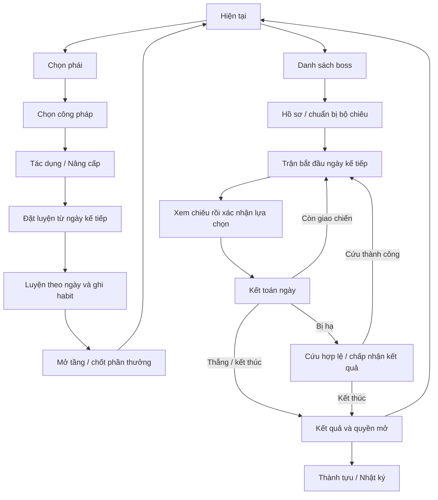

# Tu luyện — tổng hợp quyết định và kế hoạch triển khai

Cập nhật **2026-10-14**. Điểm vào cho vòng sửa Tu luyện tiếp theo; giữ các quyết định đã chốt ngày 13/10.

**Trạng thái: v2 đã phát hành staging và hoàn tất kỹ thuật.** Versions/evidence tại [RELEASE](HABIT_GAME_RELEASE.md); **PROGRESS§5.9/§6** là checkpoint hiện hành. Tài liệu này tiếp tục sở hữu luật, kiến trúc và cổng nghiệm thu; trạng thái các nhóm không được suy từ nhật ký cũ.

**Đọc bản tổng hợp sản phẩm trước:** [CULTIVATION_FINAL_BRIEF.md](CULTIVATION_FINAL_BRIEF.md). Tài liệu này sở hữu luật cố định, inventory và điều kiện nghiệm thu; PROGRESS sở hữu trạng thái/bằng chứng, GOAL sở hữu prompt. Không sao chép số tests hoặc trạng thái phát hành giữa các tài liệu để suy ra bản nguồn cuối đã đạt.

Tài liệu quy định phạm vi và cổng nghiệm thu. Quyền thực thi đến từ lệnh goal/yêu cầu của người dùng; checkpoint ghi những bước đã thực hiện.

## 0. Bản chốt để đọc trước khi chạy

### 0.1. Sản phẩm sẽ có gì

| Phần | Bản chốt |
| --- | --- |
| Điều hướng app | Hôm nay → Thói quen → Lời nhắc → Tu luyện → Thành tích |
| Điều hướng trong Tu luyện | Hiện tại → Công pháp → Thử thách → Thành tựu; Thử thách là nhãn làm việc, AI được biên tập |
| Hiện tại | Một thẻ phù hợp trạng thái đang luyện/chuẩn bị/đang đánh/chờ cứu/kết thúc, có một hành động chính |
| Công pháp | Chọn phái → chọn môn → Tác dụng/Nâng cấp; cấm thuật và môn ngoài phái theo quyền đã phát hiện/mở khóa |
| Luyện | Tầng 1–4 theo số ngày luyện. Habit đủ mục tiêu quyết định phần sát thương tăng thêm của từng kỳ |
| Độ thuần khiết | Chất lượng tích lũy, có khuyết điểm kế thừa. Thanh 100% cho biết đã đạt, trần còn khả thi, phần mất đã chốt; dự báo chưa chốt có nhãn riêng |
| Danh hiệu | Tinh Thuần 80%, Chí Thuần 90%, Thông Thần 100%; thưởng sức mạnh phải thực sự được engine tính |
| Luyện lại | Từ tầng 1, tối đa hai bản được duy trì: bản mạnh nhất và bản luyện lại. Lịch sử vẫn được giữ |
| Chiến đấu | Chọn boss → đọc cơ chế → chuẩn bị bộ chiêu → chọn một chiêu/ngày → kết toán → kết quả/cứu mạng |
| Thành tựu | Chiến tích đã đạt và thứ đã mở; có ngày thắng, số lượt, chiêu đã dùng, thông tin cứu mạng |
| Hình ảnh | Một ảnh công pháp theo tầng; giữ asset hiện có ở vòng cơ chế/UI. Chất lượng mỹ thuật chưa được nghiệm thu |
| Bàn giao | Demo HTML thử đầy đủ bằng dữ liệu riêng + app staging + tài liệu và bằng chứng trên source cuối |

### 0.2. Ba khái niệm phải tách rõ

| Khái niệm | Người dùng cần hiểu | Ví dụ |
| --- | --- | --- |
| **Tầng** | Đã đi qua bao nhiêu thời gian luyện; quyết định mốc mở/tăng hiệu ứng | Bản mới hết 4 ngày luyện kỳ tầng 2 thì mở tầng 2, dù habit đạt 50%; bản lịch cũ đọc số ngày đã lưu |
| **Phần sát thương nhận thêm** | Thành quả của habit trong chính kỳ đó; chỉ phần tăng thêm bị nhân tỷ lệ | Có 100, kỳ này tối đa +20, đạt 50% → 110. Kỳ sau tối đa +20, đạt 100% → 130 |
| **Độ thuần khiết** | Chất lượng của cả bản, giữ thiếu cũ và trần danh hiệu | Theo phép q đang thử: tầng 1 đạt 50%, tầng 2 đạt 100% → Q=25%, trần cuối 50%; sát thương kỳ 2 vẫn nhận đủ |

Ngày luyện là ngày sinh hoạt ở chế độ luyện; chuyển sang đánh/dừng luyện thì đồng hồ luyện dừng. Một tầng hoàn hảo đóng góp 25 điểm thuần khiết. Thời lượng cụ thể, công thức q và trị số thưởng là phần mở để kiểm chứng/cân bằng; hành vi F01–F18 là phần phải giữ.

### 0.3. Thứ bậc thông tin trên màn hình

1. **Màn chính/danh sách công pháp:** tên, tầng, một số **Sát thương** nổi bật; thẻ đang luyện thêm thanh thuần khiết và thời gian. Không dàn các thông số phụ thành nhiều ô lớn. Trong trận vẫn có HP hai bên; yêu cầu một số Sát thương không làm mất thông tin sinh tồn cần thiết.
2. **Tác dụng:** các dòng nhỏ, nhất quán, theo Đòn đánh → Đặc tính → Hiệu ứng; Nội tại nếu có. Điều kiện đặt cạnh tác dụng, Cái giá đặt trước hành động cần xác nhận.
3. **Nâng cấp:** hiện tại → tầng kế; nhận thêm sát thương theo habit, tỷ lệ tăng đủ theo tầng, tác dụng mới và thời gian còn lại. Có thể mở lộ trình cả bốn tầng.
4. **Mở rộng:** công thức, quy tắc cộng dồn, nguồn và lịch sử; phục vụ tìm hiểu, không chiếm màn chính.

Ví dụ một môn ba đòn có mỗi đòn 46: màn chính hiện **138 · Sát thương**; mở chi tiết mới có “Mỗi đòn 46 · Số đòn 3”. Số lớn này không bao gồm chảy máu, đòn trễ hay đòn thêm có điều kiện. Trong trận, HP dự kiến mất sau phòng ngự có nhãn riêng.

**Cách đặt chữ cụ thể:**

| Vị trí | Nội dung ưu tiên | Thông tin phụ và cách mở |
| --- | --- | --- |
| Thẻ đang luyện | Ảnh công pháp → tên/Tầng → một số Sát thương → thanh thuần và thời gian | Xem công pháp; thay đổi đang hẹn chỉ một dòng ngày hiệu lực |
| Dòng công pháp trong phái | Tên, Tầng hoặc chưa học; Sát thương của bản hợp lệ | Vai trò ngắn; không đặt xuyên/hút máu/số đòn thành các badge cạnh nhau |
| Tác dụng | Một số Sát thương, ngữ cảnh ngắn | “Mỗi đòn 46 · Số đòn 3”; tiếp theo đặc tính/hiệu ứng/nội tại bằng dòng chữ cùng cỡ. Chỉ hiện nhóm có dữ liệu |
| Nâng cấp | Tầng kế và lợi ích nhận thêm | Các dòng hiện tại → kế tiếp chỉ cho phần đổi; lộ trình bốn tầng mở thêm |
| Màn trận | HP hai bên, chiêu boss đã công bố, lựa chọn hôm nay | Một nút Chọn/đổi chiêu; trạng thái/nguồn/tài nguyên và nhật ký mở thêm |
| Bảng chọn chiêu | Tên chiêu và một số Sát thương; chạm để xem | Dự kiến HP sau lượt, tác dụng, điều kiện và cái giá; chỉ xác nhận ở hành động cuối bảng |

Không cần các nhãn “Chính/Phụ” trên từng dòng sản phẩm. Chúng giúp biên tập thứ bậc; chủ động/nội tại giúp hiểu cách kích hoạt. Các điều kiện chưa đủ, cái giá HP/cảnh giới và dự kiến bị hạ phải đọc được trước xác nhận, dù các công thức khác được thu gọn. Không đổi số Sát thương thành “tổng mọi sát thương trong cả trận” để làm môn trông mạnh hơn.

Tham khảo War Robots ở cách công bố mốc nâng cấp và lợi ích; Habitica ở độ gọn của thao tác. Không sao chép công thức, asset hoặc thêm tính năng không phục vụ luồng này.

### 0.4. Phần cố định và phần được tự hoàn thiện

- **Giữ:** luật F01–F18, phân biệt Phòng thủ/Giáp Ảo/Khiên, nguồn dữ liệu server, quyền và dữ liệu lịch sử.
- **AI quyết định có bằng chứng:** ngày luyện, các trị số đề xuất, bổ sung tác dụng hợp lý, nhãn mục boss, layout, schema/DTO/cache và thứ tự triển khai.
- **Chưa được tính là xong:** code local mới, demo cũ, simulation luật cũ, hoặc screenshot chưa được mở xem.
- **Ngoài vòng chạy này:** batch tạo lại ảnh/nhân vật/hoạt ảnh. Art làm riêng sau khi cơ chế và cách dùng ảnh ổn; ngân sách bổ sung vẫn 0đ.

Chi tiết cơ chế ở mục 3–6, UI ở mục 7, kiến trúc/chuyển dữ liệu ở mục 8, trình tự ở mục 10, file ở mục 11 và nghiệm thu ở mục 12.

### 0.5. Những điều phải hiểu được ngay khi dùng

| Người dùng muốn biết | Giao diện phải trả lời |
| --- | --- |
| Đang luyện hay đánh boss? | Hiện tại thể hiện đúng trạng thái, một hành động chính; không bày hai dashboard cùng lúc |
| Môn này đang mạnh bao nhiêu? | Một số Sát thương; mở Tác dụng để xem số đòn, xuyên, hút máu, các hiệu ứng và nội tại thực |
| Luyện tiếp được gì? | Nâng cấp cho thấy hiện tại → tầng kế, phần tăng, tác dụng mới, thời gian và điều kiện; không chỉ đổi tên tầng |
| Nếu chỉ đạt một nửa habit? | Nhận một nửa phần sát thương tăng thêm của kỳ; tỷ lệ/đặc tính vẫn nâng đủ theo tầng |
| Lỗi kỳ trước có làm mất phần tăng kỳ sau? | Không: kỳ sau đạt đủ nhận đủ phần của kỳ sau; phần đã mất và trần độ thuần vẫn giữ |
| Bản này còn có thể hoàn hảo không? | Thanh thuần có số đã đạt, trần còn khả thi và phần mất đã chốt; phần ngoài trần dự báo chưa là mất vĩnh viễn |
| Đã lên tầng 4 thì còn làm gì? | Phân biệt chờ chốt tuần / hoàn tất nhưng có khuyết điểm / Thông Thần; luyện lại nằm trong chi tiết |
| Nên học môn nào trước? | Vai trò ngắn, tác dụng hiện tại, lộ trình và điều kiện học cùng cách đọc; không giả sở hữu bản hoàn hảo |
| Boss có gì cần đề phòng? | Hồ sơ công bố Phòng thủ, lớp bảo vệ, Hồi sinh/Đọc chiêu lặp và cơ chế thật trước chuẩn bị; ý định tương lai theo quyền xem trước |
| Thành tựu khác danh sách boss thế nào? | Thành tựu kể chiến tích đã đạt; danh sách boss phục vụ chọn trận tiếp theo |

Trong ví dụ đang có **100 Sát thương**, kỳ tới tối đa **+20**: đạt 50% nhận +10, thành **110**; kỳ tiếp theo đạt đủ và cũng tối đa +20 thì thành **130**. Xuyên Phòng thủ tăng từ 35% lên 40% vẫn tăng đủ. Không nhân 50% vào toàn bộ 100 đã có, không dùng độ thuần cũ để cắt +20 của kỳ sau.

Môn hỗ trợ vẫn dùng cùng thứ bậc chữ; lợi ích Khiên/Hồi phục/điều khiển đọc trong các dòng tác dụng, không thêm một dashboard chỉ số riêng. Một số Sát thương không có nghĩa các chiêu hỗ trợ yếu hơn hoặc người dùng phải đọc mọi công thức mới chọn được môn.

### 0.6. Luồng hoàn chỉnh để kiểm nghiệm thu

1. **Bắt đầu:** vào Hiện tại → Chọn công pháp → chọn phái → chọn môn → đọc Tác dụng/Nâng cấp → xác nhận bắt đầu. Nêu ngày có hiệu lực; chưa mở tầng 1 thì chưa mang bản đó vào trận.
2. **Mỗi ngày luyện:** làm habit ở tab Thói quen, đủ mục tiêu mới có đóng góp. Hiện tại cho biết tầng, sức mạnh đã chốt, thuần khiết và số ngày luyện còn lại. Server chốt theo ngày sinh hoạt; thao tác báo ngủ không tự mở tầng hay chốt trận.
3. **Mở tầng:** đủ ngày thì mở tầng/đặc tính. Phần sát thương của kỳ nhận theo R; nếu cam kết tuần chưa chốt thì ghi chờ, giữ phần đã nhận của các kỳ trước. Factory bản mới dùng 3/4/6/8, mốc cộng dồn 3/7/13/21. Bản đã lưu đọc lịch riêng; ví dụ lịch 3/6/10/15 vẫn mở ở 3/9/19/34. Các số là ngày luyện, không bao gồm ngày đánh/dừng và ngày đợi hiệu lực.
4. **Cân nhắc môn tiếp:** xem tầng kế thêm gì, thời gian cần bỏ ra và vai trò của môn. Đổi môn/đổi chế độ có ngày hiệu lực rõ; không mất bản đã học hoặc hủy audit đang còn nghĩa vụ.
5. **Đánh boss:** Thử thách → xem hồ sơ → chọn bộ chiêu → xác nhận chuẩn bị → vào trận ngày sau → xem tình thế → Chọn/đổi chiêu → xem tác dụng/dự kiến/cái giá → xác nhận. Một lựa chọn mỗi ngày; đến hạn server mới kết toán.
6. **Kết quả:** thắng mở quyền đúng catalog; bị hạ thấy hạn và giá cứu; không cứu thì theo luật tử trận. Kết quả còn đọc được khi lịch tự trở về luyện. Thành tựu ghi chiến thắng đầu tiên, chiêu thực sự đã dùng và quyền đã mở.
7. **Hoàn thiện bản luyện:** tầng 4 chờ audit khác tầng 4 đã chốt. Bản có khuyết điểm có thể luyện lại từ tầng 1; giữ tối đa hai bản và lịch sử. Theo Q đã chốt = tổng q/4, mỗi tầng tối đa 25 điểm nên danh hiệu 80/90/100 không tự xuất hiện ở tầng 1–3.

Các đường quay lại giữ ngữ cảnh phái/môn/bản đang xem. Không buộc đọc hướng dẫn dài để thực hiện bước tiếp theo; hướng dẫn ngắn đúng lúc, công thức mở xem khi cần.

Sơ đồ diễn tả các bước sản phẩm; server vẫn kiểm điều kiện, hạn và version ở từng thao tác. Kết toán audit tuần có thể tiếp tục sau khi đổi môn/chế độ; không sửa snapshot trận đã bắt đầu.

### 0.7. Hồ sơ bàn giao và cách đọc

- **Đọc để duyệt sản phẩm:** mục 0, 3, 7 và 12 của tài liệu này.
- **Đọc để hiểu số và hiệu ứng:** PROGRESSION + GLOSSARY; SOURCE REVIEW giữ số và cơ chế baseline v1 để đối chiếu.
- **Đọc để nối tiếp code:** PROGRESS → mục 10.1 → inventory mục 11 → source/diff của phần đang làm.
- **Chạy thực hiện:** prompt GOAL; thread hiện tại có goal active thì dùng phần tiếp tục, thread mới dùng phần `/goal`.
- **Thử ngay trạng thái local:** [demo](prototypes/cultivation/kiem-y-demo.html) và [hướng dẫn demo](prototypes/cultivation/README.md). Demo sử dụng dữ liệu riêng; quyền mở sẵn trong tình huống kiểm nội dung không chứng minh nhịp chơi đã cân bằng.

### 0.8. Bảng thống nhất thông tin để thiết kế mọi màn

| Phần | Nội dung thống nhất | Vị trí mặc định |
| --- | --- | --- |
| Luyện | Tầng 1–4, ngày luyện, Độ thuần khiết đã đạt/trần/phần mất, danh hiệu | Thẻ Hiện tại; không đưa vào danh sách hiệu ứng combat |
| Chỉ số người/boss | HP, Công, Phòng thủ | HP trong trận; Công/Phòng thủ trong hồ sơ |
| Đòn đánh | Sát thương đòn chính, mỗi đòn, số đòn | Chỉ **Sát thương** nổi bật; mỗi đòn/số đòn là dòng phụ |
| Đặc tính | Xuyên Phòng thủ, Hút máu; ghi nền tính và phạm vi | Tác dụng; chỉ hiện đặc tính thực có |
| Sát thương bổ sung | Chảy máu, đòn trễ, đòn thêm, đòn theo HP, kết liễu | Hiệu ứng; lượng, thời điểm, điều kiện và trần rõ |
| Bảo vệ/hồi phục | Khiên, Giáp Ảo, giảm thương, né, phản thương, hồi | Hiệu ứng; không gộp Khiên/Giáp Ảo vào Phòng thủ |
| Buff/điều khiển | Tăng sát thương, tăng/giảm Phòng thủ, giải trừ, niêm phong, xem trước, đổi thứ tự, chuyển lực | Hiệu ứng có hạn/phạm vi/nguồn; chi tiết nguồn mở thêm |
| Cơ chế boss | Nhiều đòn, hồi, tăng Phòng thủ, Hồi sinh hữu hạn, Đọc chiêu lặp | Công bố trong hồ sơ; chiêu sắp tới chỉ theo quyền xem trước |
| Điều kiện/cái giá | HP, chiêu trước, tài nguyên, hồi chiêu; hiến HP/giảm trần HP/cảnh giới | Cạnh tác dụng; rủi ro và giá thấy trước xác nhận |
| Chủ động/nội tại | Chủ động phải thi triển; nội tại do mang môn và đủ trigger | Ghi đúng loại trong chi tiết; không gọi mọi hiệu ứng kéo dài là nội tại |

Chí mạng và Xuyên Giáp Ảo là **định nghĩa dự phòng**, chưa có trong engine; không hiện như quyền đã có hoặc tự thêm để làm đủ bảng. Kiếm Ý xuyên Phòng thủ chỉ cho đòn của chính môn; mang nó không tăng xuyên cho mọi chiêu. Các trạng thái hiện hành và tác dụng thử v2 được đánh dấu riêng trong [GLOSSARY](CULTIVATION_EFFECT_GLOSSARY.md), [PROGRESSION](CULTIVATION_PROGRESSION_PROPOSAL.md) và [SOURCE REVIEW](CULTIVATION_EFFECTS_REVIEW.md).

### 0.9. Thứ tự thực hiện của lần chạy tiếp

1. Đọc PROGRESS §5.9/§6, diff và report đã hoàn tất; giải hai lỗi footer chữ200% và rerun assertion Đọc chiêu lặp trước. History race và targeted support/log đã đạt; giữ bằng chứng đúng source, không dựng lại. Kiểm forecast/audit/legacy còn rủi ro.
2. Đối chiếu quyết định A08: factory bản mới đã chọn 21 ngày; dùng baseline/candidate/mastery/mixed/repetition đã có để hoàn thiện cân bằng, giữ lịch đã lưu. Đo riêng luyện một môn, tuyến truyện và sưu tập; ghi giới hạn solver, chỉ rerun khi thay đổi hoặc rủi ro yêu cầu.
3. Giữ component chuẩn bị/bộ chiêu/đổi bản mới; kiểm hồi quy và hoàn thiện cứu/log/kết quả, áp cách trình bày chung cho 39 môn/40 encounter, cập nhật demo từ source chung.
4. Kiểm phối môn/tác dụng mới, visual mọi trạng thái và hiệu năng nguồn cuối; sửa findings.
5. Full gates, backup/restore và phục hồi tương thích; migration/deploy staging, smoke và commit/push.
6. Giao URL, HTML, hướng dẫn, luật/trị số cuối và bằng chứng; người dùng nghiệm thu.

Agent tự chọn giải pháp, chia bước và điều chỉnh thứ tự theo phụ thuộc. Khung này không khóa cứng layout, công thức thử hoặc số ngày chưa cân bằng; mọi thay đổi phải giữ F01–F18 và được ghi vào checkpoint.

## 1. Mục tiêu bàn giao

Hoàn thiện lại **tab Tu luyện** để người dùng hiểu ngay mình đang luyện hay đánh boss, biết công pháp đang mạnh đến đâu, lên tầng được thêm gì và nên dành thời gian cho môn nào. Demo phải thử được các trạng thái bằng dữ liệu riêng; app thật phải dùng đúng cùng cơ chế, tải gọn và bảo toàn dữ liệu cũ.

Phạm vi lần chạy tiếp theo:

- Một luồng xuyên suốt: **Hiện tại → Công pháp → mục boss → Thành tựu**.
- Lên bốn tầng theo thời gian; habit quyết định phần sát thương kiếm được; Độ thuần khiết giữ khuyết điểm.
- Hồ sơ và lộ trình nâng cấp đầy đủ cho **39 công pháp**, thông tin đúng cho **40 encounter boss**.
- Học theo phái, luyện/đổi môn/luyện lại, tối đa hai bản được duy trì cho mỗi môn.
- Chuẩn bị trận, bộ chiêu, chọn chiêu, dự kiến kết quả, nhật ký, thắng/thua/rút/cứu, mở bí tịch và xem thành tựu.
- Demo HTML để thử nhanh; triển khai domain/D1/API/web; kiểm cân bằng, hiệu năng, tương thích; push và staging khi người dùng phát lệnh cho phép.

Giữ ảnh hiện có trong vòng cơ chế/UI này. **Không coi chất lượng art đã được nghiệm thu.** Làm lại ảnh thuộc vòng riêng ở mục 9; không để một batch tạo ảnh lớn làm chậm việc kiểm chứng gameplay.

Các tab Hôm nay, Thói quen, Lời nhắc, Thành tích và cơ chế ngủ/tập trung/đột phá giữ hợp đồng hiện tại. Chỉ sửa điểm nối với Tu luyện khi có phụ thuộc thực, có kiểm chứng hồi quy.

## 2. Nguồn chuẩn và thứ tự đọc

| Tài liệu | Sở hữu nội dung |
| --- | --- |
| **Tài liệu này** | Phạm vi, quyết định cố định, thứ tự làm, chuyển dữ liệu, inventory và điều kiện hoàn thành |
| [PROGRESSION](CULTIVATION_PROGRESSION_PROPOSAL.md) | Công thức thử, ví dụ R/q/Q, nâng cấp, bảng phân vai trò 39 môn |
| [GLOSSARY](CULTIVATION_EFFECT_GLOSSARY.md) | Tên, đơn vị, nghĩa, kích hoạt và giới hạn của các hiệu ứng |
| [SOURCE REVIEW](CULTIVATION_EFFECTS_REVIEW.md) | Kiểm kê baseline v1: tác dụng gốc 39 môn/40 boss và kinh tế; dùng đối chiếu tương thích, không lấy công thức v1 thay luật v2 |
| [ARCHITECTURE](HABIT_GAME_ARCHITECTURE.md) | Layers, auth, ngày sinh hoạt, D1, receipts, guards, queries |
| [HABITS](HABIT_GAME_HABITS.md) | Lịch, mục tiêu, tuần linh hoạt, trung tính, quyền sửa habit |
| [PROGRESS](CULTIVATION_IMPLEMENTATION_PROGRESS.md) | Phần đã làm thật, quyết định phát sinh, bằng chứng và bước nối tiếp |
| [GOAL](CULTIVATION_GOAL.md) | Prompt để người dùng phát lệnh triển khai |

Ưu tiên: chỉ dẫn người dùng mới nhất → luật cố định ở mục 3 → phương án kỹ thuật đã ghi quyết định và kiểm chứng → trị số thử trong PROGRESSION → tài liệu/source lịch sử.

Source là bằng chứng của **bản hiện tại**, không tự bác bỏ luật thay đổi người dùng vừa chốt. HTML cũ không là đặc tả của engine mới. Tài liệu phát hành cũ chỉ xác nhận bản phát hành được ghi trong đó, không xác nhận vòng này đã xong.

Khi bắt đầu, đọc PLAN và PROGRESS, rồi đọc đúng chuyên đề/phần source đang làm. Không chạy lại goal Habit ban đầu hoặc vòng art cũ.

## 3. Các quyết định cố định

| Mã | Đã chốt | Hệ quả khi triển khai |
| --- | --- | --- |
| F01 | Tầng 1–4 thể hiện thời gian luyện | Không dùng Nhập môn/Tiểu thành/Đại thành/Viên mãn làm tên độ tinh thông của bản mới |
| F02 | Hết số ngày luyện quy định thì lên tầng | Habit không quyết định thời điểm mở tầng; không thêm gate điểm luyện hoặc tỷ lệ đạt |
| F03 | Sát thương tăng thêm theo habit **của từng kỳ** | Đạt 50% thì nhận 50% phần tăng tối đa của kỳ đó; phần đã kiếm không bị giảm |
| F04 | Kỳ trước 50%, kỳ sau 100% thì kỳ sau nhận đủ | Không dùng trần độ thuần tầng trước để cắt phần sát thương kỳ sau; phần bỏ lỡ trước không được bù |
| F05 | Khuyết điểm vẫn kế thừa trong Độ thuần khiết | Chất lượng và trần danh hiệu giữ thiếu cũ; cải thiện bằng luyện lại từ tầng 1 |
| F06 | Đặc tính/hiệu ứng mở và tăng đủ theo tầng | Không khóa xuyên/hút máu/nội tại bằng các gate Q; lượng sát thương của hiệu ứng vẫn có thể dùng lực sát thương |
| F07 | Mỗi môn tối đa hai bản được duy trì | Giữ bản mạnh nhất và bản đang luyện lại; không tạo hàng loạt bản, không ghép tầng hai bản |
| F08 | Thanh thuần khiết có thang 100% | Hiện phần đã chốt, phần còn đạt được, phần mất; mỗi tầng hoàn hảo góp 25 điểm |
| F09 | Các mốc Tinh Thuần 80%, Chí Thuần 90%, Thông Thần 100% tăng sức mạnh | Tên/mốc rõ; thưởng cụ thể được cân bằng; không gọi tầng 4 mặc định là hoàn hảo |
| F10 | Chỉ **một số Sát thương** nổi bật | Không đặt mỗi đòn, tổng ba đòn, số đòn thành nhiều ô lớn |
| F11 | Thông số phụ mở xem, cùng cấu trúc ở mọi nơi | Đòn đánh / Đặc tính / Hiệu ứng / Điều kiện / Cái giá; điều kiện và giá quan trọng đọc được trước xác nhận |
| F12 | Công pháp đi từ phái tới môn | Chọn phái → chọn công pháp của phái → xem tác dụng/nâng cấp → học/luyện |
| F13 | Thẻ luyện dùng hình công pháp/kiếm | Không chen avatar người chơi hoặc hoạt ảnh RPG; ảnh theo tầng chỉ minh họa |
| F14 | Bỏ Thần binh khỏi luồng mới | Không chọn, tăng chỉ số hoặc phát thưởng vũ khí cho trận mới; bảo toàn snapshot/quyền cũ |
| F15 | Boss là danh sách chọn thử thách, Thành tựu là kết quả đã đạt | Không làm sơ đồ tầng rối; không lặp lại danh sách chuẩn bị đánh trong Thành tựu |
| F16 | Habit chỉ đủ mục tiêu mới góp game | 15/20 phút góp 0; neutral không là success/miss; dư quota không farm thêm |
| F17 | Chỉ sửa habit trong ngày sinh hoạt hiện tại | Không ghi bù ngày cũ hoặc dùng demo để thay ngày thật |
| F18 | Ngủ không kết toán game | /ngu không mở tầng, chốt trận hoặc sinh một lượt; lời nhắc cá nhân đã cấu hình vẫn hoạt động theo hợp đồng đã duyệt |

**Ví dụ cố định:** đang có 100 sát thương; tầng tới có thể thêm 20. Habit kỳ đó đạt 50% → 110. Kỳ tiếp theo đạt 100%, có thể thêm 20 → nhận đủ 20 của kỳ mới. Không sửa lại phần đã mất. Tỷ lệ xuyên tăng từ 35% lên 40% vẫn tăng đủ trong cả hai trường hợp.

### 3.1. Hiểu đúng số Sát thương trên màn hình

- Là tổng sát thương thô của **nhóm đòn chính chắc chắn có** trong một lần thi triển, trước phòng ngự.
- Ví dụ Liên Vân 46 ×3: thẻ chỉ **138 · Sát thương**. Chi tiết dùng dòng nhỏ “Mỗi đòn 46 · Số đòn 3”.
- Không cộng chảy máu, đòn trễ, phản thương hoặc đòn thêm có điều kiện vào số luôn gây được.
- Trong trận, “HP dự kiến mất” là kết quả sau các lớp phòng ngự và điều kiện thực. Ghi nhãn riêng, không tráo với Sát thương.
- So sánh công pháp ngoài trận dùng cùng nền Công, không bonus ngày; trong trận dùng snapshot. Ngữ cảnh khác phải được giải thích ngắn, không ép các số khác ngữ cảnh thành giống nhau.

## 4. Những phần AI được tự quyết khi chạy

Các số dưới đây là **điểm bắt đầu để mô phỏng**, chưa là thông số cân bằng đã được người dùng duyệt từng số. Khi nhận prompt GOAL, AI được điều chỉnh chúng có bằng chứng, cập nhật PROGRESSION/tests và giải thích thay đổi.

| Nội dung | Điểm bắt đầu |
| --- | --- |
| Ngày luyện từng tầng, môn thường/trấn phái | Factory bản v2 mới: 3 / 4 / 6 / 8 ngày luyện; tổng 21 |
| Cấm thuật | Factory mới: 5 / 6 / 9 / 12; tổng 32 |
| Ngoài phái | Factory mới: 6 / 8 / 12 / 16; tổng 42 |
| R của kỳ | Trung bình tỷ lệ cam kết của từng habit có nghĩa vụ hợp lệ; trọng số habit bằng nhau |
| Chất lượng kế thừa q | q của kỳ hợp lệ = min(R kỳ đó, trần q trước); q ban đầu = 100% |
| Hệ số sát thương K | 0,40 + 0,60R1 + 0,18R2 + 0,18R3 + 0,18R4; chỉ cộng phần đã chốt |
| Độ thuần tổng Q | Tổng 25 × q của các tầng đã chốt |
| Thưởng mốc chất lượng G | 80%: +5%; 90%: +10%; 100%: +15%; lấy mức cao nhất |
| Lực sát thương D | Công × K × (1+G) × (1+bonus ngày) |
| Lực hiệu ứng F | Công × [1+0,18×(tầng−1)] × (1+bonus ngày) |
| Tỷ lệ đặc tính theo tầng | Thử 70/80/90/100% mức tối đa hiện có; ngoại lệ cố định được giữ |
| Tên mục boss | Tên làm việc “Thử thách”; AI chọn nhãn ngắn, rõ trong demo, ghi quyết định |
| Layout, chuyển màn, khoảng cách, trình bày phụ | Tự thiết kế trong hệ thống UI hiện có, tự chụp/review; giữ một số Sát thương nổi bật |

Lịch trên là quyết định A08 **đã áp cho factory local**, chưa phát hành; số cân bằng còn được điều chỉnh bằng bằng chứng trong phạm vi GOAL. Mỗi edition lưu lịch riêng. Không backfill lịch mới lên bản đang luyện hoặc dùng lịch tham chiếu thay thời hạn thật trong UI. Lịch thường 34/cấm 52/ngoài 68 ở các report cũ giữ làm baseline lịch sử.

Không tự đổi F01–F18 để dễ lập trình hoặc cân bằng. Không thêm Chí mạng/Xuyên Giáp Ảo vì chúng có tên trong glossary; engine hiện **chưa có** hai cơ chế đó. Không bắt mọi môn có một nội tại hoặc một hiệu ứng mới ở mỗi tầng.

### 4.1. Các quyết định kỹ thuật phải giải trước khi code diện rộng

AI tự giải và ghi vào PROGRESS, không để thành TODO cuối:

| Mã | Cần quyết định | Ràng buộc |
| --- | --- | --- |
| A01 | Habit nào tham gia kỳ, khi thêm/sửa/xóa giữa kỳ | Không xóa nghĩa vụ đã phát sinh, không phạt trước khi habit tồn tại, không farm bằng tạo bản sao; cân nhắc việc phải đợi lâu nếu chỉ tham gia từ tầng sau |
| A02 | Chia nghĩa vụ tuần qua tầng/bản/chế độ | Một thiếu phân bổ một lần; không lấy success ngày chiến đấu cấp thêm luyện; không bỏ audit cũ khi đổi môn |
| A03 | Mở tầng, chốt R, chốt q có thể khác ngày | Hiệu ứng mở đúng thời hạn; R kỳ sau chốt độc lập; q chờ chuỗi kế thừa; snapshot trận bất biến |
| A04 | Trần Qmax khi tuần/kỳ đang mở | Là giới hạn có căn cứ, giữ thiếu đã biết, ghi tạm tính khi chưa chốt |
| A05 | Xác định bản được giữ là mạnh nhất | Quy tắc ổn định, xét tầng/đặc tính và sát thương, không chỉ nhìn Q; không tự xóa bản đang được snapshot tham chiếu |
| A06 | Legacy edition trong bộ chiêu/trận mới | Không suy R từ q cũ; giữ sức mạnh đã có, không thưởng lại; công bố cách tiếp tục/luyện lại |
| A07 | Schema, version dispatch, chuyển dữ liệu và rollback | Migration tăng dần, có giới hạn, kiểm được trên bản sao; binary phục hồi hiểu mọi rule đã lưu |
| A08 | Nhịp luyện và cân bằng toàn campaign | Mô phỏng lịch thật gồm ngày luyện/đánh, không chỉ cấp sẵn toàn bộ môn tầng 4 |

Những điều trên là lựa chọn triển khai trong khung đã chốt. Chỉ hỏi nếu giải pháp thực sự đòi đổi luật cố định/quyền hoặc thiếu cấu hình thiết yếu không có cách tiếp tục.

### 4.2. Rủi ro nhịp chơi phải xử lý bằng số liệu

Theo factory bản mới đang có, tối đa toàn bộ danh mục cần **25×21 + 8×32 + 6×42 = 1.033 ngày luyện**, khoảng 2,8 năm nếu luyện liên tục; chưa tính ngày đánh boss. Baseline lịch34 trước đó là **1.674 ngày luyện**. Đây là chi phí lý thuyết để tối đa cả 39 môn, **không phải** thời gian đã đo để hoàn thành campaign; vẫn là finding về nhịp sưu tập để cân nhắc.

Đã có baseline v2 120 hành trình: habit đạt 80% có 30/30 tới kết truyện trong **362–608 ngày**, 100% trong **338–494 ngày**; 50% có 28/30 đường tìm được. Lịch đối chiếu **3/4/6/8** cũng đủ120: nhóm80/100% đều30/30, nhóm50% đạt29/30; trung vị giảm30 ngày ở80/100%, một ca80% chậm hơn. Mastery-first mẫu Thiên Kiếm/100% hoàn tất môn ngày 35 so với22; mixed năm phái/80% đều kiếm40 thắng; repetition 12.800 ca không có dominance candidate theo probe. Những report này đã dẫn đến chọn lịch21 cho bản mới. Harness biết pattern và chưa tính phí thử thất bại nên chưa là kỳ vọng người thật; probes chưa thay kiểm mọi combo/lợi ích tác dụng mới. Mẫu sưu tập1.925 ngày thuộc lịch34, chưa phải phép đo sưu tập theo factory mới. Chi tiết nguồn/giới hạn tại [BALANCE](HABIT_GAME_BALANCE.md) và PROGRESS §5.6–5.8.

Agent phải đo ít nhất: tới môn dùng được đầu tiên, boss đầu tiên, một bộ chiêu có lựa chọn thực, một môn hoàn tất và các mốc campaign. Đối chiếu 1 habit/5–6 habit, lịch ngày/quota tuần, tỷ lệ 50/80/100% và việc dừng luyện để chiến đấu. Báo riêng ngày luyện, ngày chiến đấu, ngày chờ và tổng ngày sinh hoạt; không nén tất cả thành một con số “chơi bao lâu”.

Trong phạm vi được cấp khi chạy GOAL, AI được giảm/đổi thời lượng đề xuất, trị số hoặc yêu cầu nội dung chưa cố định nếu simulation cho thấy chờ quá lâu, ít quyết định hoặc nâng cấp ít giá trị. Giữ lên tầng theo thời gian, phần sát thương theo habit từng kỳ, khuyết điểm và snapshot. Không tự mở luyện song song hoặc chuyển chế độ tức thì để che vấn đề nhịp chơi. Không yêu cầu phải tối đa cả 39 môn mới được đi hết campaign trừ khi luật nguồn thực sự có điều kiện đó.

## 5. Luồng luyện và phân bổ habit

### 5.1. Một ngày sinh hoạt

1. Server xác định ngày, chế độ và bản nhận đóng góp từ lựa chọn đã có hiệu lực.
2. Người dùng ghi habit trong ngày. Số nhập được lưu; chưa đủ mục tiêu chưa là đóng góp cuối.
3. Đóng ngày, habit tạo outcomes bất biến theo lịch/cam kết.
4. Ngày ở chế độ luyện cộng **một ngày luyện**, dù cam kết đạt hay thiếu. Ngày chiến đấu/dừng luyện không cộng đồng hồ.
5. Tới hạn kỳ mở tầng/đặc tính. Kỳ tiếp theo bắt đầu từ ngày luyện kế tiếp.
6. Chốt phần tăng sát thương khi R có số cuối; chốt q/Q khi các trần kế thừa đã rõ.
7. Cron và GET chỉ làm khối lượng kết toán có giới hạn; đóng/mở app, bấm ngủ hay LLM không quyết định kết quả.

Đổi môn/chế độ có hiệu lực ngày sinh hoạt kế tiếp. UI hiện rõ “Hôm nay” và lựa chọn “Từ ngày …”, không giả đổi ngay hoặc dùng nguồn của một ngày cho cả luyện và đánh.

### 5.2. Tuần linh hoạt

Giữ cách tính của HABITS: với quota 3 ngày/tuần, ngày 1 đạt được tính đạt. Ngày 2–5 chưa làm nhưng còn cơ hội thì trung tính. Đóng ngày 6 vẫn mới đạt một lần thì phát sinh một thiếu; ngày 7 thiếu thêm nếu không đạt. Ghi thiếu mới, không trừ lặp toàn bộ thiếu lũy kế.

Đối với kỳ luyện mới:

- Success thuộc bản/tầng nhận ngày thực hiện; không chuyển nguồn sang một kỳ khác để làm đẹp tỷ lệ.
- Đề xuất chia thiếu theo số ngày luyện đã ràng buộc trong tuần, kể cả ngày chưa đạt, thay trọng số nỗ lực của practice-v1.
- Ledger/audit ghi quota, cửa sổ tuần, revision, các bản/tầng nhận và phần đã phân bổ. Tổng phân bổ đúng, retry không sinh phần thứ hai.
- Không có ngày luyện nhận tuần đó thì không tạo khuyết điểm luyện giả.
- Khi quota đã đủ, các ngày còn lại trung tính đối với game; không ghi các ngày đó thành đã làm hoặc thêm nghĩa vụ mới.
- Nếu chia phần lẻ, lưu số nguyên có thang đo và quy tắc phân bổ phần dư ổn định; không mất nghĩa vụ do làm tròn.

**Tuần chưa xong khi hết kỳ tầng:** tầng/đặc tính mở ngay, phần sát thương dùng những khoản đã chốt. Dòng phụ “Sát thương chờ kết toán tuần”. Khi audit xong, cập nhật bản cho các trận chuẩn bị sau đó; không đổi trận đã snapshot.

Kỳ **không có nghĩa vụ** khác kỳ **bỏ hết nghĩa vụ**: trường hợp đầu không cấp R=100% miễn phí, không làm hạ trần kế thừa; trường hợp sau có R=0. Tầng không có đóng góp thuần vẫn mất phần 25 điểm của chính tầng đó, không được bù về sau. Validator v2 phải chấp nhận chất lượng 0 nếu luật cho ra 0; không áp sàn 1% của v1.

### 5.3. Độ thuần và nâng cấp

Thanh thuần có ba phần kèm số/chữ:

- **Đã đạt:** Q khóa theo các kỳ đã quyết toán.
- **Có thể đạt:** Qmax, giả định mọi nghĩa vụ còn lại có thể hoàn thành, giữ thiếu và trần kế thừa đã biết.
- **Phần mất đã chốt:** từ kết quả/khuyết điểm kế thừa bất biến; dùng nét/vạch và số/chữ, không chỉ màu.

Khi tất cả giả định đã chốt, phần mất là 100 − Qmax. Khi Qmax còn dự báo theo lịch hiện tại/luyện liên tục, phần ngoài trần ấy có thể khác phần mất chắc chắn. DTO local đã có `permanentLossBp` riêng; không gọi toàn bộ 100−Qmax tạm tính là mất vĩnh viễn. UI ghi “Trần tạm tính”, phần mất đã biết và giả định khi mở chi tiết, tránh hứa hoàn hảo hoặc phán khuyết điểm từ số còn thay đổi.

Ví dụ R = 100/50/100/100% theo phép q thử: Q lần lượt 25/37,5/50/62,5%. Hai kỳ sau vẫn nhận đủ sát thương tăng thêm; bản không đạt các danh hiệu 80/90/100. Trần độ thuần **không phải** trần sát thương kỳ sau.

Mục Nâng cấp có:

1. Mốc thời gian: còn bao nhiêu ngày luyện, không phải bao nhiêu điểm habit.
2. Sát thương hiện tại → mức có thể nhận thêm; tách kết quả đang có, dự kiến theo habit đã biết và tối đa còn khả thi.
3. Các đặc tính tăng đủ: ví dụ Xuyên Phòng thủ 35% → 40%.
4. Tác dụng/nội tại vừa mở: cách kích hoạt, lượng, hạn và giới hạn.
5. Mở xem bốn tầng để cân nhắc học môn trước/sau.

Không thay dự kiến bằng cam kết đã nhận, không làm tròn 99,99% thành Thông Thần. Tầng 4 ghi “Hoàn tất 4 tầng”; dưới trần thì có hướng luyện lại; đạt 100% ghi Thông Thần và thưởng thực.

## 6. Bộ chiến đấu thống nhất

### 6.1. Phân nhóm và cách kích hoạt

| Nhóm | Nội dung | Cách hiện |
| --- | --- | --- |
| Đòn đánh | Sát thương mỗi đòn, số đòn; tổng suy ra | Tổng đòn chính là số Sát thương duy nhất nổi bật; mỗi đòn/số đòn nhỏ |
| Đặc tính | Xuyên Phòng thủ, Hút máu; Chí mạng/Xuyên Giáp Ảo chỉ khi engine thật có | Chỉ hiện thuộc tính có, ghi rõ nền tính |
| Hiệu ứng | Chảy máu, đòn trễ, khiên, Giáp Ảo, giảm/phản thương, hồi, buff/debuff, điều khiển | Nhãn chuẩn + lượng + hạn; mở chi tiết nguồn/cộng dồn |
| Điều kiện | HP thấp, chiêu trước, Hư Ảnh/ấn/Cương Kình, hồi chiêu | Sát tác dụng liên quan; thiếu điều kiện giải thích ngay |
| Cái giá | Hiến HP, giảm HP tối đa, còn 1 HP, trả cảnh giới | Đọc được trước xác nhận, không giấu trong lore |

Mọi tác dụng có loại, lượng/đơn vị/nền tính, đối tượng, thời điểm, điều kiện, thời hạn/giới hạn, nguồn và version luật.

**Chủ động:** cần chọn thi triển môn. **Nội tại:** do mang môn vào bộ chiêu, không cần chọn chính môn ở lượt kích hoạt. Chảy máu/đòn trễ/phản thương sau thi triển vẫn là tác dụng của chiêu chủ động. Mang Kiếm Ý không tự cấp xuyên cho mọi chiêu; mang Thôn Thiên không tự hút máu.

Cả 39 môn hiện tại là chiêu chủ động. Ba bổ sung thử:

| Môn | Tác dụng mới thử | Cách kích hoạt |
| --- | --- | --- |
| Kiếm Ý | Sau thi triển, chiêu Thiên Kiếm khác lượt kế nhận +5/10/15% sát thương trực tiếp ở tầng 2/3/4 | Buff sau chiêu; một lần, không stack |
| Huyền Quy | Khiên 20/25/35% HP tối đa ở tầng 2/3/4 | Nội tại: sống sau đòn boss, HP ≤35%, 2 lượt, một lần/trận; không từ tự hiến HP |
| Thôn Thiên | Hút máu thêm 5/10/15 điểm % ở tầng 2/3/4 | Phải thi triển môn khi HP ≤40%; chỉ đòn được phép của môn |

Đây là **nội dung đề xuất đang được thử trong code local v2**, chưa là kết quả cân bằng hoặc bản đã phát hành. AI phải kiểm/cân bằng và đồng bộ demo/API/UI trước bàn giao. Nội tại không có thanh luyện riêng; hiển thị chưa mở/sẵn sàng/đã dùng nếu thực sự có.

### 6.2. Lực và các lớp phòng ngự

- D tính sát thương trực tiếp/bổ sung, chảy máu/đòn trễ theo Công và các trần sát thương.
- F tính điểm Khiên, Giáp Ảo, hồi và giảm Phòng thủ theo Công; không nhân q vào các lượng hỗ trợ.
- Tỷ lệ hút/xuyên/giảm/phản thương và mốc mở theo tầng đầy đủ. Hút máu hồi theo **HP thật lấy được**, không theo lớp Khiên bị phá.
- Đòn theo HP boss/chuyển lực/sao chép/phản thương giữ nền nguồn và trần đúng; không nhân thưởng vào nguồn rồi nhân lần nữa vào kết quả.
- Buff sát thương hiện giữ trần +60% và phạm vi đã công bố; không tự buff hồi/Khiên hoặc cập nhật lượng trễ đã chốt.

Giữ xử lý **từng đòn**:

~~~text
Sát thương thô
→ Giảm thương
→ trừ Phòng thủ sau xuyên Phòng thủ
→ Giáp Ảo giảm 40% nếu còn ở đầu đòn, rồi hấp thụ
→ Khiên hấp thụ
→ mất HP
~~~

Xuyên 50% là xuyên **Phòng thủ**, không là Giáp Ảo. Chảy máu/phản thương xuyên 100% Phòng thủ vẫn gặp các lớp còn lại. Khi lớp vỡ giữa chuỗi, đòn sau tính theo trạng thái mới.

Giữ giới hạn hiện có trừ khi có quyết định cân bằng riêng: hai nguồn mỗi loại/đích, cùng nguồn làm mới; giảm thương 70%, phản thương 100%; lớp tạo theo nguồn tối đa 65% HP; Cương Kình 3, Hư Ảnh 1, Bốn ấn khác loại. Niêm phong không làm boss bất động vĩnh viễn.

### 6.3. Boss và trận

1. Chọn boss đã tìm thấy, đọc cơ chế/điều kiện/cái giá, chọn tối đa năm môn đạt tầng 1, mỗi môn một bản; Võ Kỹ riêng.
2. Chuẩn bị có hiệu lực ngày sau. Snapshot fighter/rank, edition, phần sát thương đã nhận, tầng/đặc tính, rule/content và lịch trở lại luyện.
3. Mỗi ngày có một lựa chọn chiêu; sửa trước hạn bằng version guard. Không cần bật từng hiệu ứng riêng.
4. Kết toán: hiệu ứng đến hạn → trả giá/thi triển → boss còn sống hoặc hồi sinh thì phản công → tác dụng cuối lượt.
5. Boss chết thật thì thắng; không nhận phản công thừa. Người chơi 0 HP không tự được ghi thắng ngoài luật cứu/đồng quy.
6. Không chọn thì chờ, không chạy một lượt hiệu ứng; ba ngày không chọn rút an toàn.
7. Cứu/thua/hết lượt giữ kinh tế hiện hành, giới hạn một quyền cứu/trận và hạn server. Không tạo retry thắng/thưởng hai lần.
8. Sau kết thúc, thể hiện rõ kết quả, bí tịch mở và hành động tiếp; cho chuẩn bị trận kế nếu hợp lệ.

Hồ sơ boss dùng cùng từ: HP/Công/Phòng thủ, đòn đơn/nhiều đòn, hồi sau phản công, tăng Phòng thủ, Hồi sinh hữu hạn, Đọc chiêu lặp. **Không gán thêm hiệu ứng boss chưa có.** Công bố cơ chế Hồi sinh/Đọc chiêu lặp trước vào trận; chỉ lộ hành động tương lai đúng quyền xem trước, không trả nguyên pattern.

Đọc chiêu lặp 65/75/85% phải có cảnh báo khi chọn chiêu lặp. Hiệu ứng đang có xem trong một mục gọn. Nhật ký tách sát thương thô, hấp thụ, HP mất, hồi và cái giá.

**Đã có local, còn cổng nghiệm thu:** log v2 lấy breakdown raw/giảm thương/Phòng thủ/Giáp Ảo/Khiên/HP/overkill từ resolver; không đổi combat hoặc log legacy. Pagination có status/Thử lại, giữ rows/cursor, dedup và loại response stale. Targeted domain đã đạt, browser còn phải tạo race đúng và kiểm hết ca; trạng thái ở PROGRESS §5.9. Diễn biến giữ thứ tự lượt, không gom nhóm làm mất quan hệ nguyên nhân–kết quả.

### 6.4. Buff ngày và kinh tế giữ lại

- Cảnh giới snapshot: HP tối đa 180+60×rank; Công 30+12×rank; Phòng thủ 2×rank.
- Habit đạt hợp lệ trong ngày đánh: nền +30%, nguồn trưởng thành bổ sung +6%, trần +60%, đúng quy tắc nguồn hiện hành.
- Task gốc hợp lệ: +5% mỗi task, tối đa hai/ngày; nằm trong snapshot và được tính một lần trên mọi trận. Không tăng từ subtask/minute/retick.
- Phù đột phá, bảo hộ và chuỗi ngủ không trở thành buff sát thương mới. Rank đang đánh không tự tăng vì người dùng đột phá sau snapshot.
- Hộ Mệnh dùng chi phí Tu Vi hiện có; Nghịch Mệnh yêu cầu đúng chiêu/quyền và trả cảnh giới; trạng thái giảm HP tối đa/khóa đột phá được giữ. Xem đầy đủ giá tại SOURCE REVIEW và battle-economy.ts.
- Tài khoản bị tạm dừng, thời hạn cứu, replay và guards giữ semantics hiện hành. LLM không tính damage, cấp quyền hoặc tự chọn chiêu.

## 7. Luồng UI/UX cần giao

### 7.1. Hiện tại

Hiển thị theo trạng thái có thật, không dựng nhiều dashboard cùng lúc:

| Trạng thái | Nội dung đầu tiên | Hành động chính |
| --- | --- | --- |
| Chưa học/chưa chọn luyện | Mô tả ngắn và chọn công pháp | Chọn công pháp |
| Đang luyện | Ảnh công pháp, tên/Tầng, một số Sát thương, thanh thuần, ngày luyện | Xem công pháp / Xem nâng cấp |
| Đã đặt đổi môn/ngừng/chuẩn bị trận | Hiện tại + một dòng ngày có hiệu lực và lựa chọn đã đặt | Xem/điều chỉnh lựa chọn |
| Đã chuẩn bị, chưa bắt đầu trận | Boss/bộ chiêu và ngày bắt đầu | Xem bộ chiêu |
| Đang đánh | HP hai bên, hành động boss, chiêu chọn hôm nay, preview có nhãn | Chọn/đổi chiêu |
| Chờ cứu | Kết quả bị hạ, hạn và giá các cách cứu hợp lệ | Cứu / Chấp nhận kết quả |
| Vừa kết thúc | Kết quả và thứ vừa mở, sau đó bước tiếp | Tiếp tục luyện / Chọn boss |
| Đang xử lý ngày trước | Dữ liệu đã chốt + trạng thái xử lý gọn | Cập nhật khi cần; không cho mutation với ngày/version sai |

Một hành động chính mỗi trạng thái; thao tác phụ ở chi tiết. Không rải badge, các hộp chỉ số cùng cỡ hoặc nhiều menu trong thẻ.

### 7.2. Công pháp

**Chọn phái → danh sách môn → chi tiết.**

- Năm phái có tên/nhận diện và vai trò ngắn. Không đổ 39 thẻ trên màn đầu.
- Trong phái: tên, tầng/bản đang có hoặc trạng thái chưa học; một số Sát thương khi có bản hợp lệ. Không giả sở hữu một bản tối đa.
- Bí tịch cấm/ngoài phái có nhóm riêng. Sealed/discovered/unlocked do server; đã phát hiện thì xem đúng điều kiện, chưa phát hiện không lộ tên qua metadata.
- Chi tiết hai mục **Tác dụng / Nâng cấp**, cùng thứ bậc chữ. Chủ động và nội tại đúng nghĩa; hiệu ứng không có thì không tạo mục rỗng.
- Trước học: tác dụng/lộ trình là tham chiếu theo nền Công ghi rõ, chưa phải tài sản tài khoản. Đủ quyền thì chọn bắt đầu; thiếu quyền đi tới thử thách nguồn, không tự vào trận.
- Bản luyện/công thức/lịch sử thu gọn. Quay lại giữ đúng phái, vị trí cuộn và bản đang xem.

#### Bố cục Nâng cấp phải phục vụ chọn môn để luyện

Mặc định xem **tầng kế tiếp**, không bắt đọc cả bốn bảng dài:

| Dòng nhỏ | Hiện tại | Tầng kế tiếp |
| --- | --- | --- |
| Sát thương | Lượng đã chốt | Lượng dự kiến và phần tăng tối đa còn khả thi, ghi rõ phần phụ thuộc habit |
| Xuyên Phòng thủ | Ví dụ 35% | 40% · tăng đủ 5 điểm %, không bị tỷ lệ habit cắt |
| Tác dụng mới | Chưa mở | Tên chuẩn + lợi ích + cách kích hoạt; không chỉ ghi tên lore |
| Độ thuần khiết | Đã đạt / trần bản | Phần chất lượng còn kiếm được; không gọi là buff đã nhận |
| Thời gian | Đang ở ngày luyện nào | Còn bao nhiêu ngày luyện để mở tầng |

Các trị số ở đây là cấu trúc minh họa; API tính theo đúng môn/bản/ngữ cảnh. Không lặp lại mọi thông số không đổi. Một dòng “Xem lộ trình 4 tầng” mở các mốc còn lại, phân biệt rõ tầng đã mở/tầng kế/tầng sau và tác dụng chưa đạt điều kiện.

Tầng 4 còn chờ tuần ghi chờ kết toán. Tầng 4 đã chốt Q<100% ghi hoàn tất và giới hạn của bản, đưa Luyện lại vào thao tác phụ. Q=100% mới ghi Thông Thần. Không hiện nút nâng cấp giả khi thời gian đã xong.

### 7.3. Luyện lại và hai bản

Giữ tối đa hai **bản được duy trì**. So sánh bằng Sát thương, tầng/đặc tính, Q/Qmax; không dùng chỉ Q để đánh giá mạnh hơn.

Luyện lại từ tầng 1, không bù bản cũ hoặc ghép các tầng. Nếu đã có bản đang luyện lại, xác nhận thay đúng bản đó, nêu phần mất; giữ bản được giữ và mọi lịch sử/snapshot. Thay bản hiệu lực ngày sau, không xóa nguồn/audit chưa chốt.

Mặc định thử để chọn bản được giữ: ưu tiên tầng/đặc tính đã mở, rồi sát thương ở nền so sánh Công=100/bonus=0, rồi Q; hòa giữ bản đang được giữ. A05 phải kiểm trường hợp cơ chế cũ/mới hoặc tác dụng khác khiến thứ tự này không phù hợp; ghi thuật toán cuối và chứng cứ, không gọi bản ít tầng hơn là mạnh chỉ vì Q cao.

### 7.4. Mục boss

Tên “Vượt tầng” không được coi là đã chốt. Dùng nhãn làm việc **Thử thách** trong vòng demo; AI được biên tập nhãn.

Danh sách boss tuyến chính theo thứ tự; thử thách phụ gộp trong Cơ duyên, không tạo một cây điều hướng dài. Một dòng/thẻ gọn chỉ rõ đã thắng/có thể vào/thiếu điều kiện. Chạm mở hồ sơ → chuẩn bị. Không tự chuẩn bị khi chạm một thẻ để đọc.

Mở hồ sơ thấy cơ chế chính, nội tại thực, điều kiện vào, bí tịch/phần thưởng được phép biết. Chi tiết kỹ năng/diễn biến tương lai theo discovery và quyền xem trước.

AI được biên tập tên mục, tên hiển thị boss/chiêu và mô tả để có bản sắc tiên hiệp, đọc gọn; giữ ID, tuyến mở quyền và snapshot lịch sử. Tên hiệu ứng vẫn theo GLOSSARY. Không dùng các tên lore mới như một hệ thuộc tính phụ, hoặc đổi tên để che tác dụng chưa triển khai.

### 7.5. Thành tựu

Một khu kết quả đã đạt: chiến thắng đầu tiên, các dấu mốc và thứ đã mở. Dùng bố cục huy hiệu/chiến tích gọn khác danh sách chọn đánh; không đặt nút Chuẩn bị trận lặp trên mọi boss.

Chạm xem ngày thắng, số lượt, có cứu hay không, chiêu thực sự đã dùng và phần thưởng mở. Không gọi bộ chiêu cuối là toàn bộ chiêu đã dùng nếu trận có đổi môn. Lịch sử thua/rút ở Nhật ký, không trộn với huy hiệu thắng.

### 7.6. Tiêu chuẩn màn hình

- Ưu tiên 360–390px, kiểm thêm 320px và desktop. Không scroll ngang; nhãn/số không đè nhau.
- Chỉ một số chiến đấu lớn; các dòng phụ đồng bộ cỡ chữ, màu, nền và khoảng cách.
- Panel/dialog có tiêu đề/X và hành động truy cập được khi cuộn; hỗ trợ bàn phím, focus và safe area.
- Màu trầm, ít điểm nhấn; trạng thái có chữ/icon, không chỉ màu. Không yêu cầu hiệu ứng chuyển động để hiểu dữ liệu.
- Chữ 200%, tên dài, chưa có dữ liệu, nhiều bản lịch sử, tải chậm/offline/retry/conflict đều có trạng thái dùng được.
- Không bày tên rule, receipts, SQL, provenance hay công thức engine vào luồng chính.

## 8. Kiến trúc, dữ liệu và tương thích

### 8.1. Một nguồn tính và một hợp đồng trình bày

Domain tính hồ sơ dẫn xuất từ edition/rule/tầng/catalog và ngữ cảnh. Resolver xử lý cùng tác dụng mà API mô tả. UI dùng DTO có version/ngữ cảnh, không tự viết lại công thức D/F hoặc suy điều kiện mở.

Tác dụng/các mốc nâng cấp dùng cùng effect IDs và metadata. Không duy trì ba catalog hiệu ứng khác nhau cho engine, demo và web. Demo local đã dùng session mẫu tại `scripts/lib/cultivation-demo.ts`, gọi domain production và dùng views/actions của app; builder `scripts/build-cultivation-demo.mjs` sinh HTML. Tiếp tục giữ cấu trúc này khi hoàn thiện; không sửa công thức trực tiếp trong HTML đầu ra hoặc đóng gói adapter mẫu vào runtime deploy. Dữ liệu mẫu/fixtures vẫn cần kiểm parity với contracts D1/API thật.

Layers giữ: domain thuần → application qua ports → D1 adapter → entrypoint auth/DTO → web model/view/feature. Không SQL/fetch/env trong domain/application. Không chuyển stack/hosting.

### 8.2. Model tối thiểu cần có

- Edition: ID/rule/technique, slot bản giữ/bản luyện lại, version và lịch sử tham chiếu.
- Kỳ tầng: lịch/số ngày luyện, trạng thái mở tầng, R riêng, q riêng, phần sát thương đã nhận, ngày chốt, trạng thái audit.
- Cam kết tham gia: habit/revision/period, nghĩa vụ và receiver. Lưu nguồn có khả năng kiểm toán/chống dùng hai lần.
- Q/Qmax và hồ sơ combat là giá trị dẫn xuất từ dữ liệu chuẩn; cache có revision rõ, không nhận từ client.
- Trận: rule/content, hồ sơ công pháp đã chốt, độ mạnh và hiệu ứng snapshot; nội tại dùng/rồi, nguồn buff, trigger timing.

Không nhét ledger từng ngày/cả catalog vào JSON edition hoặc overview. Giữ JSON bản/trận trong giới hạn hiện hành 8KB/24KB hoặc điều chỉnh có phép đo/validator; dữ liệu dài chuẩn hóa có index/pagination.

### 8.3. Giao dịch

Giữ owner/day/version guards và canonical receipt: cùng request/payload replay; cùng ID khác payload conflict. Habit outcome, phân bổ tuần, mở tầng, phần sát thương, Q, cursor và nguồn game áp dụng chốt nguyên tử theo phần settlement.

R có thể chốt trước q; state phải thể hiện hai bước, không dùng một field “purity” cho cả hai. Ngày/query kết toán muộn không cộng đồng hồ hai lần. Các audit của bản không còn active vẫn được xử lý có giới hạn.

Chuẩn bị/sửa bộ chiêu, chọn chiêu, rescue và victory giữ guards game/battle/healthy/day cần thiết. Thiếu dữ liệu hoặc batch lỗi không để nửa thưởng/nửa nguồn/receipt.

### 8.4. Kế hoạch chuyển dữ liệu đề xuất

**P0 phải kiểm source và xác nhận chính sách sau bằng fixture trước migration:**

1. Tạo rule mới, dự kiến practice-v2/battle-v2; không thay nội dung hàm v1 rồi chạy lại lịch sử. Content mới tăng version khi bộ tác dụng thật thay; giữ IDs và registry cũ.
2. Trận v1 đang đánh tiếp tục theo v1 với snapshot/giá/log hiện có. Rescue/withdraw/exchange vẫn dispatch đúng rule.
3. Edition v1 giữ R không biết là **không biết**. Không dùng q hoặc effort suy ngược một chuỗi R rồi giả là kết quả gốc.
4. Mặc định bảo toàn edition v1, cho tiếp tục theo v1 khi đã active; luyện lại tạo v2 từ tầng 1. UI gọi Tầng 1–4 nhưng giải thích gọn bản theo cơ chế cũ khi cần. Không tự reset ngày luyện/progress.
5. Trận mới theo rule mới có thể nhận hồ sơ legacy được materialize theo sức mạnh/tác dụng cũ; không tự cấp nội tại mới cho edition cũ. D/F của hồ sơ legacy giữ lượng tương đương v1. Resolver phải kiểm parity hoặc chọn đường tương thích khác có chứng cứ.
6. Mỗi môn chiếu tối đa hai slot được duy trì; tất cả edition cũ còn trong lịch sử chỉ đọc. Không xóa JSON, receipt, quyền học hoặc edition được trận cũ tham chiếu.
7. Preset trỏ edition nằm ngoài hai slot giữ nội dung cũ; readiness báo cần chọn lại nếu không còn hợp lệ cho trận mới, giữ draft và hướng tới đúng môn. Không âm thầm thay edition bằng bản gợi ý hoặc xóa preset.
8. Backfill slot/metadata theo batch có cursor/unique guards; chạy lại an toàn. Mọi thay đổi có thống kê và đối chiếu trước/sau.

Số migration mới **không chốt cứng**. Workspace đã có `0038_cultivation_progression.sql` chưa áp remote; kiểm listing local/remote và schema thật khi chạy tiếp. Bảo toàn migration đã phát hành; nếu phát hiện 0038 đã áp hoặc bị chiếm số thì bổ sung migration mới theo thứ tự, không ghi đè lịch sử.

Rollback: sau khi ghi rule mới, binary phục hồi phải đọc được cả rule cũ/mới và schema mới. Chuẩn bị bản tương thích trước rollout. Không rollback bằng xóa cột/record hoặc import backup cũ đè ghi nhận mới; ưu tiên sửa tiến tới.

### 8.5. Tải và hiệu năng

- Hiện tại cần overview, không đợi toàn catalog/victories/history. Mỗi mục nạp dữ liệu của chính nó; chi tiết/lịch sử lazy.
- Không thêm 39×4 hồ sơ và 40 pattern vào bootstrap. Catalog tĩnh và projection theo quyền tách rõ; private data không cache chéo owner.
- Requests độc lập chạy song song; de-dupe; loại response stale bằng owner/generation/version. Không thêm cascade tải nối tiếp chỉ để render một thẻ.
- Khi mutate thành công, cập nhật đúng phần liên quan; không reload mọi tab. Giữ anchor/draft khi retry/conflict.
- Đo cold/warm, network/API/parse/render/image riêng; giữ Server-Timing. So sánh cùng fixture/thiết bị/throttle/cache và đủ mẫu trước báo cải thiện.
- Giữ ngân sách D1 dự án: invocation đại diện ≤50 SQL, GET game overview <50KB không nén; số query không tăng theo từng habit/từng môn kiểu N+1.
- Mục tiêu lab ban đầu: shell/trạng thái phản hồi ≤200ms; chuyển lại mục có cache ≤100ms; nội dung đầu tiên có ích ≤2,5 giây ở cấu hình mobile/network được ghi. Đây là target để đo, không là lời hứa latency live. Nếu target chưa đạt, xử lý nguyên nhân trong phạm vi và ghi số thật/giới hạn.
- Art có kích thước cố định, thumb cho danh sách, lazy cho ngoài màn; không tải bốn ảnh lớn để vẽ thẻ tầng hiện tại.

## 9. Phạm vi hình ảnh

Vòng này dùng art hiện có để thử UI, chỉnh cách crop/kích thước/tải khi cần. Không tạo một batch boss/nhân vật mới. Không coi ảnh kiếm hiện tại là mẫu chất lượng cuối.

Vòng làm lại art sau phải:

- Chốt một ảnh Kiếm Ý cơ sở và dãy Tầng 1–4, giữ cùng kiếm/góc/ngôn ngữ hình; lên tầng thêm lực và chi tiết có kiểm soát.
- Không người/hoạt ảnh RPG trên thẻ luyện; một ảnh công pháp đủ rõ ở kích thước điện thoại.
- Asset nguyên bản; tham khảo cách đọc/độ mãn nhãn của các game, không lấy asset/nhân vật/logo của họ.
- Có thử crop trong UI thật sáng/tối, thumbnail, nén WebP, manifest/hash/quyền nguồn và provenance riêng.
- Ngân sách bổ sung 0đ; local generation đã có workflow, không tự chuyển sang API trả phí.

Prompt ở GOAL **không kích hoạt vòng art này**. Nếu cần thay ảnh để giải quyết một lỗi hiển thị thì dùng ảnh hiện có/placeholder trung tính và ghi giới hạn, không tự tuyên bố mỹ thuật đã được nghiệm thu.

## 10. Kế hoạch chạy xuyên suốt

Các chặng là cổng tự kiểm, không là điểm dừng giao một phần sau khi GOAL đã cho phép toàn phạm vi.

| Chặng | Công việc | Đầu ra và điều kiện qua |
| --- | --- | --- |
| P0 — khảo sát/khóa hợp đồng | Kiểm HEAD/diff, baseline, giải A01–A08, timeline tuần/tầng, schema/rule dispatch, DTO và migration rehearsal plan | Quyết định có ví dụ; luật cố định không mâu thuẫn; inventory cập nhật; không dùng báo cáo v1 chứng minh v2 |
| P1 — demo và lát cắt Kiếm Ý | Cập nhật HTML theo UI mới; thử các tầng/tỷ lệ/pending/audit/luyện lại/trận; xây phần tính thuần cần thiết rồi sinh fixture | Mở trực tiếp thử được; ảnh mobile thật đã xem; một số Sát thương; ví dụ 50% rồi 100% đúng |
| P2 — engine/dữ liệu | Time tiers, R/q/Q, weekly ledger, max hai slot, profiles/effects, rule compatibility, ports/application/D1/API | Unit/integration và migration trên bản sao đạt; receipts/ownership/rollback an toàn; parity legacy |
| P3 — UI thật/toàn catalog | Hiện tại, phái→môn, chi tiết/nâng cấp, boss, chuẩn bị/chọn/log/cứu, Thành tựu; cập nhật demo từ DTO production | 39 môn/40 encounter dùng cùng schema; toàn flow thử được, không màn rỗng/nút giả; baseline khác tab giữ |
| P4 — tự review/cân bằng/tải | Simulation lịch chơi thật, kiểm chiến thuật, mobile UX/visual, query/payload/latency; sửa findings | Bằng chứng số/ảnh cho source cuối; không một chiêu thắng mọi tình huống; không bịa hiệu suất |
| R1 — phát hành/bàn giao | Full gates source cuối, backup/restore rehearsal, migration staging, deploy, smoke, push và docs | Commit/Worker/migration/URL/evidence; no regression/unfinished required work; owner smoke khi có phiên thật |

AI được đổi thứ tự/chia nhỏ khi giảm rủi ro, ghi lý do. Kiếm Ý là lát cắt để kiểm thiết kế, **không phải** điểm kết thúc thay cho 39 môn/40 boss.

### 10.1. Danh sách nối tiếp từ workspace đang dở

Danh sách này bổ sung thứ tự làm theo checkpoint hiện tại, không yêu cầu dựng lại phần đã có:

| Việc | Đầu ra cần có trước khi chuyển tiếp |
| --- | --- |
| B01 — kiểm trạng thái và hợp đồng | Đọc diff/checkpoint; đối chiếu A01–A08. Rule-v2/migration 0038 vẫn local; giữ mọi thay đổi trước đó. Hai failures main trước đã sửa: fixture Monday=0, rehearsal đối chiếu listing migration và kiểm flow v2 sau restore; targeted 13/13 đạt. Không sửa lại các lỗi đã giải; chạy full main trên nguồn cuối theo gate |
| B02 — hoàn thiện độ thuần và forecast | Đã có forecast lịch/quota, ngày chốt riêng, permanentLossBp và fixtures revision/quota đã kiểm targeted. Kiểm rủi ro còn lại: revision, paused mode, tuần pending, kỳ tương lai chưa ràng buộc và kết toán muộn. Phần thiếu đã chốt không đổi; thưởng danh hiệu khớp Q và dự kiến không là thưởng đã nhận |
| B03 — kiểm engine và tương thích | Mixed v1/v2, hiệu ứng theo tầng, buff/nội tại mới, multi-hit/layers/cứu mạng và snapshots. Loại Thần binh khỏi trận/quyền thưởng mới, giữ hiệu lực lịch sử |
| B04 — hồ sơ và API vừa đủ | Đã có projection và /api/game-technique: kiểm contracts/ownership/discovery, hai bản độc lập với trang lịch sử, compact overview và context so sánh. Local đã bổ sung thay đổi lượng/trần/hạn/điều kiện/thời điểm, roadmap hỗ trợ và pending; tiếp tục kiểm toàn catalog/ngữ cảnh, không viết lại phần unit đã đạt |
| B05 — demo đúng luật | Builder/session cùng source production; kiểm state matrix/parity và sinh lại sau khi sửa nguồn. Phần đã đạt đọc PROGRESS, không dựng công thức riêng |
| B06 — app thật | Giữ39/40/archive chỉ đọc, giới hạn5/1 và guards ngày/game/battle/healthy; kiểm history/log/kết quả và thao tác ở320×460/chữ200%. Findings và gates đã xử lý đọc PROGRESS, không lặp lỗi footer đã giải |
| B07 — cân bằng cả danh mục | Baseline120/candidate120/mastery2/mixed5/repetition12.800 dẫn tới lịch21 cho factory mới, lịch cũ giữ. Test Huyền Quy on/off đã đạt; tiếp tục lợi ích ba tác dụng mới, combo/legacy/rescue còn rủi ro. Không lặp probes đã đủ; solver thất bại không chứng minh bất khả thi |
| B08 — review hình và đo tải | Manifest ảnh, D1/query proof, visual review và report cold/warm có tại PROGRESS. Chụp/đo lại phần chịu ảnh hưởng khi sửa; localhost không thay latency Worker/D1 |
| B09 — phát hành | Backup staging/restore+0038 trên bản sao đã đạt. Kiểm độ mới backup, gates nguồn cuối và rollback bằng binary tương thích; migration/deploy staging đúng nguồn, smoke quyền hợp lệ, commit/push thường. Không restore backup cũ đè writes mới |
| B10 — bàn giao | URL, demo, cách thử, luật/trị số cuối, commit/Worker/migration và bằng chứng. Mọi mục bắt buộc đã đạt hoặc ghi rõ phần thật sự còn chặn; không đánh complete khi còn việc bắt buộc |

Không coi việc B05/B06 phải chờ đủ mọi simulation. Có thể hoàn thiện song song theo phụ thuộc trong cùng tiến trình; các hợp đồng tính/DTO phải ổn trước khi mở rộng toàn UI. Các rủi ro B02–B04 và rehearsal dữ liệu phải giải trước release.

### 10.2. Thứ tự ưu tiên và tiêu chí quyết định

| Ưu tiên | Hoàn thiện | Cách quyết định đã đủ |
| --- | --- | --- |
| 1 — cơ chế đúng | R/q/Q, audit tuần, ngày mở/chốt, hai bản, tương thích v1/v2 | Các ví dụ cố định đúng từ domain qua D1/API; không có nguồn thưởng hoặc khuyết điểm bị đếm/xóa sai |
| 2 — thao tác rõ | Hiện tại và trận; phái→môn; Tác dụng/Nâng cấp; kết quả | Người dùng biết trạng thái và bước kế; không phải lựa chọn giữa nhiều nút cùng vai trò; quay lại giữ ngữ cảnh |
| 3 — động lực luyện | Lộ trình 39 môn, quyền mở 40 encounter, nhịp campaign | Thấy lợi ích tầng kế; simulation dùng tiến độ thật chứng minh có lựa chọn học trước/sau và thời gian chờ hợp lý |
| 4 — chất lượng dùng | Mobile/dark/chữ lớn, tải đầu/chuyển màn, lỗi mạng/conflict | Mở ảnh thật, sửa findings; số đo cùng cấu hình; không chỉ kiểm không tràn ngang |
| 5 — giao bản dùng được | Full gates, backup/rehearsal, staging, demo và hướng dẫn | Source giao khớp commit/Worker/migration; thử được end-to-end, có bằng chứng và giới hạn rõ |

Không mở tính năng mới để né việc hoàn thiện luồng chính. Khi lựa chọn kỹ thuật phát sinh, ưu tiên giải pháp ít trạng thái hơn, cùng nguồn dữ liệu hơn và dễ thử hơn; ghi lý do/ảnh/số đo vào PROGRESS. Thêm nội tại hoặc thay trị số phải tạo lợi ích đọc được trong Nâng cấp, giải quyết nhu cầu chiến thuật cụ thể và qua simulation.

### 10.3. Hồ sơ đầu ra của lần chạy tiếp

| Nhóm | Hồ sơ agent phải để lại | Câu hỏi cần được trả lời trước bàn giao |
| --- | --- | --- |
| Luật và dữ liệu | Decisions A01–A08, rule/schema versions, integration và compatibility evidence | Đổi kỳ/môn/chế độ có mất hoặc đếm hai lần đóng góp không? Trận và bản cũ có giữ đúng lợi ích/giá không? |
| Gameplay toàn catalog | Profiles/lộ trình sinh từ engine cho 39 môn; descriptors/unlocks 40 encounter; validator | Mỗi môn có tác dụng đọc được và nâng tầng được lợi gì? Boss công bố đúng cơ chế thực không? |
| Nhịp chơi | Báo cáo v2 trong BALANCE: config/seed, nguồn phiên bản, các mốc học/bộ chiêu/boss, ngày luyện/đánh/chờ/tổng | Người có 1 hoặc 5–6 habit tiến triển thế nào ở 0/50/80/100%? Thời gian chờ và lựa chọn học trước/sau có hợp lý không? |
| UX và hình | Ma trận trạng thái, ảnh đã mở, findings và cách sửa; demo sinh từ source cuối | Nhìn Hiện tại biết trạng thái/bước kế không? Có hiểu Sát thương, thuần và nâng cấp mà không mở công thức không? Chuẩn bị, xác nhận và quay lại có dùng được ở mobile/chữ lớn không? |
| Tốc độ | Fixture/cache/throttle/mẫu đo, cold/warm và API/query/payload breakdown | Thời gian nào nằm ở mạng, D1, parse/render hay ảnh? Mở lại có nhanh hơn theo số thật không? |
| Release | Gates trên source cuối, backup/rehearsal/rollback, commit và Worker/migration/URL | Bản giao có khớp nguồn đã kiểm, dữ liệu cũ an toàn và owner smoke có bằng chứng hợp lệ không? |

Tên báo cáo và cách tổ chức tooling được tự chọn trong inventory; giữ một nơi sở hữu từng kết quả để tài liệu không mâu thuẫn. Không bắt chạy lại phần đã chứng minh chỉ để tăng số tests; chạy lại khi nguồn đổi hoặc còn rủi ro cụ thể. Đọc PROGRESS trước để biết bước tiếp theo thực sự còn thiếu.

## 11. Inventory dự kiến để người dùng cho phép khi phát GOAL

**Không sửa các file code dưới đây trong phiên lập kế hoạch.** Tên file mới là dự kiến; agent cập nhật inventory trước mỗi nhóm. Prompt GOAL cho phép file phụ thuộc trực tiếp trong các thư mục này, với giải thích/checkpoint; không cần hỏi lại từng file trong phạm vi đã cho phép.

### 11.1. Prototype và hồ sơ

| File | Thay đổi dự kiến |
| --- | --- |
| docs/prototypes/cultivation/kiem-y-demo.html | HTML đầu ra đã có; sinh lại từ builder sau thay domain/UI/session |
| docs/prototypes/cultivation/demo.js, docs/prototypes/cultivation/README.md — đã có local | Shell lắp views/actions thật và hướng dẫn thử; dữ liệu mẫu độc lập, không gọi tài khoản thật |
| scripts/lib/cultivation-demo.ts, scripts/build-cultivation-demo.mjs — đã có local | Session gọi domain production và builder sinh HTML; không copy công thức vào HTML, không deploy session mẫu |
| docs/CULTIVATION_*.md, docs/HABIT_GAME_BALANCE.md, docs/HABIT_GAME_ARCHITECTURE.md, docs/HABIT_GAME_USER_GUIDE.md, docs/HABIT_GAME_RELEASE.md, docs/OPERATIONS.md, docs/HANDOFF.md | Đồng bộ decisions, rules, evidence, guide và vận hành |

### 11.2. Domain

| File | Thay đổi dự kiến |
| --- | --- |
| src/domain/practice.ts | Dispatch v1/v2, model compatibility; giữ v1 |
| src/domain/practice-progression.ts — đã có local | Time periods, R/q/Q/Qmax, award/audit transitions v2; tiếp tục kiểm forecast |
| src/domain/technique-profile.ts — đã có local | Hồ sơ/tier changes và nền damage/effect dùng chung; hoàn thiện validation/cân bằng |
| src/domain/practice-presentation.ts — đã có local | Projection training/profile/upgrade dùng chung; tách dự kiến khỏi đã nhận, không đưa ledger vào overview |
| src/domain/combat-effects.ts — dự kiến mới nếu cần | Descriptor/validator effect IDs, units, activation; không tạo registry cạnh tranh |
| src/domain/techniques.ts, src/domain/battle-techniques.ts | 39 môn, lộ trình, tác dụng và unlock metadata thật |
| src/domain/battle.ts, src/domain/battle-armor.ts, src/domain/battle-run.ts | Resolver/version dispatch, profiles, passive/buff mới nếu đạt cân bằng, logs/preview; giữ defense order |
| src/domain/battle-economy.ts | Tương thích rule mới và rescue/quote; không thay giá ngoài lý do đã ghi |
| src/domain/game-content.ts, src/domain/game-content-model.ts, src/domain/game-balance.ts | Version catalog, boss descriptors và validator |
| src/domain/game-campaign.ts, src/domain/game-branches.ts, src/domain/game-discovery.ts | Giữ graph/IDs, công bố cơ chế boss đúng discovery |
| src/domain/game-presets.ts, src/domain/game-rewards.ts | Max slot readiness, legacy/rewards compatibility; không vũ khí mới |

### 11.3. Application/ports/D1/entrypoints

| File | Thay đổi dự kiến |
| --- | --- |
| src/application/practice-service.ts, src/application/battle-service.ts, src/application/game-preset-service.ts, src/application/game-export-service.ts | Validation/commands/version handling; xuất model mới nếu có |
| src/ports/game-store.ts, src/ports/battle-store.ts, src/ports/game-preset-store.ts, src/ports/game-export-store.ts, src/ports/habit-game-companion.ts | DTO/contract mới vừa đủ, không expose SQL |
| src/adapters/d1/game-store.ts, src/adapters/d1/battle-store.ts, src/adapters/d1/battle-settlement.ts | Time settlement/audits/slots/profiles/atomic writes, query budgets |
| src/adapters/d1/game-preset-store.ts, src/adapters/d1/game-export-store.ts, src/adapters/d1/habit-game-companion.ts | Readiness/export/LLM context theo rule; không tính game bằng LLM |
| migrations/0038_cultivation_progression.sql — đã có local | Kiểm schema/index/backfill và listing staging trước áp; chưa remote. Không đổi migration đã áp; phát sinh mới dùng số kế tiếp sau kiểm |
| src/entrypoints/mini-app/game.ts | DTO profiles/upgrades/status, lazy details, errors/auth |
| src/entrypoints/mini-app.ts, src/entrypoints/worker-scheduler.ts | Chỉ route/wiring/bounded closure khi cần, giữ cadence/phases |

Không tự đưa src/ai/contracts.ts hoặc tool-executor.ts vào chỉnh logic vì đổi UI. Chỉ cập nhật mô tả/hợp đồng bot liên quan nếu thực sự lệch model v2; ghi phạm vi bổ sung trước thao tác theo quyền GOAL.

### 11.4. Web

| File | Thay đổi dự kiến |
| --- | --- |
| web/views/game.js, web/views/journey.js, web/views/game-collection.js | Hiện tại, thư viện phái/môn, danh sách boss, Thành tựu |
| web/models/practice.js, web/models/cultivation.js, web/models/game-library.js, web/models/game-goal.js | Format/status/normalize DTO, giữ ngữ cảnh; không damage authority |
| web/features/game.js, web/features/battle.js, web/features/battle-presets.js | Luyện/học/luyện lại, details/upgrades, prepare/choose/confirm/retry |
| web/features/game-guide.js, web/features/game-export.js, web/features/experience.js | Hướng dẫn và labels/export đúng luật |
| web/core/state.js, web/core/live-data.js, web/core/lifecycle.js, web/core/mutations.js | Lazy loads/cache/generation/day/version; giữ hành vi tab khác |
| web/ui/game-art.js, web/ui/feedback.js, web/assets/than-lo/technique-kiem-y-tier-1.webp … tier-4.webp | Raster Kiếm Ý theo tầng đã có; kiểm crop/loading/hash/provenance và feedback. Session mẫu nằm ở scripts/lib, không ở web/demo |
| web/ui/technique-profile.js — đã có local | Renderer chung một số Sát thương, thanh thuần, tác dụng/nâng cấp; hoàn thiện cap/timing/roadmap và accessibility |
| web/ui/battle-loadout.js — đã có local | Draft tối đa 5 môn, tìm không dấu, chi tiết lazy, chọn hai bản maintained; preset validation nguyên tử và disabled/stale guards |
| web/app.js, web/index.html, web/styles.css | Wiring/label/layout scoped; giữ thứ tự Hôm nay → Thói quen → Lời nhắc → Tu luyện → Thành tích |

### 11.5. Kiểm chứng/tooling

| File | Thay đổi dự kiến |
| --- | --- |
| tests/unit/practice.test.ts; tests/unit/practice-progression.test.ts, tests/unit/technique-profile.test.ts — đã có local | Time/R/q/Q/ceilings/neutral/weekly/derived stats |
| tests/unit/practice-presentation.test.ts — đã có local | Compact projection, dự báo khả thi và lộ trình tham chiếu riêng, ngày chốt, legacy và grade validation |
| tests/unit/battle.test.ts, tests/unit/battle-run.test.ts, tests/unit/battle-read-stance.test.ts, tests/unit/battle-economy.test.ts | Layering/triggers/version/preview/rescue/legacy |
| tests/unit/battle-preview.test.ts — đã có local | Preview read-only từ resolver; toàn bộ 39 môn, HP/cooldown/cái giá và intent tương lai chưa được xem |
| tests/unit/game-content.test.ts, tests/unit/game-discovery.test.ts, tests/unit/game-rewards.test.ts, tests/unit/game-profiles.test.ts | 39/40, graph/projection/upgrade descriptors/simulation |
| tests/unit/game-library.test.ts, tests/unit/game-loader.test.ts, tests/unit/game-goal.test.ts, tests/unit/web-modules.test.ts | UI format/shared meaning/load/cache/labels |
| tests/unit/cultivation-demo.test.ts, tests/browser/cultivation-demo.test.mjs — đã có local | Demo gọi domain/actions thật, đổi ngày, kết quả, cứu, mở trực tiếp/offline và parity với app |
| tests/integration/practice.test.ts, tests/integration/battle.test.ts, tests/integration/game-presets.test.ts, tests/integration/game-export.test.ts, tests/integration/habit-game-bot.test.ts, tests/integration/mini-app.test.ts | D1, transactions, retries, owner/day/version, legacy/schema/DTO |
| tests/browser/cultivation-flows.test.mjs, tests/browser/app-flows.test.mjs, tests/browser/app-harness.mjs | Mobile flows, bounds/states/shared numbers/retry and other-tab regression |
| scripts/simulate-game.ts, scripts/simulate-game-profiles.ts, scripts/simulate-game-tactics.ts | Rule-v2 earned timelines và balance evidence |
| scripts/simulate-cultivation.ts, tests/unit/cultivation-simulation.test.ts — đã có local | 24 profile ×5 phái, mixed/collection/rescue, source hashes, lịch thử đối chiếu; v1 mặc định giữ nguyên |
| scripts/measure-cultivation.mjs — đã có local | Browser local cold/warm/detail, fixture/throttle/mẫu và resource timings; đo live tách riêng |
| docs/art/kiem-y-runtime-v2.json, tests/unit/cultivation-art.test.ts — đã có local | Nguồn PNG/metadata/model/seed/input, prototype/runtime WebP, SHA256/dimensions và trạng thái nghiệm thu |
| tests/integration/upgrade-rehearsal.test.ts, scripts/rehearse-staging-upgrade.ts | Rehearsal với danh sách migration thực; giữ legacy proof và kiểm flow practice-v2 sau restore. Đếm migration không thay bằng bỏ kiểm bảo toàn dữ liệu |
| scripts/check-web.mjs, package.json, tsconfig.json | Chỉ sửa khi module/test/build discovery mới thật sự cần; không thêm dependency theo thói quen |

## 12. Kiểm chứng và điều kiện hoàn thành

### 12.1. Các ca cơ chế bắt buộc

| Ca | Kết quả cần đúng |
| --- | --- |
| R=0/50/100% của kỳ có nghĩa vụ | Nhận 0/50/100% phần sát thương tối đa; phần cũ không giảm |
| Kỳ 1 đạt 50%, kỳ 2 đạt 100% | Kỳ 2 nhận đủ; khuyết điểm giữ trong q/Q; không bù kỳ 1 |
| Hết ngày luyện nhưng chưa đủ habit | Mở tầng/đặc tính đúng hạn |
| Không có nghĩa vụ vs bỏ hết | Neutral không giả failure/success; trường hợp bỏ hết R=0 hợp lệ |
| Tuần qua mốc tầng/bản/chế độ | Không né audit, không đếm nguồn hai lần; mở tầng không chờ tuần |
| R kỳ sau biết trước q kỳ trước | Damage kỳ sau chốt độc lập; q chờ kế thừa |
| Q/Qmax, pending và ngưỡng 80/90/100 | Phần đã mất rõ, không mở bằng rounding/preview; không cộng dồn ba thưởng |
| Luyện lại/thay bản/preset/archive | Tối đa hai slot, history/snapshots/receipts giữ; không ghép tầng |
| Retry qua ngày hoặc hai thiết bị | Replay đúng/invalid version conflict; không nửa batch |
| Legacy active battle/v1 edition | Không đổi force/effects/giá/nguồn lịch sử; v1/v2 dispatch đúng |
| Factory lịch mới / edition lịch đã lưu | Bản mới21/32/42 ngày; bản đã lưu đọc requiredDays riêng, không reset hoặc rút hạn do đổi factory |
| Layers/hits/lifesteal/bleed/reflect | Trừ mỗi đòn; phân biệt HP/Khiên/Giáp Ảo; đúng nền tính |
| Nội tại mới/buff nối chiêu | Đúng trigger/đối tượng/hạn/lần dùng; không từ hiến HP hoặc chờ không giao chiến |
| Chi tiết chiêu/dự kiến trận | Owner-only/no-store, không ghi state; resolver parity, không lộ intent; dữ liệu stale không được xác nhận hoặc ghi lựa chọn |
| Đổi một ô / xác nhận cứu-rút-thua | Chỉ thay đúng bản/ô; giữ HP/lượt/trạng thái/tài nguyên/quyền cứu. Quote hoặc ngày/version đã đổi thì refresh, không ghi/chi trả từ xác nhận cũ |
| Nhật ký / trang tiếp / retry | Phân biệt sát thương thô, hấp thụ, HP mất, hồi và giá; đúng thứ tự; lỗi trang tiếp thấy được và retry không lặp/mất lượt |
| Sleep/undo/reminder/focus/đột phá | Không settlement bằng /ngu; không mở ngày cũ, không thay hợp đồng đã có |

### 12.2. Kiểm đầy đủ nội dung và cân bằng

39 môn = 25 môn của năm phái + 8 cấm thuật + 6 ngoài phái. 40 encounter = 22 chính + 5 truyền thừa + 7 nhánh cấm + 6 ngoài phái; Nghịch Mệnh mở từ một boss chính. Không bổ sung bản sao boss để làm đủ số.

Validator phải kiểm mọi mốc tầng, effect/unit/condition, reference, unlock graph không vòng/khóa rỗng, owner discovery, không vô hạn/đệ quy và không lộ lore/ending chưa mở.

Simulation dùng **hàm production** với:

- 1 habit và 5–6 habit; daily/chọn thứ/quota tuần; tỷ lệ đạt 0/50/80/100%.
- Mức quality/legacy khác nhau, thuần phái/phối môn, một vài môn mới học/tầng thấp.
- Timeline học/luyện/đánh/mở quyền thực, gồm tổng ngày và thời gian chờ. Không chỉ cấp 39 môn tầng 4 để kết luận chơi được.
- Multi-hit/defense, bleed/delayed, heal/shield/reflect, resource/seal, repeat ward và revival; các giá kỹ năng/cứu/thua.
- Build có và không có ba tác dụng mới; phát hiện chiêu/build thống trị, combo vô hạn, hoặc tầng cao không mang lợi ích đọc được.

Không thêm gate habit trái F02 để sửa kết quả profile 0%. Cân bằng qua thời lượng/trị số/đối thủ/điều kiện trong phạm vi mở; ghi phát hiện thật. Báo cáo v1 ở BALANCE giữ lịch sử, thêm kết quả v2 với seed/config/source/rule rõ.

### 12.3. Gates source cuối

~~~text
npm.cmd run typecheck
npm.cmd run check:web
npm.cmd test
npm.cmd run test:browser
npm.cmd run build:check
npm.cmd run staging:check
~~~

Chạy simulation và migration rehearsal riêng theo scripts/harness thực tế. Baseline lỗi phải phân biệt, sửa phần liên quan có chứng cứ; không sửa test để hợp thức hóa lỗi. Sau sửa source cuối, chạy lại gate bị ảnh hưởng; trước release có một lượt full gates trên đúng commit/source giao.

Ảnh QA: 320/360/390/1440, sáng/tối, chữ 200%, luyện/chờ tuần/max/luyện lại/prepared/active/cứu/thắng/thua, catalog sealed/discovered/unlocked. **Phải mở và xem ảnh thật**, sửa findings; file screenshot tồn tại không là visual review. Emulation không tự thay nghiệm thu thiết bị người dùng.

Kiểm chữ tiếng Việt trong DOM thực tế: nhãn, thông số, thông báo lỗi, xác nhận, guide. `check:web` chỉ kiểm cấu trúc không chứng minh câu chữ có đúng dấu. Hai implementation game mới đã sửa chuỗi hỏng local; tiếp tục review toàn DOM và các màn còn renderer cũ trước gates giao sản phẩm.

### 12.4. Phát hành staging

1. Kiểm đúng branch/remote/HEAD, giữ thay đổi có sẵn, đúng Worker/DB staging; listing migrations lại trước chọn số.
2. Backup remote ngoài Git; hash/metadata; restore vào DB thử riêng không dispatch và chạy migration mới/fixtures trên đó.
3. Dry-run/schema compatibility; có bản phục hồi hiểu rule mới. Áp migration theo hướng tăng dần, kiểm listing và integrity, không reset DB.
4. Deploy staging theo commands của dự án; kiểm asset/API auth/Origin và kết toán tự nhiên. Không tạo dữ liệu cá nhân giả hoặc gửi tin thử.
5. Owner smoke chỉ khi có phiên thật hợp lệ; dùng read-only khi không được phép ghi thử. Thiếu phiên phải ghi giới hạn và hỏi đúng thông tin cần thiết, không coi 401 là evidence owner flow đạt.
6. Push thường, ghi commit/migration/Worker version/URL và evidence; không force-push/production.

**Hoàn thành kỹ thuật** khi mọi phạm vi bắt buộc dùng được, cơ chế/gates/migration/compatibility/visual/performance có bằng chứng, bản staging giao đúng source và không còn việc bắt buộc chưa xử lý. Thẩm mỹ/cuốn dài ngày do người dùng nghiệm thu sau; không viết “người dùng đã duyệt hình ảnh” từ việc AI tự review.

## 13. Checkpoint và cách tiếp tục

Sau mỗi chặng ghi PROGRESS: phần thực sự xong, code/rule/migration version, decisions A01–A08, lệnh và kết quả, ảnh đã xem, số đo, blocker thật và next action. Không gắn test/latency của commit trước cho commit sau.

Khi nối tiếp/compaction, đọc checkpoint và git diff rồi tiếp tục phần dở; không khởi tạo lại catalog/dữ liệu, rerun mục tiêu cũ hoặc hỏi lại lựa chọn đã chốt.

Nếu gặp trở ngại, tiếp tục phần độc lập; hỏi cụ thể khi cần input. Quyền/tài khoản/network/budget thật có thể cần người dùng; không báo complete khi thiếu đầu ra bắt buộc, không tự chuyển qua dịch vụ trả phí. Trạng thái goal tuân theo công cụ/system đang dùng.

## 14. Quyền của phiên này và phiên chạy sau

Lượt yêu cầu hiện tại **tổng hợp tài liệu để chạy tiếp sau**. Chỉ dẫn AGENTS mới nhất của người dùng yêu cầu nêu file/thay đổi và chờ xác nhận trước khi sửa code. Việc code v2 đã có từ lượt triển khai trước không tự cấp quyền sửa thêm ở lượt này.

Người dùng gửi prompt trong [CULTIVATION_GOAL.md](CULTIVATION_GOAL.md) sẽ cấp quyền triển khai inventory mục 11 và các phụ thuộc trực tiếp cần thiết trong phạm vi mục 1; prompt nêu rõ thay yêu cầu duyệt từng file bằng việc tự triển khai phạm vi đó. Tài liệu tự nó không cấp quyền.

Prompt không kích hoạt vòng tạo lại ảnh, không tự cấp quyền production hoặc thay luật cố định. AI được quyết định chi tiết mở/cân bằng theo evidence và bàn giao sản phẩm để người dùng nghiệm thu.
