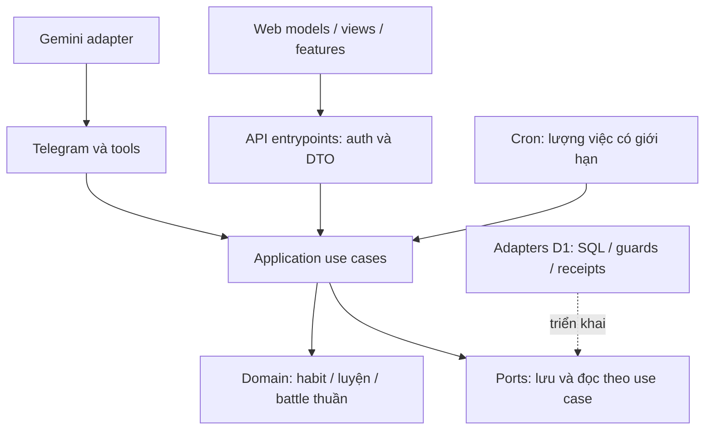

# Habit/Thần Lộ — kiến trúc và hợp đồng kỹ thuật

Cập nhật 2026-10-12. F1–F4 đã commit/push; F5 đang local với catalog/version registry/rewards và archive. Toàn nội dung/art/UX và release đang làm. Kiểm HEAD/schema và [PROGRESS](HABIT_GAME_PROGRESS.md), không suy từ tài liệu rằng remote đã migration/deploy.

## 1. Tiếp nối kiến trúc

| Vùng | Vai trò | Mẫu cần khảo sát |
| --- | --- | --- |
| `src/domain` | Hàm thuần, state transition, thời gian/random truyền vào | `healthy.ts`, `recurrence.ts`, `availability.ts` |
| `src/ports` | Interface cho use case, không expose D1/SQL | `work-store.ts`; tách interface mới vừa đủ |
| `src/application` | Điều phối, validation nghiệp vụ, giao dịch qua port | `schedule-command.ts`, `tool-executor.ts` |
| `src/adapters/d1` | Queries, constraints, receipts, optimistic guards, atomic commit | `healthy-store.ts`, `schedule-store.ts`, `day-plan-store.ts` |
| `src/entrypoints` | Auth/input cap, lỗi, wiring, công việc có giới hạn | `mini-app.ts`, `mini-app/context.ts`, `worker-scheduler.ts` |
| `web` | Server là nguồn chuẩn; models/features/views nhỏ | `core/mutations.js`, `core/http.js`, `features/sleep.js` |

Không SQL/fetch/config/process.env trong domain/ports/application. Không thêm mọi luật vào file trung tâm hoặc abstraction chỉ để dự phòng. Thư mục con/dependency/refactor có thể dùng khi có lợi ích đo/kiểm được; không tự chuyển stack/hosting. Gate import hiện chỉ quét file trực tiếp; agent phải mở rộng phủ thư mục con nếu tạo chúng. Scripts test hiện dùng glob file trực tiếp; test đặt trong thư mục mới phải được discovery/chạy thật, không chỉ được tạo trên đĩa.

## 2. Nhóm dữ liệu cần thiết kế

### Hợp đồng habit đã triển khai local (F1/F2)

`0031_habits.sql`: aggregate guard `habit_accounts`, definitions `habits`, normalized `habit_revisions`, immutable day windows `habit_days`, current-day totals `habit_logs`, sequential cursor/period `habit_periods`, immutable contributions `habit_outcomes`, request receipts `habit_receipts`. Revision giữ archive boundary riêng để restore không thay lịch sử.

- `GET /api/habits?archived=1`: ngày server `{day,startAt,endAt}` và list definition/pending/log/preview. Lazy load ngoài bootstrap; preview chưa phải reward.
- `POST /api/habits`: request `id` theo auth/CSRF/body cap chung. Các operation create/update/archive/restore/log đi qua `HabitService` và port `HabitStore`; log bắt buộc `habitId,version,day,logVersion,value` (value external), note tùy chọn. Owner/time/commitment/rewards không nhận từ client.
- `GET /api/habit-history?from=…&to=…&habitId=…&before=…&limit=…`: keyset, max100 rows/max366 ngày, target/lịch theo revision cũ; ngày chưa kết toán hiển thị processing. CSV export chỉ đọc và chống công thức nguy hiểm.
- Owner habit receipt kiểm trước day; guard habit + log + owner aggregate trong một D1 batch. Không dùng healthy account cho một tick. Cron settle có giới hạn, bất kể healthy suspension; không gọi LLM để tính kết quả.

F2 bổ sung:

- `0032_habit_reminders.sql`: link tới recurrence rule chuẩn, ID SHA256 owner/habit. `reminderTime` optional khi create/update, lưu cùng receipt. Nhắc là lời nhắc cá nhân đã cấu hình, tiếp tục khi ngủ; không tick habit hoặc thưởng. Ngày chọn thứ được dịch nếu giờ nhắc nằm trước mốc ngày sinh hoạt. Archive có end date và guard lifecycle; không gửi lại cùng slot đã sending/sent/uncertain khi đổi revision.
- `0033_habit_slots.sql`: mỗi habit/ngày tối đa một reservation 5–240 phút, bước 5 phút. `slot/remove_slot` có expected day/version; thay slot tăng version habit để tab cũ không ghi đè. Atomic guards gồm aggregate habit, healthy/day/settings/plan/events/tasks; giữ khung task đã xếp, dự trữ thời gian khi replan. Slot không bật nhắc, tạo task hay ghi nhận hoàn thành.
- `GET /api/habit-report?from=…&to=…&habitId=…`: totals, ngày, tỷ lệ từ successes/(successes+misses); neutral không vào mẫu số. Tổng lượng tách theo metric/unit qua revision. History hỗ trợ `status` và keyset; CSV tôn trọng bộ lọc.
- `today()` đọc nhóm definitions/logs/reminders/slots với số query cố định; tuần preview tối đa 7 ngày. Integration 30 habit kiểm tổng prepare ≤25, có headroom dưới ngân sách 50. Chưa đo CPU/runtime remote hoặc lịch sử nhiều năm.
- Today thực tế dùng `renderDailyPlan`; reservation hiển thị tại đây và link về danh sách habit. `renderTimeline` cũng nhận DTO nhưng không thay layout Today đã duyệt.

Các hợp đồng đã triển khai được đánh dấu theo F3/F4/F5; các thiết kế mở phía sau không chứng minh tính năng đã chạy.

### Hợp đồng luyện đã triển khai local (F3)

- `0034_practice.sql`: `game_accounts` giữ version/joined-day/next-day riêng; `game_selections` effective-day; `technique_unlocks`; `practice_versions` JSON≤8KB +edition unique; `practice_week_audits`; `game_days` immutable và `game_receipts`. Không nhét nội dung/phiên bản vào healthy account.
- `PracticeService` điều phối input whitelist/start/continue/stop. `D1GameStore` guard/version/receipt canonical; cùngID khácpayload conflict. Không khởi tạo game chỉ vì mở tab, không luyện bù trước joined-day. Một ngày bắt đầu với mode đã lựa chọn, đổi effective ngày sau.
- `GET /api/game` chốt tối đa1 ngày từ outcomes đã immutable rồi trả overview; catalog lazy tại `/api/game-catalog`; history theo technique/cursor tại `/api/practice-versions`; POST `/api/game` có day/version. Auth/Origin/body cap dùng chung; không owner/time/purity/rewards từ client.
- Settlement chờ tất cả habit của ngày, guard game+habit và next-day ở commit; cập nhật versions/audits/game_days/source receiver/game_applied cùng batch. Battle dùng handler F4 và vẫn chốt audit tuần; không chuyển nguồn thành tiến độ luyện. Luyện không mutation healthy/vé; death/rescue có delta cùng batch.
- Catalog39 có identity/name/group/description/factor và finite effects F4. Năm môn đầu phái cho chọn luyện; unlock graph và tình huống dùng toàn39 môn vẫn cần F4/F5. Không gọi data catalog là game đã hoàn thành.
- Chính sách tinh thuần/weekly audit/cost do [GAMEPLAY mục2](HABIT_GAME_GAMEPLAY.md) sở hữu; weekly audit của bản không active vẫn chốt. Outcome có named source trong game_days để UI giải thích ngày/habit góp luyện.
- Habit closure cùng oldest-day được đọc/ghi theo nhóm≤30 (`settleBatch`); wrapper `settle` chỉ lặp tới limit cho maintenance/local. Cron phase3 luân phiên legacy/habit/game mỗi12phút, các phase thông báo giữ4phút. Không xếp6habit-days cộng game trong một invocation. Integration kiểm30habit grouped≤20SQL, GETgame≤50SQL/<50KB và hai maintenance invocation≤50SQL. Giới hạn Free được đối chiếu [Cloudflare D1 limits](https://developers.cloudflare.com/d1/platform/limits/); CPU/latency thật và backlog nhiều năm còn là gate release.

### Hợp đồng chiến đấu F4 đã commit/push; F5 đang mở rộng local

- `0035_battles.sql`: battle snapshot/version/content (JSON≤24KB), một trận live/owner; choices unique battle/day; sequence audit events; unique boss victories; frozen task sources/global unique task awards; cooldown rank trong game account.
- `BattleService` và port `BattleStore` validate whitelist/day/version/cost. Adapter đọc game version trước dữ liệu phụ thuộc; guard game/battle/healthy/schedule-day cùng canonical game receipt. Failed batch không có delta/receipt một phần.
- `prepareBattleSettlement` trong batch game closure phối hợp practice audits/versions, battle turn/event, task sources, victory/unlocks, mode day+1 và game_day/receivers/next-day. Auto death thêm healthy guard/delta. Sleep không gọi handler.
- POST `/api/game`: prepare/cancel/choose/withdraw/rescue/death/exchange. GET `/api/game` thêm public summary/victories/choices/quote trong một query ghép bounded, không lộ future intents. Lazy `/api/battle-loadout` gợi ý một bản mỗi môn từ toàn lịch sử theo tầng rồi tinh thuần; `/api/practice-versions` cho chọn mọi bản cũ qua keyset. `/api/battle-history` owner/keyset/≤50events; `/api/battles` owner/keyset/≤50summary, không trả pattern/ending.
- F5 `0036_game_rewards.sql` lưu unique weapon/achievement entitlements theo owner/kind/id và nguồn trận. Victory, quyền học và rewards ghi cùng batch với settlement/rescue. Một weapon thuộc owner được chọn ở prepare; fighter/shield/tradeoffs được snapshot đúng một lần, không đổi giữa trận hoặc áp lại khi retry/cast/rescue.
- `than-lo-2` có40encounters/15chương/39quyền, registry vẫn đọc `than-lo-1` của snapshot cũ. Catalog bounded omits intros/endings/patterns; boss/chapter details lazy theo victories và bản đã học, kết chương chỉ đọc sau tất cả trận chính. Đọc lại không phát thưởng.
- Habit export CSV/JSON từ cùng history API, cap3000rows và báo nếu còn cursor thay vì xuất thiếu âm thầm. JSON `assistant-habits` v1 chứa operating-day/range/filter, scale100, revisions và lịch sử; không có account/tasks/secrets hoặc lệnh import.
- Content snapshot trong trận không đổi khi publish. F4 có5encounters mở đầu; F5 đã mở graph40encounters/15chương với version registry. Art/cast/UX toàn inventory vẫn phải hoàn thiện. Public overview loại `pattern` khỏi snapshot và chỉ hiện victory sau thắng; intents công bố qua projection của engine.
- Healthy giữ kinh tế cũ. Cooldown combat được endpoint breakthrough/SQL guard kiểm lại, odds/penalties/charms thường không đổi. Bootstrap thêm restriction vào account read DTO; UI nói ngày thử lại. Cứu cần healthy version; undo ngủ giữ delta/guards.
- Task không clone: roots khi prepare, completion source chuẩn, chỉ2/ngày và global once-only. Steps/work-log/estimate/task mới không thành sức mạnh vô hạn. Giá/order/absence tại [BATTLE_RULES](HABIT_GAME_BATTLE_RULES.md).
- Local30 nguồn battle: GETgame cùng closure≤50 SQL/<50KB. CPU/latency remote, backlog dài và staging còn là release gates.

| Nhóm | Dữ liệu/trách nhiệm | Bất biến |
| --- | --- | --- |
| Habit definitions/revisions | Mục tiêu, lịch, lifecycle, mốc hiệu lực | Lịch sử đọc theo revision hiệu lực, không theo mục tiêu mới |
| Commitments/periods | Q, cửa sổ ngày/tuần, ngày hợp lệ, đóng kỳ | Thay/xóa không xóa nghĩa vụ đã phát sinh |
| Logs | Habit/ngày, giá trị cuối, ghi chú, version | Một trạng thái hiện tại/ngày; ngày đóng chỉ đọc |
| Contributions | Đạt/thiếu mới, nguồn, receiver/chế độ, preview/final | Unique nguồn/kỳ; trung tính không thành success |
| Cultivation | Quyền học, bản luyện, tầng, tiến độ/phẩm chất/provenance | Chất lượng đã khóa và bản cũ bất biến |
| Battles | Bộ chiêu/bản, nền, intent, lựa chọn, turn, HP/status, result | Snapshot và rule/content version xác định kết quả |
| Story/rewards | Đường mở, quyết định truyện, unlock, thần binh, chiến tích | Một reward entitlement; không nhận lại khi refresh/replay |
| Requests/jobs | Receipt, version, lease/fence, checkpoint kết toán | Retry không nhân mutation, job muộn đúng kỳ |

Đây không phải yêu cầu một bảng cho mỗi dòng. Agent chọn SQL/JSON phù hợp và viết actual schema/DTO/transaction notes ở P0. Không nhét 39 môn/bản/history/battle log vào HealthyState JSON: `HealthyStore` hiện giới hạn account/result/request JSON khoảng 12 KB. Không mặc định mọi lần ghi habit phải đụng account.

Các index/constraint cần owner + source/day/period/version; queries bind params, phân trang ổn định và giới hạn history. Snapshot nguồn có giới hạn, không sao chép toàn bộ kế hoạch mỗi lượt. Tách payload log chi tiết khỏi bootstrap.

## 3. Giao dịch và replay

Một use case ghi phải nêu rõ: canonical request, expected day/version, dữ liệu đọc, guards kiểm lúc commit, writes cùng transaction, receipt/result và side effects sau commit.

- Cùng ID + cùng canonical payload: trả kết quả đã lưu. Cùng ID + payload khác: conflict. Receipt đã tồn tại được replay kể cả ngày đóng; không tạo mutation mới.
- Retry qua ngày chưa commit: từ chối stale day, không tính lại ngày/payload và tự ghi sang hôm nay. Server quyết định thời gian; client gửi expected day để phát hiện lệch, không để được chọn ngày cũ.
- D1 batch dùng constraints/guards thật; không giả transaction bằng read → nhiều write độc lập. Concurrency account/habit/battle kiểm version hoặc điều kiện tương đương tại commit.
- Khi có delta Tu Vi/rank/inventory/tickets, delta và kết quả/receipt/reward nguồn phải cùng commit hoặc cùng thất bại. Không lấy lock in-memory Worker làm guarantee.
- Kết toán một nguồn chỉ một lần, theo thứ tự kỳ; hai tab/cron/LLM không nhân. Không tái dùng đóng góp đã thuộc battle cho luyện sau khi rút/thắng.
- Random server được lấy/lưu trong request/result hợp lệ để retry không reroll; không tin roll/damage/reward từ client/model.
- Outbox phát sau commit, có dedupe và lease/version fence. Gửi ngoài hệ thống có thể uncertain; không hứa exactly-once Telegram và không reset uncertain để thử lại hàng loạt.

Use case ghi log, đóng ngày, đổi chế độ, lên tầng, kết toán lượt, cứu/tử trận và thưởng cần integration tests bằng D1/local. Chỉ mocking port không chứng minh atomic writes.

## 4. API và tools: hợp đồng phải có

Tên endpoint/DTO do AI quyết định, không cần cố đóng băng URL từ tài liệu. Web và bot/LLM gọi cùng application rules; mỗi khả năng phải có input, output, lỗi, giới hạn, version và quyền rõ.

| Khả năng | Input cần có | Output/điều kiện chính |
| --- | --- | --- |
| Đọc tổng quan | Phạm vi ngày/kỳ hợp lệ, paging | Server time/day, revisions, preview/final; snapshot giới hạn |
| Quản lý habit | Fields whitelist, expected version, effective policy | Definition/revision và mốc hiệu lực; không mass assignment |
| Ghi habit | Habit ID, tổng hoặc action rõ, expected day/version, request ID | Giá trị đã lưu, trạng thái đạt, preview; day closed/stale/conflict rõ |
| Lịch/nhắc habit | Source ID, giờ/slot/duration, version | Conflict/capacity, occurrence liên kết; không tạo task thưởng |
| Đọc history/export | Bộ lọc/cursor/kỳ có giới hạn | Dữ liệu read-only/versioned, không kích hoạt settlement giả |
| Luyện/đổi chế độ | Bí tịch/bản mục tiêu, ngày hiệu lực theo server | Trạng thái hiện tại và pending; xác nhận luyện lại giữ bản cũ |
| Chuẩn bị/bắt đầu/rút trận | Boss/loadout IDs, expected state/version | Giá/rủi ro/hạn khóa; không owner/damage do client chọn |
| Chọn chiêu | Trận/ngày, môn/bản đã mang, version/request ID | Lựa chọn/preview, chi phí đã công bố; chưa final trước chốt |
| Cứu/nhận kết quả | Trận, quyền cứu, expected state/request ID | Delta/cost/result nguyên tử; không rút sau HP 0 |
| Library/story/log | IDs có quyền xem, cursor | Nội dung đã mở, spoiler policy, rule/content version |

Mọi endpoint kiểm owner từ auth context. Giữ Telegram initData/HMAC/TTL, browser auth/cookie/Origin và error semantics hiện có. Request API hiện có cap 4 KB; nếu payload mới cần đổi cap, chứng minh nhu cầu và vẫn có giới hạn. Không cho AI arbitrary SQL/code/network hay chọn owner/thời gian kết toán.

Tool chỉ ghi khi user có yêu cầu rõ trong cơ chế hiện tại. Hỏi tình trạng không tự tạo habit/đổi chế độ/chọn cấm thuật. Context gồm ngày server, sleep/focus/notification state, tóm tắt habit/chế độ/trận liên quan với revision; không đưa cả catalog/history hoặc dựa summary để suy quyền. Khi Gemini lỗi/quota, web và luật/kết toán vẫn dùng được.

## 5. Thời gian và cron

Ngày sinh hoạt lấy từ `operatingDay/dayWindow`; điểm danh vẫn dùng ngày lịch Việt Nam. Snapshot đầu kỳ phải ổn định khi user đổi settings, mode hay catalog. Các period đã đóng không thể được viết lại bằng sửa giờ máy/client.

- Xử lý các ngày/kỳ cần đóng theo thứ tự thời gian; chốt đóng góp D bằng chế độ D kể cả cron đang ở D+1.
- Công việc có lượng tối đa mỗi lần, checkpoint/resume, indexes và quyền retry rõ. Không sweep mọi user/history hoặc mọi content mỗi phút.
- Tôn trọng cron bốn pha/giới hạn runtime hiện có; đo query count/CPU thực tế tại fixture đại diện và sát giới hạn lớn. Không coi LIMIT hoặc mock test là bằng chứng đủ hiệu năng.
- Delayed/repeated/concurrent jobs, crash giữa commit và outbox, backlog nhiều ngày phải converge tới cùng kết quả. Habit commitments bị thiếu vẫn chốt; trận vắng app theo chính sách safe absence.
- Kết toán dùng engine thuần, không gọi LLM hay sinh ảnh. Clock giả chỉ ở fixture/test tooling local, không để API đổi thời gian/test grant mở trên staging.

## 6. Tích hợp ngủ, focus, lịch và kinh tế

- `/ngu` hoặc web sleep là nguồn trạng thái chuẩn. Chặn lời thúc task/ngủ và lời chủ động tương đương focus; lời nhắc user đã cấu hình tiếp tục, trừ pause/inactive. Không áp một điều kiện ngủ lên toàn outbox.
- Lỗi báo ngủ sớm nhưng còn nhận nhắc chưa được xác định nguyên nhân. Điều tra từ receipt/day/generation/outbox/final-send; thêm regression đúng nguyên nhân rồi sửa. Không suy từ một timestamp rằng đã biết root cause.
- Undo ngủ giữ cửa sổ 5 phút/guards hiện có, không giới hạn mới 1 lần/ngày. Đảo delta ngủ, không khôi phục cả account; đột phá hoặc mutation có liên quan có thể khóa undo theo guard.
- Liên kết habit ngủ/điểm danh là opt-in, shared source và preview; không tự biến streak hiện có thành habit. Delta game đã khóa phải theo thời gian chốt; báo ngủ không chốt trận.
- Slot habit đi qua khả năng plan/availability phù hợp, không viết lại planner và không làm ảnh hưởng task đã xong/cha–con/deadline/work log. ACK reminder khác với hoàn thành task/habit.
- Task thưởng vé lần đầu theo nguồn task gốc; đột phá thông thường, gacha, inventory, sleep penalties tiếp tục theo source hiện tại. Cấm thuật/cứu mạng là delta nghiệp vụ mới có giá/guard riêng.

## 7. Version nội dung và hiệu năng tải

Catalog khai báo data có validate và finite effects. Lưu rule/content version hoặc đủ snapshot cho trận/tầng đang chạy; khi balance đổi, không giải thích log cũ bằng công thức mới hoặc đổi boss âm thầm giữa trận. AI chọn chiến lược publish/compatibility trước batch nội dung đầu.

Bootstrap chỉ có thông tin đủ cho tab/overview; lazy load catalog/chapter/history/art theo màn. Có cache phù hợp cho static immutable assets, hash/version khi thay ảnh. Bounded payload và paging được đo; không preload cả 15 chương/39 môn/ảnh lớn trên mạng di động.

App phục vụ ảnh cuối; model/inference/dependency art chạy local, không trong Worker. D1 data thật, SQL backup, model weights, venv/cache/ảnh nháp và secrets không vào Git.

## 8. Nâng cấp, backup và tắt tính năng

- Migration bổ sung sau số hiện có (khảo sát đang tới 0030); kiểm lại trước tạo. Không sửa migration lịch sử.
- Nâng cấp DB cũ với fixtures task/reminder/healthy/auth/sleep thật về cấu trúc; so counts/invariants, kiểm foreign keys/constraints và queries mới.
- Backup staging trước schema change, giữ riêng ngoài Git và kiểm restore vào DB riêng. Không phát reminder từ DB restore/test.
- Rollback code/config hoặc tắt feature phải có chính sách job đã pending/settlement; không rollback schema bằng xóa dữ liệu. Tắt UI game không tự xóa trận hoặc nghĩa vụ habit.
- Export người dùng và operational backup khác nhau. Import/restore phải idempotent với source IDs và không reissue thưởng, mở ngày cũ hoặc xóa dữ liệu thật để “cho chạy test”.
- Lưu metrics lỗi/latency/backlog có giới hạn, không token/initData/raw chat. Kiểm độ lớn log/history và hướng bảo trì khi tài khoản dùng 1–3 năm.

Tiêu chí release và bằng chứng tại [ACCEPTANCE](HABIT_GAME_ACCEPTANCE.md); thao tác cloud tham khảo [OPERATIONS](OPERATIONS.md) và quyền mới nhất trong [IMPLEMENTATION](HABIT_GAME_IMPLEMENTATION.md).
