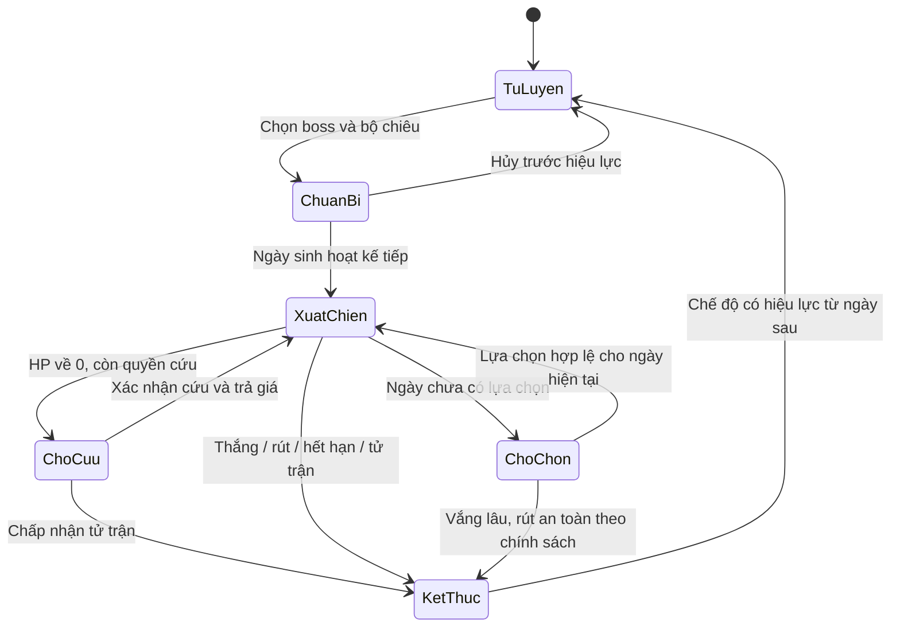

# Thần Lộ — luyện, chiến đấu và toàn bộ nội dung

Cập nhật 2026-10-12. F3 đã commit/push; engine và mở đầu F4 chạy local, chưa release hoặc đủ toàn bộ nội dung. [PRODUCT](HABIT_GAME_PRODUCT.md) sở hữu phạm vi; [HABITS](HABIT_GAME_HABITS.md) sở hữu cam kết; [CREATIVE_BRIEF](HABIT_GAME_CREATIVE_BRIEF.md) sở hữu trải nghiệm/mỹ thuật.

Danh mục bên dưới chuẩn hóa bản nháp để agent thiết kế sản phẩm đầy đủ. Tên, lore, chỉ số và cách triển khai có thể được AI biên tập; không tự xem mọi con số/đề xuất trong [BUSINESS_DRAFT](HABIT_GAME_BUSINESS_DRAFT.md) là luật đã duyệt.

## 1. Vòng lặp và trạng thái

Đây là mô hình nghiệp vụ; agent có thể tách state lưu trữ khác nếu cùng hành vi. Chuẩn bị trận không đổi chế độ hôm nay. Mỗi ngày có snapshot chế độ; kết thúc trận trong ngày không cho chuyển đóng góp của ngày đó sang luyện. Không có lựa chọn hợp lệ thì không tự dùng chiêu có giá hoặc tự cho boss đánh vì user không mở app.

## 2. Luyện và phẩm chất

- Một môn đang luyện; mỗi môn có Nhập môn/Tiểu thành/Đại thành/Viên mãn hoặc tên tương đương được biên tập thống nhất. Khi đạt tầng dùng được có thể đem vào trận.
- Tiến độ khác tinh thuần. Nhiều habit hợp lệ tăng tốc với trần/lợi ích giảm dần; một habit vẫn có thể luyện mọi môn và tạo bản 100%.
- Chất lượng tầng khóa khi tầng hoàn thành. **Khuyết điểm tích lũy nghiêm**, tầng sau không xóa lỗi tầng trước. Công thức cụ thể do AI chọn và mô phỏng; không làm mềm quyết định này.
- Cải thiện bằng bản luyện mới từ tầng 1. Giữ bản cũ và provenance; dùng một bản xác định, không cộng các bản hoặc vá tầng lẻ.
- Task không luyện công pháp. Xuất Chiến tạm dừng luyện, không giả thành ngày bỏ luyện. Habit vẫn theo dõi và cam kết vẫn ghi đúng.
- Ngày không có nghĩa vụ/kết quả cam kết là trung tính; không tính failure 0% giả. Chưa đủ mục tiêu của một habit tính 0 đóng góp, không triệt tiêu toàn bộ sức mạnh nền.
- Ngoại Đạo khó luyện ×2 so với chuẩn tương đương. Trấn phái hiếm ở đường truyền thừa; không mặc định toàn bộ trấn phái cũng ×2. AI chọn và kiểm chứng hệ số cấm thuật.

P0 phải chốt cách phân bổ thiếu weekly khi chuyển môn/bản/tầng/chế độ, hủy luyện hoặc chưa chọn môn. Điểm xuất phát là sự kiện thuộc ngày nó phát sinh, không sửa tầng cũ. Quy tắc phải giữ nghĩa vụ đã phát sinh và chống né thiếu bằng chuyển trạng thái; có thể cần snapshot ràng buộc cam kết/phiên luyện hoặc hạn chế thời điểm thay đổi. AI chọn phương án dễ hiểu, ghi timeline và mô phỏng exploit trước khi code; không thêm lệnh cấm tùy tiện mà UI không giải thích.

### Quyết định A03/A04 cho bản triển khai đầu

Đây là quyết định của agent trong quyền thiết kế đã cấp, không phải luật mới do user tự chốt. Rule `practice-v1`:

- Chi phí bốn tầng là3/6/10/15 đơn vị; Ngoại Đạo×2, cấm thuật×1,5, các môn phái/trấn phái×1. Lưu chi phí/rule trong bản luyện. Một ngày đạt ít nhất một habit hợp lệ nhận1đơn vị; bonus0,12 cho mỗi habit trưởng thành thêm, tối đa1,6. Bonus cần habit có cam kết hiệu lực ít nhất7ngày; phần theo dõi trước hiệu lực không tăng tiến độ. Tiến độ đầy một tầng không tràn sang tầng sau trước khi tầng khóa.
- Tinh thuần tính từ nỗ lực đã dùng và thiếu tích lũy của **bản**: `max(1%, (S/(S+2M))^(1+0,35*(tầng-1)))`, làm tròn xuống basis point, không cao hơn tầng trước đã khóa. S là tiến độ đã dùng, M là thiếu quy đổi; không dùng ngày trung tính làm thành công. Khuyết điểm không mất khi đổi môn/tầng. Một habit hoàn thành đều có thể đạt100%; bản lỗi chỉ cải thiện bằng bản mới.
- Thiếu daily/chọn thứ áp vào bản đang luyện trong snapshot của ngày. Tuần linh hoạt có audit riêng: bất kỳ bản/tầng nào nhận tiến độ trong tuần đều ràng buộc với **các cam kết tuần đang hiệu lực**, kể cả tiến độ hôm đó đến từ habit daily khác. Điều này chặn né quota tuần bằng chỉ luyện vào Chủ nhật hoặc dùng habit daily để khóa tầng trước ngày thiếu.
- Audit chốt khi tuần kết thúc hoặc đủQ ngày đạt (khi đó thiếu mới về sau không thể phát sinh). Thiếu cả tuần phân bổ một lần theo phần tiến độ đã dùng của từng bản/tầng; integer milliunits và phần dư phân bổ xác định. Nếu cả tuần không có tiến độ, thiếu đi vào bản chưa hoàn tất được chọn luyện gần nhất trong tuần; không đổ vào tầng cũ đã khóa.
- Tầng đủ tiến độ nhưng còn audit chưa chốt hiển thị “Đủ tiến độ · chờ cam kết tuần”. Mỗi tầng đã khóa bất biến; audit của bản đã chuyển khỏi lịch vẫn được chốt, kể cả đang chiến đấu/idle. Việc kiểm nghĩa vụ không tạo thêm tiến độ hay sức mạnh luyện từ nguồn đã thuộc trận.
- Chọn môn/bản hoặc dừng luyện hiệu lực từ ngày sinh hoạt kế tiếp. Tạo bản mới giữ bản cũ; nếu đã có bản cùng môn thì yêu cầu xác nhận luyện lại. Chưa chọn bản thì habit vẫn theo dõi và không tự học môn. Một source/ngày chỉ thuộc snapshot mode của ngày đó.
- Game settlement theo ngày, chỉ sau khi **tất cả** habit có hiệu lực trong ngày đã kết toán; guard account+habit cùng batch, đánh dấu sources với receiver và game_applied cùng kết quả. Cron muộn vẫn đọc selection của ngày cũ. Ngủ không chốt ngày/game.

Timeline cần test: Q3 chỉ ngày1 đạt, luyện từdaily trong ngày1–3 → tầng đủ tiến độ nhưng chưa khóa; ngày6/7 thiếu tổng2, audit chốt rồi mới khóa. Đổi sang bản khác/ngừng luyện/Xuất Chiến từ ngày4 vẫn chốt vào các bản dùng tiến độ trước đó. Chỉ luyện Chủ nhật vớiquota đã thiếu trước đó vẫn chịu audit cả tuần. Q3 đạt ba ngày đầu → audit chốt sớm với0thiếu, không buộc chờ Chủ nhật. Các con số được mô phỏng và có thể điều chỉnh trước release, giữ luật nghiêm và compatibility/rule version.

## 3. Sức mạnh và kết toán

Nguồn nền là Cảnh giới, tầng, tinh thuần và bản sắc công pháp. Habit là phần gia tăng chính theo cam kết đủ điều kiện, task là phần phụ có trần. Task vẫn thưởng vé theo hệ hiện có; không tự thêm thưởng Tu Vi/habit/vé mới.

AI chốt cách lấy đóng góp task từ nguồn ổn định và snapshot đủ sớm: task cha/con, việc được thêm/đổi estimate/replan, work log tự khai báo và tick/untick không tạo nhiều nguồn sức mạnh. Không lấy số dòng task hoặc phút tự nhập làm damage không giới hạn.

Thứ tự giải quyết phải được định nghĩa thành một hàm/chuỗi quy tắc rõ:

1. Tải intent đã xác lập, lựa chọn hợp lệ, đóng góp cuối và trạng thái từ trước; kiểm rule/content version của trận.
2. Giải quyết các hiệu ứng đến hạn và đòn người chơi theo thứ tự AI đã đặc tả; công pháp ngày đó chỉ thi triển một lần.
3. Người chơi đánh trước. Boss chết thật thì kết thúc thắng ngay, không phản công. Boss hồi sinh chỉ qua cơ chế đã báo trước, có giới hạn và thứ tự rõ.
4. Boss còn sống phản công từng hit. Tách raw damage, né, giảm, giáp/khiên, HP thật và phản thương; chốt thứ tự rounding/cap.
5. HP người chơi về 0 thì xử lý quyền cứu/tử trận; không tiếp tục trừ theo chuỗi hit khi chưa chốt quy tắc cứu. Nếu phản thương tạo đồng quy, có chính sách thắng/thua xác định.
6. Cập nhật hiệu ứng/hạn sử dụng, HP, nhật ký và trạng thái trận; commit nguồn đóng góp, kết quả và delta kinh tế cùng nhau khi có delta.

Boss có thể phản ứng với lịch sử các ngày trước, không sửa intent tùy ý sau khi nhìn lựa chọn hôm nay. Preview phải nói rõ phần chắc chắn, phần phụ thuộc habit cuối ngày và rủi ro; không hứa một kết quả chính xác nếu còn yếu tố chưa chốt.

## 4. Thời gian, vắng mặt và cái giá

- Lựa chọn, rút lui và chỉnh lựa chọn chỉ trước mốc khóa server công bố. Ngày hết quyền sửa dù cron chưa chạy. Không xem kết quả rồi rút miễn phí.
- Ngày giao chiến đã giải quyết khác ngày lịch/ngày tạm chờ. Boss thường khoảng 3–5 ngày giao chiến, boss chương 5–7, boss cao tối đa 14–17. AI chọn giới hạn cụ thể từng boss và giải thích trong UI.
- Chưa chọn/vắng app: chờ có giới hạn rồi rút an toàn, không tự tử trận. Habit đã bỏ lỡ vẫn được ghi thiếu theo cam kết; an toàn chiến đấu không miễn tinh thuần.
- Sau HP=0 đã kết toán, chỉ còn cứu mạng hợp lệ hoặc tử trận. Chờ quyết định cứu không mở quyền rút về trước đòn; AI chốt timeout/tiếp tục trận và giá công khai.
- Hộ Mệnh dùng Tu Vi; Nghịch Mệnh hạ **một đại cảnh giới**, không thêm phí Tu Vi kích hoạt. Dùng chung một quyền cứu/trận.
- Nghịch Mệnh chỉ hợp lệ nếu đã trang bị và chọn làm chiêu của ngày bị hạ HP về 0; không tự chọn sau khi thấy chết. Chọn có giá/hy sinh phải được đồng ý rõ trước thi triển.
- P0 chốt % HP hồi, chuỗi hit còn lại, giá tử trận, trần tổn thất, thứ tự với ngủ/đột phá và bảo vệ 72 giờ. Không tự biến Hộ Tâm/An Tâm thành cứu mạng boss.
- Cảnh giới hiện là `rank` riêng, không tự suy từ `qi`. Hạ do cấm thuật phải giữ `qi`/`earned`/`highestRank`, nhưng không bật lại ngay; AI chọn điều kiện tái đột phá/cooldown trong phạm vi game và cho thấy trước khi xác nhận. Không âm thầm thay tỷ lệ/giá đột phá thông thường.
- Chỉ số nền của trận có snapshot/rule rõ. Rank thay đổi ngoài trận, lời nguyền và hy sinh trong trận không được UI và engine hiểu khác nhau. Ngủ/undo không tự chốt lượt hoặc hoàn nguyên cả tài khoản.

## 5. Hệ hiệu ứng hữu hạn

Quyết định A05/A06 cho `battle-v1`, giá, thứ tự và bằng chứng hiện tại tại [BATTLE_RULES](HABIT_GAME_BATTLE_RULES.md). Khung dưới đây vẫn áp dụng khi mở rộng toàn nội dung.

Nội dung khai báo bằng ID/type và tham số đã validate, không script tùy ý. Mỗi hiệu ứng có nguồn, thời điểm bắt đầu, mốc hết hạn theo ngày giao chiến, quy tắc stack/replace, trần, đối tượng và dòng giải thích. Tối thiểu hỗ trợ những nhóm cần cho catalog: đánh đơn/nhiều hit/xuyên giáp, khiên/giáp ảo, né/giảm, hút/hồi HP, HP tối đa, phản thương, chảy máu/đòn trễ, buff/debuff, Cương Kình/Hư Ảnh, dấu ấn, echo, đổi bộ chiêu, soi/đổi intent, phong ấn và cứu mạng.

Các ranh giới bắt buộc:

- Không stack thành bất tử vô hạn, khóa boss vĩnh viễn, kéo dài trận vô hạn hoặc đệ quy echo/phản thương/hiệu ứng sao chép.
- Echo chỉ tái hiện một lần, không sinh echo khác; không mang thưởng/ấn sang trận mới.
- Chiêu % HP/max HP, phong ấn và sao chép boss có cap/điều kiện, không làm mọi boss cao thành một nút bấm.
- Giáp Ảo Sơn Hà: hit bắt đầu khi giáp còn thì giảm 40% trước, sau đó trừ giáp và HP; hit sau giáp vỡ không hưởng giảm. Giáp 20 + hit 100/100 → mất HP 40/100; giáp 110 + 100/100/100 → mất HP 0/10/100 (bỏ qua hiệu ứng khác).
- Bốn ấn Kiếm Đồ có ID khác nhau, tạo từ bốn thức khác nhau trong cùng trận; dùng lặp không thêm ấn. Vấn Thiên cần bốn ngày chuẩn bị + ngày thi triển để bùng nổ; thiếu ấn vẫn có đòn cơ bản.
- Quan Thiên soi hai ngày kế tiếp để có giá trị so với intent cơ bản. Nghịch Thiên đổi hai hành động hợp lệ, không đẩy đại chiêu ra ngoài trận miễn phí.

## 6. Catalog đủ 39 công pháp

Mỗi dòng phải thành nội dung có ID ổn định, mô tả một câu, tầng/tinh thuần, effect/cost, điều kiện mở và tình huống dùng được. ID không đổi chỉ vì đổi tên/lore. Không dùng cùng một handler damage với 39 tên để gọi là hoàn thiện catalog.

| Nhóm | Bốn môn thường và một trấn phái | Bản sắc cần giữ |
| --- | --- | --- |
| Thiên Kiếm | Kiếm Ý; Liên Vân Kiếm; Tuyệt Mệnh Kiếm; Vô Hồi Kiếm; **Kiếm Vực Khai Thiên** | Xuyên giáp, nhiều hit, kết liễu, bùng nổ có rủi ro, chuẩn bị kiếm vực |
| Bất Diệt | Bất Diệt Kim Thân; Huyền Quy Chân Kinh; Phản Chấn Quyết; Trấn Sơn Quyền; **Bất Diệt Chiến Thể** | Tạo/giữ/tiêu Cương Kình, phản thương và chuyển phòng thủ thành công |
| U Minh | Thôn Thiên Ma Công; Huyết Sát Quyết; Minh Hà Huyết Chú; Tàn Mệnh Chỉ; **Huyết Hải Phần Thiên** | Hút/hiến HP, chảy máu, phản sát, đánh đổi HP tối đa |
| Thái Hư | Thái Hư Bộ; Hư Không Tạng; Không Minh Trảm; Hoán Hình Thuật; **Vạn Pháp Quy Hư** | Một Hư Ảnh: giữ để thủ hoặc tiêu để công/hồi/né; không hoãn đòn vô hạn |
| Thiên Cơ | Quan Thiên Chỉ; Lạc Tử Ấn; Dẫn Kiếp Chỉ; Thất Tinh Sát; **Nghịch Thiên Kỳ** | Nhìn xa, đặt thế và thay nhịp có giới hạn; không stunlock |

| Cấm thuật | Giá trị độc đáo và giới hạn cần thiết kế |
| --- | --- |
| Nghịch Mệnh Hoán Sinh | Cứu đã chuẩn bị bằng một đại cảnh giới; cùng quyền cứu Hộ Mệnh |
| Thâu Thiên Hoán Mệnh | Cướp phần HP có trần, hy sinh max HP; không tráo toàn bộ % HP |
| Táng Nhật Nhất Kích | Đòn cực lớn, bản thân gần chết; không xóa rủi ro bằng combo miễn phí |
| Đồng Mệnh Huyết Khế | Chia thương từ HP thực mất, vẫn phải chịu thương |
| Cửu U Đoạt Hồn | Sao chép dấu vết thần thông boss đã dùng, phạm vi hữu hạn |
| Thiên Táng Phong Thần | Niêm phong một tuyệt kỹ/giai đoạn, giá max HP, boss còn hành động |
| Tam Nhật Đoạn Mệnh | Một Tử Ấn nổ sau ngày giao chiến; không chồng vô hạn |
| Nghịch Luân Chuyển Sinh | Đảo một lợi thế boss vừa có, không tua cả trận/ledger |

| Ngoại Đạo | Giá trị độc đáo |
| --- | --- |
| Vô Môn Dịch Kinh | Đổi một ô sang môn đã sở hữu từ ngày giao chiến sau; không reset lượt đã dùng |
| Kiếm Lý Sơn Hà | Giáp ảo giảm 40% đúng từng hit |
| Nhất Kiếm Khai Hoàng Huyết Uông Dương | Đòn có phần theo max HP và chảy máu có trần |
| Thượng Hoàng Kiếp Động | Chuyển hóa một phần intent damage đã xác lập |
| Kiếm Táng Vạn Cổ | Echo một lần, buff/hồi có thời hạn |
| Nhân Hoàng Vấn Thiên | Đòn thường; tiêu bốn ấn để bùng nổ một lần/trận |

Các tên vay cảm hứng từ IP, đặc biệt một số kiếm thức, phải được AI đổi tên/lore/mỹ thuật bản phát hành để tạo bản gốc; giữ ID/cơ chế/tinh thần chiến thuật. Bản nháp vẫn là nguồn lịch sử, không phải quyền sử dụng hình/nhân vật bên ngoài.

Bốn môn thường của một phái đạt Nhập môn + boss truyền thừa mở **quyền học** trấn phái; sau đó còn phải luyện. AI có thể cải thiện điều kiện bằng trải nghiệm/simulation, giữ giá trị đầu tư và tránh vòng mở khóa đòi chính môn đang khóa. Thuần mỗi phái và bộ pha trộn đều có đường thắng ở sức mạnh hợp lý.

## 7. Tuyến truyện đủ 15 chương

Đây là khung biên tập, agent tự viết scene/thoại/encounter, có thể đổi tên/cast. Giữ động lực gần gũi, sự thật về Tuyển Tiên Lệnh, nhân vật có lựa chọn riêng, đối thủ tái ngộ có tiến triển và cuối Diệt Thần do thắng boss thật.

| Chương | Mốc truyện / đối thủ chủ đạo | Điều gameplay cần đem lại |
| --- | --- | --- |
| 01 Hắc Lệnh Qua Thôn | Thiết Lệnh Sứ; người thân bị bắt | 3–5 encounter mở đầu, Võ Kỹ, lần đầu mở bí tịch; hướng công/thủ dễ hiểu |
| 02 Thiên Kiêu Không Tên | Kỷ Hành lần đầu | Tỷ thí, giới thiệu đầu tư công pháp và các phái |
| 03 Huyết Hà Tà Vực | Huyết Hà Đạo Nhân | Hút máu/chảy máu, chính–tà có động cơ khác nhau |
| 04 Cửu Mệnh Lão Quái | Tạ Trường Sinh | Hồi sinh có báo trước; nhìn thấy cái giá Nghịch Mệnh |
| 05 Bách Tông Đại Hội | Thiên Kiêu Khôi Lỗi | Đối thủ kết hợp chiêu; đầu mối truyền thừa năm phái |
| 06 Sát Lục Thiên Bảng | Vô Ảnh Sát Chủ | Chu kỳ sơ hở/áp lực, user trở thành con mồi |
| 07 Thần Mộ Không Người Chết | Thủ Mộ Nhân | Di sản Ngoại Đạo, thần binh và Kiếm Đồ |
| 08 Huyết Hải Nữ Đế | La Sát Nữ Đế | Phản sát, rủi ro cấm thuật và nhánh săn bí tịch |
| 09 Ngũ Tông Phá Sơn | Thiên Luật Chấp Kiếm Sứ | Hệ quả tới nhân vật/thánh địa quen thuộc |
| 10 Thiên Kiêu Phản Đạo | Kỷ Hành lần hai | Tái ngộ đổi chiến thuật, hé lộ người thân còn sống |
| 11 Cửu Trụ Thiên Ngục | Các Thần Tướng | Các trận/pha có cá tính, không chín bản sao HP |
| 12 Vạn Đạo Thần Thể | Vạn Pháp Thần Khôi | Chiêu bị cướp trở thành áp lực, tổng hợp nhiều nhóm hiệu ứng |
| 13 Thiên Môn Phản Chiến | Kỷ Hành lần ba | Động cơ bảo vệ người bị giam, chiến thắng có hậu quả truyện |
| 14 Cổ Thần Chiến Trường | Thần Chiến Vương | Tái sử dụng bài học cũ ở cấp thần, vai trò đồng minh |
| 15 Thiên Mệnh Thần Chủ | Thần Chủ | Nhiều pha rõ, nhiều bộ chiêu thắng được; commit chiến tích DIỆT THẦN |

Mỗi chương phải có mở/diễn biến/encounter/chuyển biến/kết nối tiếp theo và art đã tích hợp; không chỉ có tiêu đề. Định nghĩa graph mở khóa, điều kiện/cảnh giới gợi ý, độ dài, phần thưởng và nơi đọc lại. AI có thể gộp các scene/nhân vật phụ để nhịp tốt hơn, nhưng toàn bộ 15 chương phải chơi được.

## 8. Tuyến phụ, thần binh và hồi chơi

- Năm tuyến truyền thừa: mỗi phái có thử thách/boss riêng về chiến thuật và quyền học trấn phái. Có thể dùng lại danh tính truyện với encounter khác thật; không tính đổi tên là một thử thách mới.
- Tám tuyến cấm thuật: chứng kiến sức mạnh/cái giá, gặp điều kiện mở và nhận quyền học; không bắt sở hữu tất cả để kết thúc truyện.
- Ngoại Đạo/Kiếm Đồ: rải manh mối và từng thức; một thức riêng vẫn dùng được, bộ năm là mục tiêu sưu tập.
- Dị Giáo: có lore/chiến tích cho phối hợp nhiều phái, không tạo debuff ép thuần phái hoặc một thanh currency mới.
- Thần binh: lượng gọn do AI chọn, mỗi món đổi một đặc tính chiến đấu; không thêm hàng chục slot/cường hóa. Trang bị/cost/snapshot rõ và không nhân thưởng từ tháo/lắp.
- Chiến tích: thắng thuần phái, không cứu, thắng sau hiến tế, hoàn tất truyện… lưu một lần từ kết quả hợp lệ. Mốc sưu tập không là khóa bắt buộc của tuyến chính.
- Đánh lại boss/chương hỗ trợ thử bộ chiêu và đọc truyện. Thưởng một lần/repeatable phải công bố, idempotent; không farm bí tịch, vé hoặc Tu Vi vô hạn.

## 9. Hồ sơ nội dung và cân bằng

Trước khi mở rộng sau lát cắt đầu, AI tạo mẫu khai báo đủ cho công pháp/boss/chương/phần thưởng/điều kiện/asset và validator phát hiện ID trùng, reference thiếu, vòng mở khóa, chiêu rỗng, số không hợp lệ. Mỗi boss có cơ chế dễ tóm tắt, intent có ý nghĩa, ít nhất hai hướng đáp trả, số ngày/rủi ro và nguyên nhân muốn đánh.

Mô phỏng một và 5–6 habit; nhịp hoàn thành 60–80%, tuần linh hoạt, ngày nghỉ và quay lại sau gián đoạn. Kiểm toàn catalog, từng phái, phối hợp, bản phẩm chất thấp/vừa/cao, cứu mạng, trấn phái/cấm thuật và endgame. Sửa chiến thuật thống trị hoặc nội dung không thể mở; không chỉ ghi thành “hạn chế”. Xem tiêu chí bằng chứng tại [ACCEPTANCE](HABIT_GAME_ACCEPTANCE.md).

Evidence trước/sau counter đọc chiêu của content3 ở [BALANCE](HABIT_GAME_BALANCE.md).30earned profiles và5mixed routes vẫn có đường thắng toàn40encounters; tactical fixture hiện không có chiêu lặp vượt toàntruyện. Thắng sau cứu đã có earned scenario. Những kết quả này không chứng minh F6 đạt toàn bộ: UX/art/network/release còn phải kiểm riêng. Giữ tinh thuần nghiêm và snapshots cũ.
