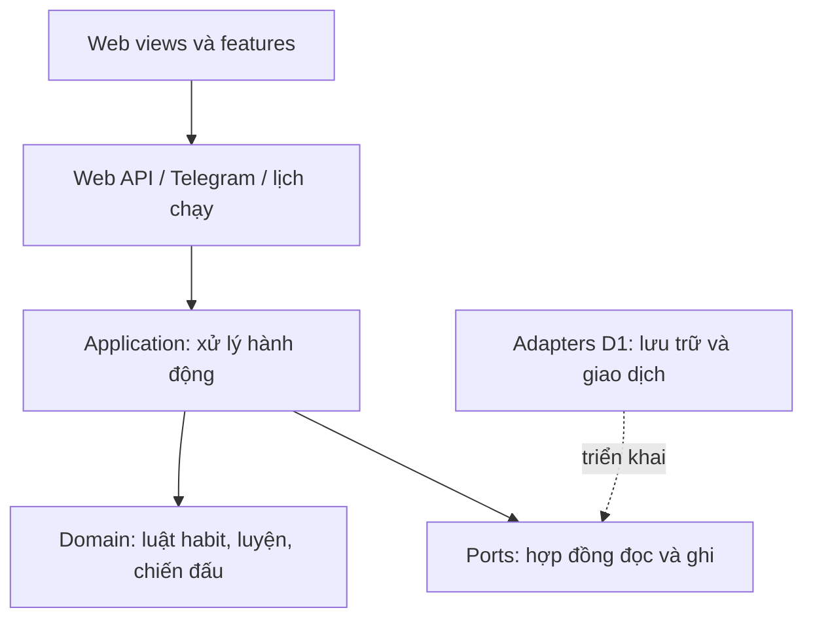

# Giao việc cho coding agent: Habit và Thần Lộ

Ngày chuẩn bị: 2026-10-12. Baseline khảo sát: `51f5ffd`, nhánh `review/p1-p3`; agent phải kiểm tra lại HEAD và workspace khi bắt đầu.
Trạng thái: chuẩn bị cho một phiên /goal tự triển khai từ thiết kế đến sản phẩm nghiệm thu. Chưa bắt đầu goal, chưa có code habit/game hoặc migration mới.

## 0. Cách làm mới theo yêu cầu chủ sản phẩm

Chủ sản phẩm muốn AI tự thiết kế sản phẩm, kiến trúc, luật còn mở, nhân vật, cốt truyện, hình ảnh, triển khai, kiểm thử và chỉnh đến bản hoàn thiện; chủ sản phẩm nghiệm thu cuối. Đây là hướng mới thay cách xin duyệt từng nhóm file trong bản bàn giao trước.

- AI được chủ động quyết định và sửa các phần cần thiết trong phạm vi habit/game đã thống nhất, bảo toàn hành vi cũ. Khi phát lệnh /goal theo mục 10, user cấp phạm vi tự sửa code rõ trong chính lệnh; không quay lại hỏi từng file/hàm hay thông số cân bằng.
- Đọc các luật đã chốt trong REVIEW. AI tự hoàn thiện các chi tiết còn mở bằng đặc tả và ví dụ, ghi quyết định trước khi code và tự kiểm chứng; không tự làm mềm tinh thuần hoặc đảo các lựa chọn đã chốt.
- Mốc P0/H1/H2/T1/B1/Q1 là cổng tự kiểm tra của agent. Không chờ user nghiệm thu giữa các cổng nếu chúng nằm trong phạm vi ủy quyền.
- Ngân sách bổ sung đã chốt là 0đ: không dùng API ảnh trả phí, không mua dịch vụ, top-up, subscription hoặc nâng gói. API phục vụ phần mới chỉ dùng khi xác nhận không phát sinh phí; có key không chứng minh miễn phí.
- Đã được phép tự commit/push và áp migration/deploy staging hiện tại để giao URL nghiệm thu. Chạy gate, kiểm tra target, giữ dữ liệu cũ và có kế hoạch rollback code; không cần xin lại từng lần trong phạm vi này. Production và dịch vụ mới không thuộc quyền staging.
- Nếu hướng dẫn AGENTS khác với phạm vi đã được user ủy quyền mới nhất, áp dụng chỉ dẫn user mới nhất cho phạm vi đó. /goal không tự mở rộng sandbox, quyền dịch vụ hoặc chính sách phê duyệt của ứng dụng.
- Nhân vật/hình ảnh có yêu cầu riêng tại [HABIT_GAME_CREATIVE_BRIEF.md](HABIT_GAME_CREATIVE_BRIEF.md). Ảnh tạo chưa được lưu/tích hợp/kiểm tra trong app không phải một hạng mục đã hoàn thành.

Ba câu hỏi đã có câu trả lời: một phái đầy đủ + chương mở đầu 3–5 boss; AI tự chọn phong cách tiên hiệp trầm/nguyên bản/đồng nhất; ngân sách 0đ và được tự commit/push/migration/deploy staging. Chỉ bắt đầu goal khi user thực sự yêu cầu, không suy ra từ việc user nói sẽ dùng /goal sau.

Nguồn ảnh đã chốt: AI tự tải/thiết lập mô hình sinh ảnh cục bộ khi chạy /goal trên máy có GTX 1650 khoảng 4 GB VRAM. Thực hiện [HABIT_GAME_LOCAL_ART.md](HABIT_GAME_LOCAL_ART.md): xác minh môi trường, thử model nhẹ, tạo ảnh thật, QA và tích hợp vào app. Chưa cài/chưa chạy thử ở phiên chuẩn bị; phần này chưa được tính là đã hoàn thành. Không cần hỏi thêm các lựa chọn tổng thể trước khi user bắt đầu goal.

User cho phép hỏi trực tiếp khi cần API. Hỏi tên dịch vụ, model/endpoint, quota và cách cấu hình cần thiết; key đặt qua môi trường/.env. Chỉ bổ sung biến .env.example khi đã biết backend thực sự dùng; không tạo biến có vẻ được hỗ trợ nhưng code không đọc. Không gửi/in giá trị key hoặc commit .env; việc khai báo ví dụ phải có ghi chú local/runtime phù hợp. Với ảnh tạo cục bộ, model phục vụ sản xuất asset trên máy phát triển, không đóng gói model lớn vào Worker/app.

## 1. Bắt đầu ở đâu

1. Đọc hướng dẫn của chủ sản phẩm/AGENTS, kiểm tra git status và HEAD. Giữ các thay đổi đang có của người dùng.
2. Đọc tài liệu này để lấy nhiệm vụ, ranh giới kiến trúc và tiêu chí hoàn thành.
3. Đọc mục 1 và 11 của [HABIT_GAME_REVIEW.md](HABIT_GAME_REVIEW.md) để lấy luật đã trao đổi; mở các mục khác khi cần.
4. Chỉ đọc phần liên quan của [HABIT_GAME_BUSINESS_DRAFT.md](HABIT_GAME_BUSINESS_DRAFT.md) khi thiết kế luyện/boss/nội dung. Đây là bản nháp, không phải toàn bộ luật đã duyệt.
5. Khảo sát source của phần sắp sửa; các đoạn phát hành cũ trong HANDOFF không chứng minh trạng thái runtime hiện tại.

Quyết định mới nhất của chủ sản phẩm có ưu tiên hơn bản nháp. Mâu thuẫn giữa các luật đã chốt phải giải thích và xử lý trước khi code; chi tiết chưa chốt trong phạm vi được ủy quyền do AI quyết định có lý do, không yêu cầu chủ sản phẩm tự thiết kế database.

## 2. Phạm vi sản phẩm đầu tiên

- Quản lý khoảng 5–6 habit: thêm/sửa/xóa, lịch hằng ngày/chọn thứ/X ngày mỗi tuần, tick hoặc số lượng/thời lượng, lịch sử chỉ đọc sau khi hết ngày sinh hoạt.
- Theo dõi một phần vẫn rõ trên UI; đóng góp game chỉ bắt đầu khi đủ mục tiêu. Cam kết tuần linh hoạt ghi thiếu dần khi không còn đủ ngày để hoàn thành.
- Danh sách habit riêng; phần gọn ở Hôm nay. Giờ nhắc/đưa vào kế hoạch là tùy chọn, không tạo task để nhận thêm vé.
- Luyện một công pháp, bốn tầng, tinh thuần nghiêm và bản luyện mới từ tầng 1 nếu muốn cải thiện.
- Một phái đầy đủ: bốn công pháp thường và một trấn phái; AI tự chọn phái phù hợp để thể hiện nhiều chiến thuật, bảo đảm chơi thuần phái có đường thắng.
- Chương mở đầu hoàn chỉnh với 3–5 boss có cơ chế/nhân vật khác nhau, quyết định công/thủ, log giải thích, thắng/thua/rút và thưởng/mở bí tịch. AI quyết định số boss trong khoảng này và kiểm chứng toàn bộ đường mở khóa.
- Nhân vật nguyên bản, cốt truyện và hình ảnh cuối được tạo/tích hợp nhất quán theo phong cách tiên hiệp trầm do AI tự thiết kế.
- Nhịp chơi phù hợp đời sống: không cần mở app liên tục; giao diện mobile ít màu, số liệu đọc được, thao tác rõ.

Phạm vi giao đầu đã chốt ở trên; chỉ một trận mẫu không đáp ứng. Toàn bộ 5 phái/39 môn/15 chương là hướng mở rộng sau; kiến trúc hỗ trợ mở rộng nhưng không cần viết sẵn toàn nội dung. Engine script tùy ý không phải điều kiện bắt buộc.

## 3. Kiến trúc cần tiếp nối

| Vùng | Trách nhiệm | Điểm khảo sát hiện có |
| --- | --- | --- |
| `src/domain` | Quy tắc thuần, cùng đầu vào cho cùng kết quả; thời gian/ngẫu nhiên được truyền vào | `healthy.ts`, `recurrence.ts`, `availability.ts` |
| `src/ports` | Interface vừa đủ cho use case mới; không để application phụ thuộc D1 | `work-store.ts`; không dồn mọi năng lực mới vào interface lớn này |
| `src/application` | Kiểm tra hành động, phối hợp domain và port; không SQL/fetch/config | `schedule-command.ts`, `tool-executor.ts` |
| `src/adapters/d1` | SQL, version guard, receipt, snapshot và commit nguyên tử | `healthy-store.ts`, `schedule-store.ts`, `day-plan-store.ts` |
| `src/entrypoints` | Auth, input giới hạn, ánh xạ lỗi, nối dependencies và chạy công việc có giới hạn | `mini-app.ts`, `mini-app/context.ts`, `worker-scheduler.ts` |
| `web` | Models/view/features theo cấu trúc đang có; server là nguồn trạng thái chuẩn | `core/mutations.js`, `core/http.js`, `features/sleep.js` |

Không thêm framework hoặc viết lại planner để làm tính năng này. Không mở rộng file trung tâm thành nơi chứa mọi luật. Không tạo abstraction dùng chung chỉ để dự phòng nhu cầu chưa có.
Gate kiến trúc hiện tại là `tests/unit/architecture.test.ts`; phần kiểm import domain/ports/application chỉ quét file trực tiếp. Nếu dùng thư mục con mới, agent phải trình bổ sung kiểm tra phủ được chúng, không coi gate đang xanh là đủ.

## 4. Dữ liệu và giao dịch: thiết kế trước khi viết migration

Đây là các nhóm dữ liệu cần giải thích, không phải schema đã duyệt:

- Định nghĩa habit và phiên bản mục tiêu/lịch; cam kết của kỳ có snapshot để sửa/xóa không xóa nghĩa vụ đã phát sinh.
- Bản ghi theo habit/ngày sinh hoạt, trạng thái kỳ đã đóng; một ngày sửa tổng hiện tại không tạo thêm nhiều đóng góp.
- Đóng góp đạt/thiếu mới/trung tính, có nguồn và chế độ của ngày; không ghi trung tính thành một thành công.
- Bản luyện/tầng/chất lượng đã khóa; trận/bộ chiêu/lượt/intent/log/thưởng; không nhét lịch sử vào JSON tài khoản 12 KB.
- Receipt cho thao tác và khóa duy nhất cho kết toán; cùng ID và cùng payload được replay, tái sử dụng ID với payload khác bị từ chối.

Retry qua mốc ngày cần thiết kế rõ: nếu receipt đã tồn tại, trả kết quả cũ, không ghi thêm dù ngày đó đã đóng; nếu chưa từng commit, không lấy một thao tác của ngày cũ ghi sang ngày mới. Có thể gửi ngày dự kiến/version từ snapshot để phát hiện lệch ngày, nhưng server quyết định quyền ghi. Không tính lại payload receipt từ ngày hiện tại làm cùng request ID biến thành payload khác.

Agent phải ghi và tự review luồng transaction cho: ghi/sửa trong ngày, khóa ngày, đổi chế độ từ ngày sau, lên tầng và kết thúc trận. Nếu có thay đổi account, kết quả game và thay đổi account phải cùng commit hoặc cùng thất bại.
Mọi truy vấn kiểm owner; client/LLM không được chọn owner, ngày cũ, damage, thưởng hoặc kết quả random. Thời gian server quyết định quyền ghi, dù cron chưa kết toán.
Cron xử lý các kỳ theo thứ tự thời gian, giới hạn lượng việc mỗi lượt, chạy lặp/muộn vẫn ra đúng một kết quả; không gọi LLM để kết toán. UI đọc snapshot có thể tạm cũ, không tự kết toán lại bằng giờ điện thoại.
Không mặc định mọi thao tác habit phải ghi account qua HealthyStore; tái sử dụng nguyên tắc receipt/guard, agent giải thích phần nào cần chung giao dịch với kinh tế hiện có.

## 5. Các quyết định cần hoàn thiện trong P0

AI hoàn thiện các quyết định sau trong đặc tả P0, tách rõ luật user đã chốt khỏi chi tiết AI lựa chọn. Đánh giá bằng ví dụ và mô phỏng rồi tiếp tục triển khai, không xin user quyết định từng thông số:

| Điểm còn mở | Agent cần đưa ra |
| --- | --- |
| Kỳ tuần và thay đổi lịch | Mốc tuần, habit tạo giữa tuần, đổi mục tiêu/giờ sinh hoạt, xóa habit; ví dụ cụ thể và thời điểm hiệu lực |
| Cam kết và đóng góp | Trần sau đủ X ngày, điều kiện tăng tốc của habit mới, trọng số; bảo đảm không farm bằng tạo/xóa hoặc chia habit |
| Tinh thuần nghiêm | Công thức từng tầng/lan truyền, ngày trung tính, thiếu phát sinh khi đổi tầng/môn/chế độ hoặc không đang luyện |
| Nhịp luyện | Tốc độ với một habit và 5–6 habit; bản luyện ở từng tầng, cách mở lựa chọn đầu trận |
| Trận đầu | Boss/chiêu, thời điểm khóa chọn, ngày chưa chọn hoặc vắng app, giá thất bại và thưởng; không mặc định tỷ thí miễn tổn thất đã được duyệt |
| Đưa habit vào lịch | Slot cố định hay tự xếp, conflict/capacity, nhắc do người dùng đặt và nhắc chủ động; giữ quy tắc ngủ/focus hiện tại |

Không cần chốt toàn bộ nội dung cao cấp để làm habit. Chỉ trì hoãn phần phụ thuộc quyết định chưa có; các phần đã rõ vẫn chuẩn bị được.

## 6. Chia việc thành các phần có thể nghiệm thu

| Mã | Phần việc | Kết quả trình người dùng |
| --- | --- | --- |
| P0 | Đặc tả phần đầu, hợp đồng dữ liệu/API, quyết định còn mở, bố cục mobile và hướng nghệ thuật | AI có kế hoạch/file dự kiến, ví dụ, bộ nhân vật và danh mục ảnh; tự review trước khi triển khai |
| H1 | Habit qua domain/port/D1/API/UI; cả ba kiểu lịch, đủ/chưa đủ/trung tính/thiếu, ngày cũ chỉ xem | Tạo, ghi, sửa cùng ngày, xem tuần/lịch sử; ví dụ 3 ngày/tuần chạy đúng |
| H2 | Giờ nhắc và tích hợp kế hoạch tùy chọn theo phương án đã duyệt | Habit có/không có giờ, conflict rõ, không nhân thưởng task; web và bot không lệch luật |
| T1 | Luyện và đổi chế độ, tầng/tinh thuần/bản luyện | Một habit dùng được; xem rõ dự báo/đã khóa; luyện lại giữ bản cũ |
| B1 | Các trận/nội dung thuộc phạm vi đã chọn, công/thủ, kết toán/log/thưởng, nhân vật/hình ảnh | Chơi trọn thắng/thua/rút; quyết định đổi kết quả; không có lượt hoặc thưởng trùng; không còn ảnh tạm ở nội dung phải giao |
| Q1 | Nghiệm thu tổng thể và phát hành theo phạm vi được duyệt | Mobile, nâng cấp DB cũ, lỗi mạng, ngủ/reminders/task vẫn đúng; báo kết quả và hạn chế |

Mỗi phần chia nhỏ thành nhóm thay đổi có thể chạy thử, AI tự review và sửa lỗi trước khi tiếp tục. Ghi checkpoint để phiên sau nối tiếp được; không chờ user duyệt mỗi nhóm trong phạm vi đã ủy quyền. Nền habit phải đúng trước khi mở rộng nội dung.

## 7. Nghiệm thu bằng hành vi

| Trường hợp | Kết quả phải thấy |
| --- | --- |
| Mục tiêu 20 phút, ghi 15 rồi 20 rồi sửa 15 cùng ngày | Lưu phần thực hiện; đóng góp dự báo 0 → đạt → 0, không thưởng trùng |
| Q=3, chỉ ngày 1 đạt | Ngày 2–5 trung tính; hết ngày 6 thiếu một; hết ngày 7 thiếu thêm một |
| Q=3, ngày 1 và ngày 7 đạt | Ngày 6 ghi thiếu một; ngày 7 được tính đạt, không thiếu thêm hoặc xóa thiếu cũ |
| Q=3, không ngày nào đạt / đủ ba ngày đầu | Thiếu mới một ở ngày 5/6/7 / các ngày sau trung tính theo trần đã duyệt |
| Ngày đóng nhưng cron chưa chạy; hai tab; timeout sau POST | Không ghi bù; xung đột rõ; retry đúng receipt, không cộng/lặp lần nữa |
| Mất phản hồi POST và retry sau mốc đổi ngày | Đã commit thì replay kết quả cũ; chưa commit thì không tự ghi hành động cũ cho ngày mới |
| Đổi Xuất Chiến giữa ngày D; cron xử lý D vào D+1 | D vẫn theo chế độ cũ, D+1 theo chế độ mới; không tính nguồn hai lần |
| Boss chết trước phản công / người chưa chọn / rút trước chốt | Đúng thứ tự và chính sách đã duyệt, log giải thích được |
| Báo ngủ, hoàn tác hoặc đột phá cùng kỳ | Giữ ledger/guard; ngủ không chốt trận; nhắc task bị chặn khi ngủ, lời nhắc riêng vẫn theo luật hiện tại |
| Xóa habit/đổi lịch, mở dữ liệu trước migration | Không xóa nghĩa vụ hoặc lịch sử đã chốt; dữ liệu cũ đọc được, tính năng cũ còn hoạt động |

Cho logic tuần, kiểm tra thêm mọi mẫu đạt/chưa đạt với Q=1..7: thiếu lũy kế không giảm, không ghi trùng thiếu, đạt được tính + thiếu = Q cuối kỳ dưới giới hạn một ngày đạt/ngày. Test qua hàm production, không viết một công thức thứ hai rồi chỉ test công thức đó.
Test integration dùng D1/local cho transaction và migration; browser dùng flow thật với fixture. Test giả/model giả không chứng minh Gemini/Telegram hoặc dữ liệu cloud thật.

## 8. UI và chất lượng sản phẩm

- Thiết kế bố cục trước khi code: danh sách habit, chỉnh mục tiêu/lịch, lịch sử, luyện, trận. Tự kiểm tra luồng và hình ảnh sau khi tích hợp, không chỉ đánh giá một mockup. Mỗi màn có một hành động chính rõ ràng.
- Màn nhỏ khoảng 360–390 px, dark/light: không tràn ngang, header/nút đóng sheet luôn tiếp cận được, chữ không rời rạc, trạng thái không chỉ phân biệt bằng màu.
- Danh sách tuần hiển thị đã đạt/cam kết và trạng thái trung tính/cần thực hiện/thiếu; không gây hiểu nhầm ngày linh hoạt đã thành ngày hoàn thành.
- Empty/loading/error/read-only và POST đã lưu nhưng refresh lỗi có thiết kế cụ thể; không báo thành công nếu chưa có xác nhận server, không cho retry nhân tác dụng.
- Giao diện không đưa SQL, receipt hay thuật ngữ triển khai vào luồng người dùng; log trận giải thích diễn biến và cái giá bằng ngôn ngữ dễ hiểu.
- Trước mở rộng nội dung, mô phỏng người có 1 và 5–6 habit, hoàn thành khoảng 60–80%, có ngày không đến lịch. Tinh thuần nghiêm vẫn phải có lối chơi hữu dụng cho bản chưa hoàn mỹ.

## 9. Hoàn thành một phần việc và chuyển phiên

- Tự review diff đúng phạm vi được ủy quyền; sửa lỗi phát hiện, ghi bằng chứng chạy và hạn chế. Không dùng câu “đã test” nếu chưa chạy.
- Chạy gate liên quan khi làm phần đó. Trước phát hành chạy `npm.cmd run typecheck`, `check:web`, `test:all`, `test:browser`, `build:check`; `staging:check` cho mục tiêu staging. Báo skip/environment failure riêng với pass.
- Migration bổ sung phải kiểm tra DB local cũ → mới; không sửa migration lịch sử. Quan sát lượng query/CPU và tải history có giới hạn; không coi có LIMIT là đã đo hiệu năng.
- Tự commit/push và migration/deploy staging đã được phép. Trước thao tác remote kiểm tra đúng target/config, gate và migration nâng cấp an toàn. Không ghi nhận habit/task giả vào dữ liệu cá nhân để test hoặc gửi tin Telegram giả; dùng fixture/local cho các kịch bản đó.
- Commit theo phần việc, push bình thường; không force-push hoặc ghi đè thay đổi khác. Rollback code phải giải thích tương thích schema mới; không dùng rollback bằng xóa dữ liệu đã phát sinh. Kiểm tra file staged, giữ key/.env/model tải về và artifact nháp ngoài commit.
- Cập nhật trạng thái trong tài liệu này bằng bảng ngắn: phần việc / HEAD / đã làm / đã chạy / còn thiếu / việc tiếp theo. Không ghi phiên đã chạy hay đã deploy khi chỉ mới chuẩn bị kế hoạch.

Trạng thái ban đầu: chỉ chuẩn bị tài liệu; P0 chưa hoàn thiện; H1/H2/T1/B1/Q1 chưa triển khai; chưa có ảnh được tạo. Lỗi đã báo ngủ mà còn nhắc ngủ là vấn đề nền chưa xác định nguyên nhân; điều tra/sửa trong phạm vi bảo toàn hành vi trước phát hành, không tự coi đã sửa.

### Điều kiện hoàn thành goal

1. Toàn bộ phạm vi user đã chọn dùng được từ tạo habit đến luyện, chiến đấu, lịch sử/thưởng; mở bằng đường vào thật trong app.
2. Nội dung có nhân vật/cốt truyện và ảnh thật thuộc phạm vi đã chọn, nhất quán và được kiểm tra trong UI mobile; không còn nút rỗng/ảnh mẫu hoặc màn chỉ chạy bằng demo.
3. Luật đã chốt đúng, hành vi cũ được bảo toàn; gate phù hợp chạy đạt; migration local từ DB cũ và lỗi mạng/concurrency được kiểm chứng.
4. Mô phỏng gameplay nhiều nhịp sinh hoạt cho thấy lựa chọn ảnh hưởng kết quả và bản luyện chưa hoàn mỹ vẫn có giá trị. AI sửa vấn đề cân bằng phát hiện thay vì chỉ liệt kê.
5. Có commit/push, trạng thái bàn giao và bản staging chạy được với URL nghiệm thu đã kiểm tra đúng target. Một bản local không thay điều kiện staging đã được user cho phép và yêu cầu để test.
6. Báo URL/cách mở, hướng dẫn chơi ngắn, kết quả kiểm tra, dữ liệu/migration đã tác động và hạn chế thực tế. Không đánh dấu complete khi còn hạng mục bắt buộc thiếu do tool, key, ngân sách hoặc quyền.

Nếu gặp chặn thật, tiếp tục phần độc lập, ghi checkpoint và nêu đúng việc cần user giải quyết. Không đổi sang ảnh placeholder để âm thầm coi hạng mục hình ảnh đã xong. /goal giữ mục tiêu xuyên phiên, không bảo đảm vượt được các giới hạn quyền hoặc kết nối.

## 10. Prompt khởi động để chủ sản phẩm sao chép

Phạm vi, phong cách, ngân sách, quyền staging và nguồn ảnh cục bộ đều đã chốt. Lệnh giữ dưới 4.000 ký tự; chi tiết nằm trong các file được tham chiếu. Chỉ khi user phát lệnh mới bắt đầu goal; việc cài/chạy pipeline art là công việc của goal, không phải đã chạy ở phiên chuẩn bị.

> /goal Hoàn thiện Habit và Thần Lộ theo docs/HABIT_GAME_IMPLEMENTATION.md, docs/HABIT_GAME_REVIEW.md, docs/HABIT_GAME_CREATIVE_BRIEF.md và docs/HABIT_GAME_LOCAL_ART.md: habit tùy chỉnh, luyện, một phái đủ bốn môn thường/một trấn phái, chương mở đầu 3–5 boss, nhân vật nguyên bản và hình ảnh hoàn thiện theo phong cách tiên hiệp trầm do AI tự thiết kế. Tôi ủy quyền AI tự quyết chi tiết còn mở, sửa/tạo code, migration, test và assets cần thiết; tự kiểm thử, review và chỉnh tới bản staging để tôi nghiệm thu cuối. Trong phạm vi này thay yêu cầu xin duyệt từng file trước đây bằng tự triển khai. Giữ kiến trúc và các luật đã chốt, bảo toàn task/ngủ/reminders/đột phá. Thực hiện P0→H1/H2→T1→B1→Q1, tự kiểm tra từng cổng và cập nhật checkpoint. Ngân sách bổ sung 0đ: tự thiết lập model sinh ảnh cục bộ phù hợp GTX 1650, được tải model/cài môi trường art riêng; không dùng API trả phí hoặc nâng gói. Được tự commit/push, migration và deploy staging hiện tại sau kiểm tra đúng target và đạt gate; bảo toàn dữ liệu, không force-push, không gửi tin/ghi nhận giả vào dữ liệu cá nhân. Hoàn thành khi toàn phạm vi dùng được, ảnh thật đã tích hợp/QA, gate đạt và có URL staging nghiệm thu. Nếu có chặn thật, tiếp tục phần độc lập và nêu cụ thể; không báo hoàn thành khi thiếu hạng mục bắt buộc. Khi cần API có thể hỏi tôi trực tiếp về dịch vụ/cấu hình.

Tham khảo OpenAI Docs đã đọc ngày 2026-10-12: [slash commands](https://developers.openai.com/codex/cli/slash-commands/) và [long-running work](https://developers.openai.com/codex/long-running-work/). /goal giữ mục tiêu trong chat; mục tiêu dài nên dẫn tới file; sandbox và approval policy vẫn áp dụng.
