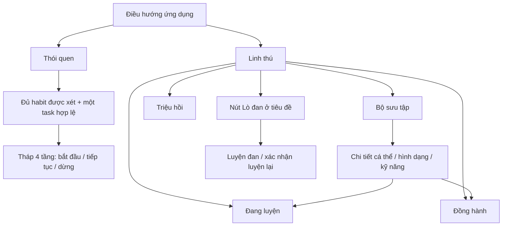

# Linh thú — triển khai và nghiệm thu

Ngày bắt đầu: 19/10/2026. Goal triển khai đầy đủ đã được người dùng kích hoạt. Sau khi trình bày nhóm file/thay đổi, người dùng xác nhận “tôi duyệt hết, cứ làm đi”. Xác nhận riêng cho bản hiện tại, backup, diễn tập restore, migration remote và phát hành staging đã nhận ngày19/10/2026; [đã thực hiện](LINH_THU_RELEASE.md).

## Trạng thái bàn giao hiện tại

Đã tích hợp 18 loài, 108 ảnh: 72 dạng thường T1–T4, 18 Thức tỉnh 95%, 18 Hoàn mỹ 100%. Ưu tiên T1–T4 theo yêu cầu; 95%/100% dùng tạm và có thể sửa riêng sau. Nguồn v3 có prompt/model/hash; registry runtime đủ cả ba biến thể và CI kiểm tính đầy đủ. [Trang xem ảnh](../output/imagegen/catalog-v3/index.html) · [Hồ sơ nghiệm thu và kết quả cuối](LINH_THU_ACCEPTANCE.md).

`test:all`: 330 main/unit/integration +25 experiments, không fail/skip/cancel; toàn bộ browser **41/41 đạt**, gồm catalog 108 ảnh thật và luồng production API/D1 tạm. Typecheck hai phía, lint, syntax 37 modules, format 109 files, complete-art gate và hai build dry-run đạt. Worker 607,70 KiB / gzip 136,37 KiB, 505 web files. Người dùng đã duyệt bản hiện tại; migration 0041 và deploy staging hoàn tất. Version `ff342cb0-4a7c-4b6b-b43c-bc3297a7a559` nhận100% lưu lượng. Kiểm sau deploy: 402 file khớp hash, tám API auth trả401, Chrome 390/1440px không lỗi JS/tràn ngang. [Hồ sơ phát hành](LINH_THU_RELEASE.md).

Các mục sau ghi lại khảo sát và từng checkpoint theo thời gian; các số lượng ảnh thiếu hoặc bài kiểm đang chạy trong checkpoint cũ không phải trạng thái hiện hành.

## Khảo sát ban đầu trước triển khai

| Phần | Bằng chứng hiện tại | Công việc |
| --- | --- | --- |
| Habit, lịch, phiên bản, ngày và kết toán | `src/domain/habits.ts`, `src/adapters/d1/habit-store.ts`, `docs/HABITS.md` | Dùng kết quả hiện có, không tạo lịch song song |
| Vé thường, tu vi, ngủ, vật phẩm, quay, ghép, đột phá | `src/domain/healthy.ts`, `src/adapters/d1/healthy-store.ts` | Nối buff vào giao dịch và receipt hiện có |
| Lần hoàn thành task | `src/adapters/d1/task-hierarchy-store.ts`, `task_ticket_awards` | Nối sự kiện đầu tiên, không lấy thời điểm sync muộn làm ngày hoàn thành |
| Linh thú | Tài liệu thiết kế, HTML độc lập | Chưa có runtime/API/DB; cần triển khai |
| Mỹ thuật | 72 WebP tham chiếu và catalog nguồn | Chưa có 72 hình vẽ mới + 18 bản hoàn mỹ |
| UX đã duyệt | `docs/prototypes/linh-thu/index.html` | Bốn tab; Lò đan là nút tiêu đề; tháp tại Habit |

Working tree ban đầu: chỉ có docs Linh thú, thư mục assets và prototype Linh thú chưa được Git theo dõi; không có diff trên file tracked. Phải bảo toàn tất cả. Migration hiện có đến `0040_habit_ticket_awards.sql`; thông tin 38 migration trong HANDOFF cũ không còn là số hiện tại.

## Luồng và vị trí tích hợp

Linh thú dùng một điểm vào rõ ràng trong điều hướng chính; không thay hoặc gộp Lời nhắc/Thành tích. Cần kiểm chứng năm mục chính ở 360px. Bốn tab con nằm trong màn Linh thú, Lò đan không chiếm tab. Tháp chỉ hiện tại Habit. Không sao chép danh sách habit vào màn Linh thú.

## Các chặng và phạm vi file

1. **Luật và cấu hình** — `src/domain/linh-thu*.ts`, tests unit, tài liệu. Tách catalog, rule/skill version khỏi cá thể; pure domain không phụ thuộc DB/HTTP. Duyệt các khoảng trống bên dưới.
2. **Dữ liệu và giao dịch** — migration mới sau 0040, `src/ports/linh-thu-store.ts`, `src/application/linh-thu*.ts`, `src/adapters/d1/linh-thu*.ts`; mở rộng đúng điểm kết toán habit, task, ngủ và tài nguyên. Owner, version, idempotency, receipt và ví cùng guarded batch; không reset dữ liệu lịch sử.
3. **API và UI** — `src/entrypoints/mini-app/linh-thu.ts`, router/bootstrap và scheduler; `web/features/linh-thu.js`, models/views, state, navigation và CSS; tháp nối vào Habit. Dữ liệu server là nguồn xác thực; client không quyết định kết quả hoặc phần thưởng.
4. **Ảnh và nghiệm thu** — assets nguồn mới có version, tối ưu web, art manifest; scripts/test unit/integration/browser, tài liệu vận hành và checklist. Dùng skill imagegen cho bitmap; không gọi ảnh tham chiếu là thành phẩm.

## Quyết định sản phẩm đã được duyệt

Người dùng đã duyệt đồng thời toàn bộ các luật sau ngày 19/10. Không hỏi lại các quyết định này. Chỉ hỏi thêm nếu phát hiện mâu thuẫn thực sự không thể giải quyết từ hợp đồng hiện có.

| Chủ đề | Đề xuất |
| --- | --- |
| Mốc điểm | R: T2 10 / T3 25 / T4 40 / đầy 60; SR: 15/35/55/80; SSR: 20/50/80/120; UR: 30/70/110/160 |
| Ngày cuối | Chia phần dung lượng còn lại theo tỷ lệ đạt; làm tròn một chữ số; nếu thiếu vẫn có tối thiểu 0,1 xám |
| Thú trùng | Mỗi kết quả là cá thể T1 độc lập; kho phân trang, không tự chuyển đổi |
| Tài khoản mới | Bộ sưu tập trống; không cấp vé/thú demo |
| Tháp | Snapshot điều kiện khi bắt đầu; sửa log sau đó không thu hồi lượt/quà; luyện vẫn theo kết quả cuối ngày |
| Quota linh hoạt | Xét achieved/missed/neutral hiện có, không phạt buổi còn linh hoạt; ít nhất một habit đạt và một task hợp lệ |
| Tháp qua ngày | Tự chốt quà tầng đã qua, chưa qua tầng nào nhận 0; lượt mới độc lập |
| Đan | 30 ngày đạt, neutral tạm dừng, miss đứt chuỗi; 40%, sau 2 fail bảo đảm; mỗi mẻ tiêu chuỗi, giữ sẵn ở 30; chạy đồng thời luyện thú |

Ảnh: người dùng yêu cầu dùng AI tích hợp của Codex để vẽ. Phiên hiện tại không có tool image_gen tích hợp. Chưa có quyền chuyển sang CLI/API trả phí và không được xem yêu cầu này như quyền fallback. Tiếp tục triển khai các phần độc lập, giữ hạng mục ảnh mới chưa hoàn thành. Chưa gọi API ảnh; chưa kiểm tra hoặc in secrets.

Ở các chặng trước, người dùng yêu cầu làm liên tục trong lúc họ đi ngủ, không hỏi lại các luật đã chốt, theo quyền triển khai trong goal. Đây là lịch sử ủy quyền; thay đổi code tiếp theo tuân theo yêu cầu xác nhận mới nhất nêu ở đầu tài liệu. Giữ giới hạn deploy/dữ liệu thật của goal.

## Kết quả triển khai từng chặng

- Đã tạo catalog domain 18 loài khớp catalog nguồn, đúng 72 dạng và thứ tự Rockwu/Rockong, Cinderclaw T4.
- Đã tạo pure domain: điểm habit theo ngày, độ thuần chính xác, hệ số xác suất thiên phú, bảng triệu hồi và bảo hiểm, ba ứng viên Pyrodaemon, phần thưởng tháp.
- Bảy unit tests đầu tiên đạt, gồm toàn bộ đường dẫn ảnh, 30 kích thước tập habit, ranh giới tỷ lệ và bảo hiểm UR ưu tiên. Đây chưa phải bằng chứng tích hợp runtime.
- Đã thêm pure domain theo luật vừa duyệt: ngưỡng luyện, clipping ngày cuối, khóa/reset, tích chuỗi/luyện đan và state machine tháp. Kiểm tra chặng này đang được bổ sung.

### Runtime và kiểm chứng bổ sung

- Migration **0041** thêm tài khoản/cá thể/lượt luyện, lịch vai trò, sổ sự kiện, tuyệt kỹ tuần, phiên tháp và lựa chọn đang chờ; đã áp dụng vào DB Miniflare tạm. Chưa chạy remote.
- Đã nối API và bốn tab UI, collection phân trang, luyện/đổi/reset, ví chung, triệu hồi, Lò đan và tháp trong Habit. Kết quả được commit trước hiệu ứng.
- 18 bộ thiên phú/Thức tỉnh ở cấu hình; đã nối task đầu tiên, habit chốt ngày, ngủ, quay thường, ghép phù và đột phá. Tuyệt kỹ có state machine, kích hoạt chung một lần/tuần, khóa mục tiêu/giao ước, lựa chọn thưởng và hủy khi reset.
- Pyrodaemon giữ ba ứng viên trên server, ×10 trả trước đủ vé và xử lý phần còn lại sau lựa chọn; chỉ cập nhật bảo hiểm theo con nhận được.
- Hychroma/Cheerstella giữ lựa chọn quay thường; không cộng thêm kết quả gốc, không trừ vé khi nhận lựa chọn; thiên phú tính một lần mỗi lượt gốc, tối đa 10 lượt trả vé/ngày.
- Bảo hộ ngủ chạy trước phạt/tụt cảnh giới. Hoàn tác chỉ đảo phần ngủ nền; thưởng kỹ năng đã xét không bốc lại, không tiêu lượt bảo hộ lần hai.
- Kỹ năng kết hợp có job ghép theo cùng ngày gốc; đổi lượt dư Meteorax chờ các kỳ thuộc tuần quyết toán. Integration tests chuyên biệt đã xác nhận cả hai thứ tự xử lý và ranh giới Chủ nhật/sau nửa đêm.
- Task được nhận diện bằng lần thưởng hợp lệ đầu; undo/redo không nhận lại skill. Mục tiêu tuyệt kỹ bắt buộc task còn hoạt động, chưa từng nhận vé.
- Đã có 18 bài kiểm domain/tích hợp Linh thú đạt ở checkpoint trước khi thêm quay thường; bài Hychroma ×10 mới đạt riêng. Phải chạy toàn bộ lại sau các thay đổi tiếp theo.
- Hồi quy nền đã đạt **306 bài** ở checkpoint trước các hook quay/ngủ cuối. Hai browser tests mới đạt; ba browser expectations cũ đã cập nhật đúng điểm vào thứ năm và thêm GET tháp. Cần chạy lại toàn bộ browser suite cuối.
- Typecheck backend/frontend, lint và 36 module syntax đạt tại các checkpoint. Build dry-run đạt Worker **593,02 KiB / gzip 134,17 KiB**, tăng từ baseline 492,49/111,68. Chưa phải số cuối.
- Đã xem ảnh render runtime 390px và 1440px, gồm nhân vật, triệu hồi và Lò đan. Ảnh kiểm tra nằm ở `trial-results/linh-thu/` (bỏ qua Git). Các hình tham chiếu giữ toàn thân, không bị cắt; bộ vẽ mới chưa có.
- 72 bản tham chiếu full WebP tối ưu sau khi dựng bằng script tái lập: **2.482.172 bytes**; 72 thumbnail 128px: **383.408 bytes**. Manifest ghi hash nguồn/đầu ra và phiên bản encoder; 72 ảnh nguồn khớp SHA256 với SOURCES.csv. Chỉ gọi đây là bản tối ưu tham chiếu; không phải ảnh AI mới.

### Checkpoint trước bổ sung tương tác — 19/10/2026

- `test:all`: **320 main +25 experiments**, 0 fail/skip. Có 23 integration tests Linh thú, trong đó nhiều bài chạy ma trận nhiều loài/trạng thái; đủ 18 tuyệt kỹ đi qua hook sự kiện thật.
- Sau đó thêm kiểm tra request chọn thưởng chậm vượt giờ đóng ngày: API từ chối trước batch, lựa chọn chưa bị tiêu. Bài Cheerstella này đạt riêng.
- Browser toàn bộ sau sửa phục hồi đạt **32 tests**, 0 fail/skip, gồm bốn luồng Linh thú. Ca mạng thực sự offline và bấm kiểm tra ngay sau reload đã tìm thấy lỗi thiếu dữ liệu nền khi retry request chưa tới server; đã sửa và cả suite đạt lại.
- Sau sửa phục hồi: 13 frontend unit/module tests, TypeScript backend/frontend, syntax 36 web modules, lint, format 102 files, build local/staging dry-run đều đạt. Không còn tiến trình kiểm tra đang chạy tại checkpoint này.
- Tối ưu phát hiện bằng đo thật: GET cùng chốt habit và kết hợp ngủ từng dùng **57 truy vấn**; đã tách một bước ghi mỗi GET. Bản đo 24/2.400 cá thể đạt: GET thường 21, collection 1, tháp 10, chốt ngày 39, kết hợp 37, lần đọc sau 19 truy vấn; payload chính dưới 10 KB. Cron tách bốn job thú, không dồn vào một invocation; đo quiescent 11–13 truy vấn, chưa coi là benchmark tải cực đại mọi job.
- Dry-run local và staging đạt: Worker **606,95 KiB / gzip 136,16 KiB**, 239 web asset files. Baseline 492,49/111,68 KiB, 43 files trước tính năng. Không deploy.
- Migration 0041 kiểm riêng giữ nguyên toàn bộ bảng có trước bằng table proofs, foreign keys/integrity đạt; vẫn không tạo ví/thú/quà mẫu. Restore rehearsal và hồi quy nền nằm trong suite main.
- Hootlet giữ budget riêng từng tuần để đánh giá muộn không reset/nhận lại heart của tuần khác. Reset Rockong hủy cứu bẫy của phiên còn chạy; không đổi vị trí bẫy, điều kiện gốc hoặc trả lượt chơi.
- Đã xem lại screenshot chữ gấp đôi, theme tối thực của app; sửa tab chồng nhãn và tách vùng chữ khỏi ảnh nhân vật. Giao diện hiện vẫn dùng tham chiếu tối ưu.
- Hồ sơ review: [checklist và bằng chứng](LINH_THU_ACCEPTANCE.md), [vận hành và chính sách version](LINH_THU_OPERATIONS.md). Các tài liệu nền giữ lịch sử cleanup, thêm điểm liên kết tới đợt Linh thú mới.

### Bổ sung ổn định tương tác — 19/10/2026

- Bảng chọn thú, chọn task tuyệt kỹ, phần thưởng quay thường và tháp giữ danh tính bảng trong khi tải. Đóng hoặc mở bảng khác làm phản hồi cũ mất quyền mở lại/ghi đè bảng. Bảng tải tháp và lựa chọn thưởng mở ngay với trạng thái tải có thể đóng.
- Chọn mục tiêu tuyệt kỹ giữ các task đã chọn qua phân trang. Browser kiểm 405 task, tải nhiều trang, đóng khi đang tải và gửi đúng hai ID mục tiêu ở hai trang khác nhau.
- Đổi vé kiểm số nguyên dương, số dư và thao tác chưa xác nhận trước khi gửi. Tài khoản trống không có thú/vé mẫu; nút triệu hồi khóa khi thiếu vé. Backend vẫn xác thực lại chi phí và số dư.
- Hai cửa sổ Chrome cùng owner: cửa sổ thứ hai dùng version cũ bị từ chối, tải số dư mới, không mở kết quả thứ hai và không giữ một request chưa rõ kết quả. Đây là UI với API fixture có version guard; bằng chứng giao dịch D1 cạnh tranh nằm trong integration tests riêng.
- Phản hồi luyện đan đến sau khi đóng Lò đan không chiếm bảng mới; thông báo kết quả và kho vẫn cập nhật. Đóng bảng không hủy giao dịch đã gửi.
- Integration D1 bổ sung đi qua HabitService → đánh giá ngày → BeastSettlementService suốt hai tuần lịch. Quota 4→1 giữ cùng habit ID, chỉ có hiệu lực từ thứ Hai kế tiếp; buổi linh hoạt neutral không tạo xám, tuần cũ vẫn giữ đúng ba lần miss, tuần mới đủ một buổi không bị phạt thêm. Đan dừng ở ngày neutral.
- Chạy lại toàn bộ sau bổ sung: **321 main +25 experiments +37 browser**, 0 fail/skip; gồm 24 integration tests Linh thú và chín browser tests Linh thú. Các ma trận nhiều loài vẫn nằm trong số integration này.
- Typecheck backend/frontend, syntax 36 web modules, lint, format 102 files, diff check và build local/staging dry-run đạt. Dry-run vẫn 606,95 KiB / gzip 136,16 KiB, 239 web files. Asset verify xác nhận 72 tham chiếu, 0 ảnh thiết kế mới. Không có tiến trình kiểm tra còn chạy sau checkpoint này; không deploy hoặc chạy migration remote.

### Cá thể trùng và kiểm tra xuyên suốt — 19/10/2026

- Bảng chọn, bộ sưu tập, chi tiết, Lò đan và xác nhận reset dùng nhãn ngắn từ ID cá thể. Hiện điểm thực/xám, độ thuần và vai trò ở bước chọn; trạng thái đã khóa phân biệt với tỷ lệ tạm tính của lượt còn luyện. Không đổi ID, tiến độ hoặc luật thưởng.
- Thêm browser test ba cá thể cùng loài: con hoàn mỹ, con 95% và con đã khóa. Chọn đúng companion ID và mở đúng xác nhận reset; mở xác nhận không tiêu đan. Đã xem ảnh 360px, chữ gấp đôi, theme tối và bộ sưu tập.
- Thêm `tests/browser/linh-thu-live.test.mjs`: UI → production API → D1 Miniflare → receipt → UI. Phục hồi triệu hồi đã commit sau reload không gửi lại POST. Có log habit, chuyển luyện/quyết toán qua ngày, ba tầng tháp/nhận tổng thưởng, luyện đan bảo hiểm/reset giữ lịch sử và đồng hành/tuyệt kỹ/báo ngủ thật. Chi tiết giới hạn fixture và cách tạo ảnh nằm trong hồ sơ nghiệm thu.
- Test dùng DB thật phát hiện trạng thái phục hồi có thể bấm khi POST gốc còn chạy. Đã vô hiệu hóa nút trong thời gian lưu/phục hồi và hiển thị trạng thái đang xác nhận; bài kiểm giữ phản hồi sau commit để chứng minh nút chưa thể bấm sớm.
- Xem screenshot của luồng D1 phát hiện thông báo hết hiệu lực đang dựa thẳng vào đồng hồ máy. Đã chuyển so sánh hiển thị tuyệt kỹ sang mốc server cộng thời gian trôi như phần còn lại của ứng dụng; test xác nhận vẫn hiện đúng ba lượt khi ngày thử khác đồng hồ máy.
- Toàn bộ browser đạt **39 bài**; 31 frontend unit/module tests đạt sau thay đổi. Backend main **321** và experiments **25** giữ checkpoint trước vì không sửa backend. Typecheck web, lint, syntax và build local đạt; format mở rộng thành 103 files. Worker vẫn 606,95 KiB/gzip 136,16 KiB, 239 web files.
- Ảnh review mới và `live-flow-proof.json` đã tạo trong `trial-results/linh-thu/`; không chứa dữ liệu người dùng thật. Bộ ảnh thiết kế mới vẫn 0/90, không đổi trạng thái nghiệm thu mỹ thuật.

### Giới hạn cron và thông báo khi chốt ngủ — 19/10/2026

- Mở rộng benchmark sang bốn job có công việc thật, 30 habit, đồng hành và tuyệt kỹ. Đã tìm ca chốt ngủ cùng luyện dùng **77 truy vấn**; scheduler giờ chốt tối đa một ngày ngủ mỗi invocation và hoãn bảo trì khác, không bỏ quyết toán gốc. Bốn job thú không có backlog ngủ đo 25/40/28/23 truy vấn; ca chốt ngủ và tiếp tục đo 24/32/40.
- Hồi quy toàn bộ tìm thêm ảnh hưởng của việc chia ngày: thông báo chủ động không được gửi giữa những ngày vắng mặt chưa chốt. Đã giữ các tin đó chờ; tin trả lời/menu/đăng nhập vẫn gửi được. Kiểm tra cũ nay chạy bốn lượt cron, xác nhận không gửi sai ở bất kỳ lượt nào và tài khoản chuyển đúng sang vắng mặt.
- Thêm hai integration tests trong `linh-thu-cron.test.ts`: benchmark production scheduler qua SQLite với giới hạn truy vấn, và gửi hai tin đã xếp hàng/chốt một ngày/lặp lại không chấm trùng. Benchmark tự chạy trong suite chính; không gọi mạng hoặc dùng dữ liệu người dùng.
- Typecheck backend, lint, format **104 files**, build local/staging dry-run đạt sau bản sửa thông báo. Worker **607,70 KiB / gzip 136,37 KiB**, vẫn 239 web files. Browser **39** và experiments **25** đạt. Hai lượt main chạy chồng đã dừng, không tính là đạt; lượt xác nhận cuối chạy một suite main duy nhất với TAP để lưu chi tiết lỗi nếu có.
- Thay đổi nhịp vận hành và giới hạn phép đo đã cập nhật trong `LINH_THU_OPERATIONS.md`. Số truy vấn dưới 50 chỉ được chứng minh ở các fixture đã đo; chưa phải phép đo CPU Worker hoặc mọi tổ hợp thông báo đến hạn.
- Kết quả xác nhận cuối: **323 main +25 experiments +39 browser**, 0 fail/skip/cancel. Main chạy `node --test --test-reporter=tap --test-concurrency=2 tests/unit/*.test.ts tests/integration/*.test.ts`, đạt trong ~277 giây; sau đó đối chiếu với kết quả `npm.cmd run test:experiments` đã đạt riêng, đủ phạm vi `test:all`. Log cuối ở `trial-results/linh-thu/main-verified.tap`, `experiments-final.log`, `browser-final.log` (Git bỏ qua). Không dùng hai lượt main đã dừng làm bằng chứng đạt. Typecheck backend/frontend, lint, syntax, format, asset verify và build local/staging dry-run đều đạt tại checkpoint tương ứng; backend checks/build đã chạy lại sau bản sửa thông báo cuối.

### Tích hợp ảnh thường và hoàn mỹ riêng — 19/10/2026

- Đã bỏ đường dẫn tham chiếu cố định khỏi nơi chọn ảnh runtime. `web/assets/linh-thu/art.js` là registry dùng chung; `beastArtwork` chọn ảnh theo loài, dạng và điều kiện hoàn mỹ của từng cá thể. Chỉ chọn bản hoàn mỹ khi cá thể đủ điều kiện, đang xem T4 và có asset đó. Khi thiếu, giữ ảnh thường và không gắn nhãn ảnh hoàn mỹ giả.
- Đã nối lựa chọn này vào màn luyện/đồng hành, bộ sưu tập, bảng chọn và chi tiết. Preview T1–T3, banner giới thiệu T4 thường và kết quả triệu hồi T1 vẫn dùng ảnh thường.
- `scripts/linh-thu-art.ts` đọc nguồn từ `docs/assets/linh-thu/art/MANIFEST.json`, giữ nguồn nguyên trạng, dựng WebP alpha 512px/thumbnail 128px và ghi provenance/hash vào `web/assets/linh-thu/ART.json`. Kiểm loài/dạng, entry trùng, nguồn vượt thư mục, kích thước tối thiểu, alpha/lề, ảnh nguồn tham chiếu nguyên byte và pixel chuẩn hóa trùng nhau. Các kiểm tra kỹ thuật không chứng minh chất lượng thiết kế lại; vẫn phải xem từng ảnh.
- Manifest nguồn hiện **rỗng**; báo cáo đúng **0/72 ảnh thường mới, 0/18 ảnh hoàn mỹ**. Registry chỉ có 72 ảnh thường tham chiếu. Không gọi API ảnh hoặc thay ảnh tham chiếu bằng hình thử nghiệm. README ở thư mục art ghi rõ schema và quy trình đưa ảnh thật vào sau này.
- Chặng này đạt **140 unit tests +40 browser tests**, 0 fail/skip/cancel. Gồm năm unit tests mới cho bộ dựng/chọn ảnh và một browser test kiểm ảnh hoàn mỹ xuyên các màn. Browser test dùng ảnh mạng fixture được khai báo rõ, không tạo hoặc nghiệm thu mỹ thuật thành phẩm.
- Typecheck backend/frontend, lint, syntax **37 web modules**, format **107 files**, asset verify và build local/staging dry-run đạt. Worker **607,70 KiB / gzip 136,37 KiB**, **241 web files**. `git diff --check` đạt. Log ở `trial-results/linh-thu/unit-art.log`, `browser-art.log`, `build-art.log`, `staging-art.log`.
- `node scripts/build-linh-thu-assets.ts --require-complete` đã chạy và **thất bại đúng dự kiến** vì chưa có ảnh mới; log `art-completeness.log`. Asset verify thường đạt không đồng nghĩa đạt điều kiện đủ 90 ảnh. Chưa chạy lại main/integration và experiments ở chặng ảnh; checkpoint đầy đủ trước đó vẫn là **323 main +25 experiments**, không tự cộng năm unit tests rồi gọi là một lần chạy main mới.
- Lượt tiếp tục sau checkpoint này chỉ đối chiếu bằng chứng và cập nhật hai tài liệu triển khai/nghiệm thu; không sửa thêm code. Bộ công cụ hiện vẫn không có `image_gen` tích hợp.

### Xác nhận đầy đủ sau tích hợp ảnh — 19/10/2026

- Đã chạy lại đúng `npm.cmd run test:all` trên bản hiện tại, một tiến trình suite chính duy nhất: **328 main/unit/integration +25 experiments**, 0 fail/skip/cancel, exit 0. Main mất khoảng 239 giây; experiments khoảng 1 giây. Đây là kết quả thực chạy đầy đủ, thay cho việc suy số lượng từ checkpoint cũ.
- Log đầy đủ: `trial-results/linh-thu/test-all-current.log` (PowerShell ghi UTF-16LE, Git bỏ qua). Không sửa code trong lượt xác nhận này. Bộ browser gần nhất vẫn **40 bài đạt** từ checkpoint tích hợp ảnh; không chạy lại browser khi chỉ cập nhật tài liệu.
- Đối chiếu lại mục tiêu và trạng thái nguồn: `MANIFEST.json` vẫn rỗng, `ART.json` vẫn 0 bản thường mới/0 bản hoàn mỹ; catalog công cụ không có image generation tích hợp. Không có tiến trình tạo ảnh để chờ. Những phần phụ thuộc bộ ảnh mới — mẫu UR/SSR, sản xuất đủ 90 ảnh, kiểm thị giác trong UI và gói nghiệm thu cuối — vẫn chưa thể thực hiện. Không đánh dấu goal hoàn thành hoặc xin phát hành khi còn thiếu các phần này.

### Giải quyết đường tạo ảnh và mẫu hai SSR — 19/10/2026

- Người dùng đưa bằng chứng một phiên khác đã sửa nhánh ảnh Cockpit và tạo Rockong thành công. Đã tìm lại đúng phiên đó, ảnh Rockong gốc và cấu hình gateway local đang chạy; xác nhận model điều phối `gpt-6.1-sol`, upstream `gpt-image-2.5`. Đây là đường tạo ảnh hoạt động, dù chat hiện không có tool sinh ảnh trực tiếp. Không còn dùng việc thiếu tool đó làm blocker chung cho toàn bộ mỹ thuật.
- Đã tạo **10 ảnh mới** qua `image_gen.py` của skill, gọi gateway local theo cấu hình hiện có, không sửa cấu hình hoặc tạo khóa mới: Frostnip/Frostpaw/Frostique/Frostluna/Hoàn mỹ và Zappur/Electroar/Blitzmane/Stormlion/Hoàn mỹ. Mỗi lần dùng ảnh đúng loài/dạng làm tham chiếu; T4 mới làm chuẩn nét vẽ cho các dạng còn lại, perfect dùng chính T4 mới của loài đó.
- Ảnh gốc và prompt ở `output/imagegen/ssr-preview-v1/`; bản xem thử 1024px có alpha và lề. Một ảnh nền xanh được tách bằng script chính thức của skill; các ảnh còn lại giữ alpha đã trả về, chỉ làm sạch phần nhiễu nền rất thấp và chuẩn hóa kích thước. Không chỉnh hoặc ghi đè tham chiếu gốc.
- Hai bảng `frostnip-full-states.png`/`zappur-full-states.png` có T1–T4, 95% và 100%. Cột 95% dùng hình T4 thường; 100% có diện mạo riêng, không phải T5. Đã xem từng ảnh, bảng đầy đủ và ảnh kiểm nền sáng/tối, 64/128px. `IMAGE_CHECKS.json` ghi 10/10 ảnh 1024px, alpha, lề ít nhất 80px, hash nguồn/đầu ra và vị trí prompt.
- Lượt này chỉ tạo ảnh, prompt, bảng xem và tài liệu; chưa sửa code, nhập registry, thay ảnh runtime hay gọi bộ mẫu là đã được người dùng duyệt. Các suite code giữ checkpoint **328 main +25 experiments +40 browser**; không chạy lại khi chưa đổi code/runtime assets. Khi tích hợp cần lưu provenance đúng luồng CLI/Cockpit, không ghi giả thành tool `image_gen` trực tiếp.

### Phần còn lại tại checkpoint cũ trước art v3

1. Tiếp tục sửa nếu kiểm tra bổ sung hoặc nghiệm thu phát hiện lỗi. Các ca tương tác nhiều tab/auth cạnh tranh còn có thể mở rộng; không suy từ ảnh ra backend đúng.
2. Đã có bộ xem thử **8/72 ảnh thường mới +2/18 bản T4 hoàn mỹ**; còn 64 dạng thường và 16 bản hoàn mỹ chưa tạo. Bộ xem thử cũng chưa được người dùng duyệt hoặc nhập runtime. Luồng Cockpit local đã tạo ảnh thành công; không cần chờ tool sinh ảnh trực tiếp trong chat.
3. Xử lý góp ý mẫu SSR, làm mẫu UR rồi hoàn thiện đủ 90 ảnh. Tích hợp provenance đúng nguồn, kiểm từng asset trong UI/hoạt ảnh, cập nhật manifest và gói review cuối. Trước khi sửa code để tích hợp, trình bày thay đổi và chờ xác nhận theo AGENTS.md hiện hành.
4. Người dùng chưa nghiệm thu hoặc duyệt phát hành. Chính sách config v1 đã ghi; registry nhiều phiên bản và cách chuyển sang v2 phải được triển khai cùng đợt cân bằng v2 thực tế, không sửa ngược v1 âm thầm.

## Kiểm tra nền ban đầu và tiêu chí bàn giao

- `npm.cmd run typecheck`: đạt trước sửa.
- `npm.cmd run typecheck:web`: đạt trước sửa.
- `npm.cmd run check:web`: đạt, 33 module trước sửa.
- Phạm vi `test:all` ở checkpoint trước art v3: **328 main +25 experiments**, **40 browser**. Kết quả hiện hành ở đầu tài liệu và hồ sơ kiểm tra; các bài frontend unit/module thuộc main suite.
- PowerShell chặn `npm.ps1`; sử dụng `npm.cmd`, không đổi execution policy.

Không được đánh dấu hoàn thành khi chỉ có domain hoặc demo. Bằng chứng cuối cần đủ UI → API → DB → receipt → UI, 18 bộ skill, 72 dạng + 18 hoàn mỹ, migration nâng cấp, retry/hai tab/mất mạng và các kiểm tra bắt buộc trong goal. Kiểm browser 360/390/768/1024/1440, chữ lớn, focus, bàn phím, sáng/tối, reduced motion; đo tải và asset so với baseline. Tách rõ kiểm tra local, review người dùng và phát hành. Người dùng chưa nghiệm thu runtime hoặc duyệt phát hành.

### Chốt hướng chỉnh nhẹ và bắt đầu UR — 19/10/2026

- Người dùng loại hướng SSR v1 vì mất vẻ tinh gọn và có cảm giác AI rõ. Đã duyệt Stormlion T4 v2 cùng hai mẫu Thức tỉnh 95% và Hoàn mỹ 100%; giữ tỷ lệ, nét viền đậm và mảng màu đơn giản của nguồn.
- Bộ đã duyệt bảo quản trong docs/assets/linh-thu/art/approved-v2/zappur, có raw, prompt, bản chuẩn hóa và hash. Quyết định ưu tiên nằm tại docs/LINH_THU_ART_APPROVALS.md.
- Làm theo thứ tự UR → SSR → SR → R. Bộ UR mới ở output/imagegen/ur-preview-v2, giữ riêng trạng thái hình đề xuất và hình đã duyệt. Không dùng bộ v1 làm chuẩn vẽ.
- Không sửa code, registry runtime, HTML hoặc CSS trong đợt lưu quyết định/tạo ảnh này. Chưa chạy lại kiểm thử phần mềm vì chưa có thay đổi phần mềm. Kết quả suite trước giữ nguyên phạm vi tại checkpoint đã ghi, không suy ra ảnh mới đã tích hợp.

- Kết quả chặng UR: đã tạo và xem 12 ảnh riêng, đủ hai chuỗi T1–T4/95%/100%; 1024px RGBA chuẩn hóa, lề ít nhất 82px, hash pixel khác nhau. Đã xem thêm 64/128px trên nền sáng/tối và đối chiếu T4 với nguồn. Tám ảnh nguồn UR giữ đúng hash SOURCES.csv. Raw/prompt/preview và hồ sơ kiểm ở output/imagegen/ur-preview-v2; trạng thái duyệt từng loài ở docs/LINH_THU_ART_PROGRESS.md. Chưa có code hoặc registry nào thay đổi.

### Sửa Hoàn mỹ UR — bản v3

Người dùng yêu cầu sửa hai dạng Hoàn mỹ UR v2. Đã tạo hai đề xuất mới từ T4 thường, giữ màu chủ đạo lửa đỏ/cam/vàng và tinh thể tím/lam; raw, prompt, RGBA chuẩn hóa và đối chiếu trước/sau ở output/imagegen/ur-perfect-v3. Đã xem trực tiếp hai ảnh mới và kiểm 64/128px trên nền sáng/tối, alpha/lề/hash. V3 đang chờ nhận xét, không ghi đã duyệt hoặc tích hợp. Code, registry, gameplay và bản Stormlion đã duyệt giữ nguyên.

### Hoàn mỹ UR v4 — lửa xanh và tinh thể đen

Theo yêu cầu trực tiếp mới: Pyrodaemon chuyển lửa xanh lam/lõi băng, Meteorax chuyển cụm tinh thể đen tím/viền tím và lõi lam nhỏ. Đã tạo, xem hai ảnh và kiểm 64/128px trên nền sáng/tối; raw RGBA 1254px, preview 1024px, lề ít nhất 82px. Hồ sơ ở output/imagegen/ur-perfect-v4. Công cụ ảnh tích hợp đã thử nhưng trả lỗi 502 không có output; các ảnh hoàn tất thực tế dùng CLI/Cockpit đã được chỉ định, provenance ghi đúng đường đó. V4 chờ nhận xét, không tự ghi là đã duyệt. Không đổi code, registry, kỹ năng hoặc bộ Stormlion đã duyệt.

## Chặng hoàn thiện art v3 và tích hợp

Ngày 19/10/2026: người dùng duyệt tiếp tục toàn bộ theo kế hoạch, ưu tiên T1–T4; 95%/100% dùng tạm, thay riêng sau. Đã ghi nhận đây là quyền sản xuất/tích hợp trong goal, không phải nghiệm thu cuối hoặc quyền deploy.

- Bộ nguồn mới ở `docs/assets/linh-thu/art/v3`, raw/prompt/kết quả CLI ở `output/imagegen/catalog-v3`; không ghi đè tham chiếu.
- Mở rộng bộ dựng để ghi đúng `imagegen_cli_cockpit` và model thực tế, giữ `image_gen` cho nguồn tương ứng. Không giả provenance.
- Thêm biến thể `awakened` T4 riêng. UI chọn hoàn mỹ trước, rồi thức tỉnh đủ điều kiện, rồi thường; T1–T3 và triệu hồi không dùng nhầm ảnh độ thuần.
- Kiểm thử nguồn CLI/model sai, ngưỡng và ảnh fallback; bài trình duyệt đối chiếu hero/chi tiết/bộ sưu tập/chọn đồng hành/triệu hồi đã đạt.
- CI thêm cổng kiểm đủ 72 ảnh thường, 18 thức tỉnh, 18 hoàn mỹ; checkpoint cuối đã đạt cả ba nhóm.
- Typecheck backend/frontend, lint, syntax 37 modules, format108 và 7 bài kiểm ảnh đã đạt. Suite hồi quy cuối đã hoàn tất: 330 main, 25 experiments, 41 browser; không fail/skip/cancel.
Đã chạy đầy đủ npm.cmd run test:all sau thay đổi hỗ trợ art: **330 main +25 experiments, 0 fail/skip/cancel**, exit0. Log trial-results/linh-thu/test-all-art-v3.log (UTF-16LE). Format hiện108file sau thêm kiểm trình duyệt catalog. Đã đối chiếu hash72ảnh tham chiếu nguyên trạng. Trang xem art mobile390px đã xem trực tiếp nền sáng/tối; lọc rank đúng, không tràn, không lỗi JS. Asset verify đủ108 ảnh và build local/staging dry-run đều đạt. Kết quả browser cuối ghi trong hồ sơ kiểm tra.

Browser sau tích hợp art v3 chạy đủ 41 bài và đạt hết, log `trial-results/linh-thu/browser-art-v3.log`. Một bài đợi mutation đã được sửa: đóng dialog không đồng nghĩa request hoàn tất; bài giờ chờ thông báo thành công trước khi đối chiếu mục tiêu đã gửi. Đã chạy lại toàn bộ browser sau sửa, không đổi gameplay. Đã xem screenshot mới Pyrodaemon, Stormlion, Rockong, Beetleknight, Ecstamira; ảnh nguồn/thumbnail từng rank trên hai nền; kiểm đầy đủ không thay duyệt thẩm mỹ của người dùng. Hồ sơ JSON cuối ở `output/imagegen/catalog-v3/VERIFICATION.json`.

### Đối chiếu goal và bổ sung hồ sơ review

- Đọc lại toàn bộ objective; đối chiếu code/API/store, domain và asserts trong các bài integration/unit theo từng nhóm skill, migration và luồng UI. [Hồ sơ đối chiếu](LINH_THU_GOAL_AUDIT.md) ghi rõ phần xác minh local và phần còn cần người dùng.
- Thêm `scripts/benchmark-linh-thu-web.mjs`, không đổi gameplay; đo cùng runtime với registry tham chiếu và artv3, ba mẫu/profile mới, localhost và mạng100ms/256KiB/s, kho2.400cá thể. Hôm nay không tải ảnh thú; collection chỉ dựng24 và dùng thumbnail/lazy. Phần so sánh không giả làm benchmark D1 remote hoặc bản triển khai cũ.
- Tạo [trang review](../output/linh-thu-review/index.html) với ảnh UI mới và ảnh từ luồng API/D1 tạm. Đã xem render, kiểm mobile/desktop, các nút chọn và ảnh tải đúng. Ảnh/fixture không cấp dữ liệu cho sản phẩm.
- Chỉ đọc metadata staging:0041 là migration duy nhất còn chờ; deployment/version hiện tại ghi trong hồ sơ nghiệm thu. Không apply hoặc deploy. Các mốc remote cũ trong lịch sử không thay trạng thái vừa kiểm.
- Lint và format109file đạt sau thêm benchmark. Các suite330+25+41 vẫn là checkpoint code sản phẩm không thay; không cộng benchmark thành test mới. Người dùng chưa nghiệm thu hoặc xác nhận phát hành riêng, goal tiếp tục active.
